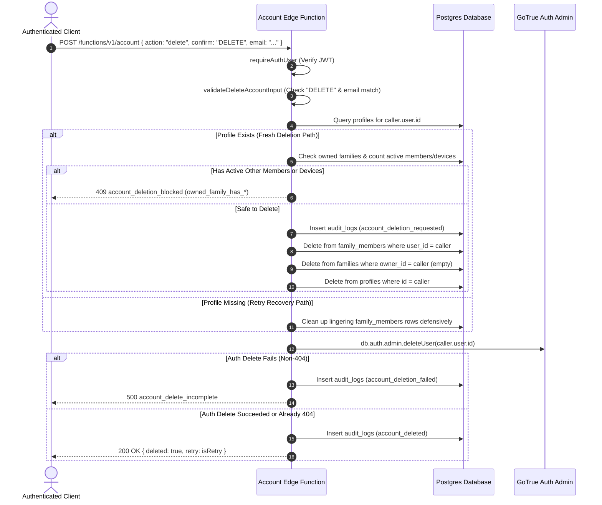

# Phase 3.5 — Report 05: Account Deletion Workflow & Retry Mechanics Audit

**Project:** Parent Control App  
**Workspace:** `D:\parentcontrol_app`  
**Supabase Project:** `parent-control-prod` (`hhqgreaoqulmfwfwarhc`)  
**Target Module:** `docs/testing/phase_3_4_3_browser_package/staging/account/deletion.ts` (and `validation.ts`)  
**Audit Date:** 2026-11-20  

---

## 1. Account Deletion Lifecycle Architecture

The account deletion workflow implements GDPR Right to Be Forgotten with strict safeguards against accidental deletion, family abandonment, and partial-failure lockouts.



---

## 2. Invariant Analysis Across Deletion Steps

### Step 1: Input Validation (`validateDeleteAccountInput`)
- **Confirmation Word:** Requires exact string `"DELETE"`. Whitespace is trimmed, but case sensitivity is strictly enforced (`"delete"` or `"Delete"` fails with `400 confirmation_required`).
- **Email Confirmation:** The user must explicitly type their account email. The typed email is normalized (`trim().toLowerCase()`) and compared against `caller.user.email`. A mismatch returns `400 email_mismatch`.
- **Missing Token Email:** If the token lacks an email claim, it immediately fails with `409 email_unavailable`.

### Step 2: Active Blocker Evaluation (`findDeletionBlocker`)
A family owner cannot delete their account if their family contains dependent members or monitored devices:
- **Other Active Members:**  
  $$\text{otherActiveMembers} = \text{COUNT}(\text{family\_members}) \text{ where } \text{family\_id} = F \land \text{status} = \text{'active'} \land \text{user\_id} \neq \text{caller}$$
  If $> 0$, deletion is refused with `409 account_deletion_blocked` (`owned_family_has_other_members`).
- **Active Devices:**  
  $$\text{activeDevices} = \text{COUNT}(\text{devices}) \text{ where } \text{family\_id} = F \land \text{status} = \text{'active'}$$
  If $> 0$, deletion is refused with `409 account_deletion_blocked` (`owned_family_has_active_devices`).
- **Blocker Rationale:** Prevents leaving minor children or monitored hardware in orphaned states without parental oversight.

### Step 3: Forensic Audit Logging Order
Audit event sequencing is structured to guarantee tamper-evident traceability:
1. `account_deletion_requested`: Recorded **before** any database row is deleted. Captures initial state (`memberships` count, `owned_families` count).
2. Relational Deletions: Cascades through `family_members`, empty owned `families`, and `profiles`.
3. `account_deleted`: Recorded **after** GoTrue Auth user deletion is confirmed.
4. `account_deletion_failed`: Recorded if GoTrue Auth deletion encounters a transient error.

---

## 3. The Partial-Failure Lockout Remediation (Root Cause Analysis)

### The Legacy Vulnerability (The 403 Lockout)
In naive implementations, every request handler begins with `requireUser`, which executes:
```ts
const profile = await db.from("profiles").select().eq("id", user.id).single();
if (!profile) throw new ApiError("profile_missing", ..., 403);
```
Under this pattern, if database cleanup succeeds (deleting `profiles`) but GoTrue's network call (`deleteUser`) times out:
1. The user's relational profile is gone.
2. The user's GoTrue Auth record still exists.
3. The user tries to log in or retry deletion.
4. The handler calls `requireUser` -> encounters missing profile -> throws `403 profile_missing`.
5. **Result:** The user is permanently locked out, unable to retry deletion or use their account.

### The Remediation (Verified in `account`)
1. `deleteAccount` is routed through `requireAuthUser`, which checks only GoTrue JWT validity and ignores `profiles`.
2. When `profile === null`, `executeAccountDeletion` recognizes this as a retry (`isRetry = true`).
3. It bypasses relational cleanup (as it is already done) and directly retries `db.auth.admin.deleteUser(userId)`.
4. If GoTrue reports `status: 404` or `code: "user_not_found"`, the handler treats this as idempotent success.
5. All non-deletion actions (`export`, `retention_report`) continue to enforce `requireUser`, ensuring that a profile-less user cannot access application features during this intermediate state.
