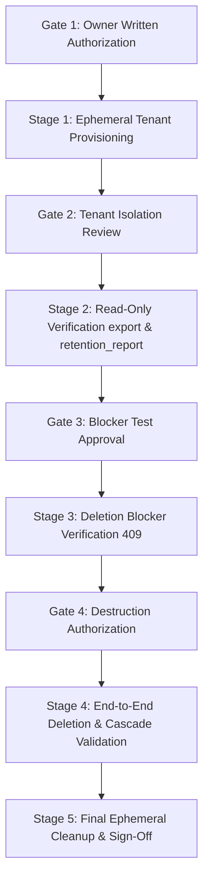

# Phase 3.5 — Report 11: Future Live Verification Roadmap & Approval Protocol

**Project:** Parent Control App  
**Workspace:** `D:\parentcontrol_app`  
**Supabase Project:** `parent-control-prod` (`hhqgreaoqulmfwfwarhc`)  
**Audit Date:** 2026-11-20  

---

## 1. Roadmap Architecture & Objectives

While Phase 3.5 completes the comprehensive offline audit and source-level verification of the `account` Edge Function, full end-to-end production qualification requires a staged, approval-gated live verification roadmap.

This plan details the exact procedure required to safely test all functional endpoints in production **without risking existing operational data or service availability**.



---

## 2. Multi-Stage Verification Stages

### Stage 1: Ephemeral Test Tenant Provisioning (Category C)
- **Objective:** Establish isolated test accounts in Supabase Auth and database without touching operational profiles.
- **Account Naming Convention:**
  - Parent: `qa-ephemeral-parent-yyyyMMdd-XXXX@internal-test.local`
  - Child: `qa-ephemeral-child-yyyyMMdd-XXXX@internal-test.local`
- **Actions:**
  1. Register parent account via Supabase Auth signup.
  2. Bootstrap profile via `auth-bootstrap` Edge Function (`role: "parent"`).
  3. Create an ephemeral test family (`"QA Ephemeral Family"`).
  4. Register child account, link as child member in ephemeral family.
- **Verification Gate:** Confirm via SQL/Dashboard that new entities reference exclusively the ephemeral UUIDs.

### Stage 2: Controlled Read-Only Endpoint Verification (Category B)
- **Objective:** Validate live business logic of `export` and `retention_report` using the authenticated ephemeral parent JWT.
- **Actions:**
  1. Invoke `POST /functions/v1/account` with `{ action: "export" }`:
     - Assert HTTP status `200 OK`.
     - Assert `Content-Disposition: attachment; filename="parent-control-export-..."`.
     - Assert JSON structure contains `scope: "family"`, `account`, `profile`, and empty tables.
  2. Invoke `POST /functions/v1/account` with `{ action: "retention_report" }`:
     - Assert HTTP status `200 OK`.
     - Assert `scope: "family"`, `last_sweep_at`, and family settings windows (`30` / `90`).

### Stage 3: Deletion Blocker Verification (Category B / Non-Destructive Mutation)
- **Objective:** Verify that `409 account_deletion_blocked` correctly fires when other members exist.
- **Actions:**
  1. Ephemeral parent attempts deletion while child is still active in family:
     ```json
     {
       "action": "delete",
       "confirm": "DELETE",
       "email": "qa-ephemeral-parent-XXXX@internal-test.local"
     }
     ```
  2. Assert HTTP response: `409 Conflict`.
  3. Assert error code: `account_deletion_blocked` with details `blocked_reason: "owned_family_has_other_members"`.
  4. Confirm via database that parent profile and family remain 100% intact.

### Stage 4: Controlled End-to-End Account Deletion (Category D — Ephemeral Only)
- **Objective:** Verify the complete cascade and GoTrue Auth deletion on the disposable test user.
- **Actions:**
  1. Remove child member from ephemeral family to clear the blocker.
  2. Ephemeral parent re-submits deletion request:
     ```json
     {
       "action": "delete",
       "confirm": "DELETE",
       "email": "qa-ephemeral-parent-XXXX@internal-test.local"
     }
     ```
  3. Assert HTTP status `200 OK` with response:
     ```json
     {
       "ok": true,
       "data": { "deleted": true, "memberships_removed": 1, "families_removed": 1, "retry": false }
     }
     ```
  4. Verify Database Cascade:
     - `profiles` row for ephemeral parent is deleted.
     - `families` row for ephemeral family is deleted.
     - `family_members` row for ephemeral parent is deleted.
  5. Verify GoTrue Auth:
     - Ephemeral parent user is completely deleted from `auth.users`.
  6. Verify Audit Logs:
     - `audit_logs` contains `account_deletion_requested` followed by `account_deleted`.

### Stage 5: Partial-Failure & Retry Recovery Simulation (Category D — Advanced)
- **Objective:** Live validation of the `profile_missing` lockout remediation.
- **Methodology:**
  1. Create second ephemeral user.
  2. Temporarily mock GoTrue Auth deletion failure (or revoke GoTrue admin secret temporarily if test harness allows).
  3. Observe that profile is deleted, but user remains in GoTrue Auth.
  4. User retries deletion with the same JWT.
  5. Assert that `requireAuthUser` authorizes the retry, GoTrue user is removed, and 200 OK is returned.

---

## 3. Prerequisite Checklist & Safety Mandate

Before executing any stage of this roadmap in a future phase:
- [ ] Explicit written authorization from project owner (`spg7753@gmail.com`).
- [ ] Confirmation that target accounts are strictly ephemeral (never operational QA accounts).
- [ ] Dedicated automated teardown script prepared to eliminate orphaned test data if tests abort midway.
- [ ] Monitoring dashboard open on `/project/hhqgreaoqulmfwfwarhc/functions/account/logs`.
