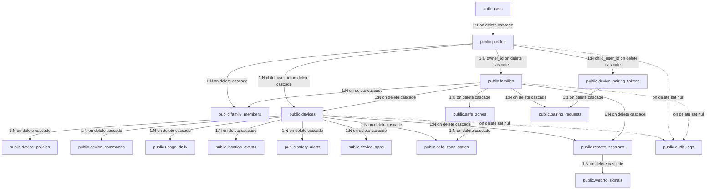

# Phase 3.6 — Report 02: Schema Architecture & Entity Dependency Map

**Project:** Parent Control App  
**Workspace:** `D:\parentcontrol_app`  
**Supabase Project:** `parent-control-prod` (`hhqgreaoqulmfwfwarhc`)  
**Source Evidence:** `supabase/migrations/20260101000000_core.sql`, `20260101000100_functions.sql`, `20260101000200_rls.sql`  
**Audit Date:** 2026-11-20  

---

## 1. Relational Entity Dependency Graph

In the Parent Control data model, tenancy is rooted at the **Family** entity, which is owned by a single Parent user identity. Every monitored entity, device, and telemetry record cascades directly from either the family or the individual profile.



---

## 2. Comprehensive Entity Discovery & Isolation Matrix

The following table documents the verified database schema based directly on SQL migration sources:

| Entity Name | Primary Key | Foreign Keys & Cascading | Ownership & Tenant Scope | Constraints & Uniqueness | RLS Implications | Isolatable in Ephemeral Tenant? |
|---|---|---|---|---|---|:---:|
| **`auth.users`** | `id` (uuid) | None (managed by GoTrue) | Global identity | Unique email | Isolated by GoTrue JWT authentication | **YES** (Via synthetic test email) |
| **`public.profiles`** | `id` (uuid) | `id REFERENCES auth.users(id) ON DELETE CASCADE` | Self (`id = auth.uid()`) | `role IN ('unset', 'parent', 'child')` | Client read/update self or shared family | **YES** |
| **`public.families`** | `id` (uuid) | `owner_id REFERENCES profiles(id) ON DELETE CASCADE` | Owned by Parent (`owner_id`) | Unique `owner_id` where `deleted_at IS NULL` | Read by members; write only by owner | **YES** |
| **`public.family_members`** | `id` (uuid) | `family_id REFERENCES families(id) ON DELETE CASCADE`<br>`user_id REFERENCES profiles(id) ON DELETE CASCADE` | Scoped to `family_id` | Unique `(family_id, user_id)`<br>Child in max 1 active family | Read only by fellow family members | **YES** |
| **`public.devices`** | `id` (uuid) | `family_id REFERENCES families(id) ON DELETE CASCADE`<br>`child_user_id REFERENCES profiles(id) ON DELETE CASCADE` | Owned by child & family | Unique `(family_id, installation_id)`<br>1 active device per child | Read by family parents or child owner | **YES** |
| **`public.device_pairing_tokens`** | `id` (uuid) | `child_user_id REFERENCES profiles(id) ON DELETE CASCADE` | Child owner | Unique `code_hash` (SHA-256) | Service-role only (No RLS policies) | **YES** |
| **`public.pairing_requests`** | `id` (uuid) | `token_id REFERENCES device_pairing_tokens(id) ON DELETE CASCADE`<br>`family_id REFERENCES families(id) ON DELETE CASCADE` | Family & Parent/Child participants | Unique `token_id` | Read only by involved participants | **YES** |
| **`public.device_policies`** | `id` (uuid) | `device_id REFERENCES devices(id) ON DELETE CASCADE`<br>`family_id REFERENCES families(id) ON DELETE CASCADE` | Scoped to device & family | Unique `(device_id, version)` | Read by family parent or device child | **YES** |
| **`public.device_commands`** | `id` (uuid) | `device_id REFERENCES devices(id) ON DELETE CASCADE`<br>`family_id REFERENCES families(id) ON DELETE CASCADE` | Scoped to device & family | Unique `(device_id, idempotency_key)` | Read by family parent or device child | **YES** |
| **`public.usage_daily`** | `id` (uuid) | `device_id REFERENCES devices(id) ON DELETE CASCADE`<br>`family_id REFERENCES families(id) ON DELETE CASCADE` | Scoped to device & family | Unique `(device_id, day, package_name)` | Read by family parent or device child | **YES** |
| **`public.location_events`** | `id` (uuid) | `device_id REFERENCES devices(id) ON DELETE CASCADE`<br>`family_id REFERENCES families(id) ON DELETE CASCADE` | Scoped to device & family | Checked bounds (`lat`, `lng`, `accuracy_m`) | Read by family parent or device child | **YES** |
| **`public.safe_zones`** | `id` (uuid) | `family_id REFERENCES families(id) ON DELETE CASCADE` | Family scoped | Checked radius `[50, 5000]` m | Read by members; write by parent | **YES** |
| **`public.safe_zone_states`** | `(zone_id, device_id)` | `zone_id REFERENCES safe_zones(id) ON DELETE CASCADE`<br>`device_id REFERENCES devices(id) ON DELETE CASCADE` | Device & zone scoped | Composite PK | Service-role only (No RLS policies) | **YES** |
| **`public.safety_alerts`** | `id` (uuid) | `family_id REFERENCES families(id) ON DELETE CASCADE`<br>`device_id REFERENCES devices(id) ON DELETE CASCADE` | Scoped to device & family | Severity `info/warning/critical` | Read by family parent or device child | **YES** |
| **`public.remote_sessions`** | `id` (uuid) | `family_id REFERENCES families(id) ON DELETE CASCADE`<br>`device_id REFERENCES devices(id) ON DELETE CASCADE`<br>`parent_user_id REFERENCES profiles(id) ON DELETE CASCADE`<br>`child_user_id REFERENCES profiles(id) ON DELETE CASCADE` | Scoped to participants | Status enum | Read only by session participants | **YES** |
| **`public.webrtc_signals`** | `id` (uuid) | `session_id REFERENCES remote_sessions(id) ON DELETE CASCADE`<br>`from_user_id REFERENCES profiles(id) ON DELETE CASCADE` | Live session scoped | 16 KB payload cap | Read by session participants; write only self | **YES** |
| **`public.audit_logs`** | `id` (uuid) | `family_id REFERENCES families(id) ON DELETE SET NULL`<br>`actor_user_id REFERENCES profiles(id) ON DELETE SET NULL`<br>`device_id REFERENCES devices(id) ON DELETE SET NULL` | Scoped by actor & family | Length checked event type | Read only by family parents (family_id NOT NULL) | **CONDITIONAL** (See Critical Finding below) |
| **`public.device_apps`** | `id` (uuid) | `device_id REFERENCES devices(id) ON DELETE CASCADE`<br>`family_id REFERENCES families(id) ON DELETE CASCADE` | Scoped to device & family | Unique `(device_id, package_name)` | Read by family parent or device child | **YES** |
| **`public.pairing_attempts`** | `id` (uuid) | `parent_user_id REFERENCES profiles(id) ON DELETE CASCADE` | Parent scoped | Rate limit hash | Service-role only | **YES** |

---

## 3. Critical Discovery: Audit Log Retention & Orphaned Records

### The `ON DELETE SET NULL` Invariant
Unlike all other operational entities in the database, `public.audit_logs` enforces:
```sql
family_id uuid references public.families (id) on delete set null,
actor_user_id uuid references public.profiles (id) on delete set null,
device_id uuid references public.devices (id) on delete set null,
```

### Architectural Implications for Ephemeral Tenants
1. **No Automatic Row Cascade:**  
   When an ephemeral test tenant is deleted (via the `account` Edge Function or test cleanup), Postgres cascades and completely removes `family_members`, `devices`, `location_events`, and `families`. However, **the `audit_logs` records remain in the table**, with their foreign key pointers set to `NULL`.
2. **Post-Deletion Visibility:**  
   Under RLS policy `audit_logs_select_family_parent`, rows with `family_id IS NULL` can **never be read by any client authenticated user**. They become service-role readable only.
3. **Retention Sweep Behavior:**  
   The scheduled retention sweep (`public.run_retention_sweep()`) purges audit logs only when they exceed 365 days (`created_at < now() - interval '365 days'`).
4. **Cleanup Protocol Requirement:**  
   Because `audit_logs` entries do not cascade delete, any cleanup procedure for ephemeral test tenants must embed a correlation tag (`metadata->>'test_run_id'`) in every audit record to allow explicit identification and sweep during test tenant teardown.
