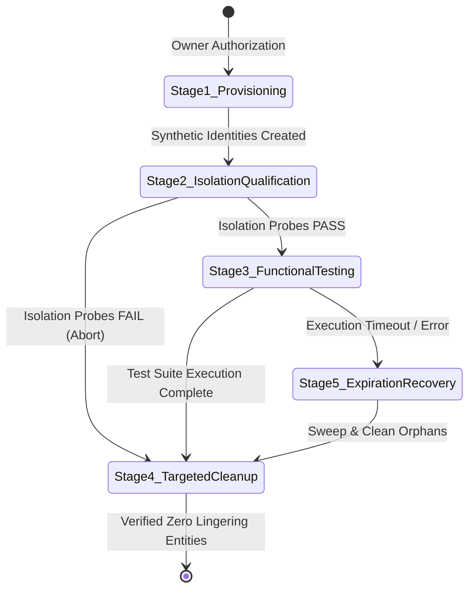

# Phase 3.6 — Report 04: Ephemeral Tenant Lifecycle & Operational State Machine

**Project:** Parent Control App  
**Workspace:** `D:\parentcontrol_app`  
**Supabase Project:** `parent-control-prod` (`hhqgreaoqulmfwfwarhc`)  
**Audit Date:** 2026-11-20  

---

## 1. Ephemeral Tenant Lifecycle State Machine

To guarantee that disposable test entities can never linger indefinitely, interfere with real families, or escape test containment, an explicit 5-stage lifecycle state machine is defined.



---

## 2. Detailed Lifecycle Stages Specification

### Stage 1: Provisioning (Deterministic Synthetic Namespace)
- **Correlation ID:** Every test run generates a unique, cryptographically random correlation UUID:  
  `CORRELATION_ID = "run-" + Date.now() + "-" + crypto.randomUUID().slice(0, 8)`
- **Identity Naming Standard:**
  - Parent User Email: `ephemeral-parent-<CORRELATION_ID>@internal-test.local`
  - Child User Email: `ephemeral-child-<CORRELATION_ID>@internal-test.local`
  - Family Name: `Ephemeral QA Family <CORRELATION_ID>`
  - Device Installation ID: `test-inst-<CORRELATION_ID>-01`
- **Metadata Tagging:**
  All created profiles and families carry structured metadata:
  ```json
  {
    "is_ephemeral_test": true,
    "test_correlation_id": "<CORRELATION_ID>",
    "expires_at": "<ISO8601_TIMESTAMP_NOW_PLUS_1_HOUR>"
  }
  ```
- **Execution Guard:** The provisioning script checks that the target email domain is strictly `@internal-test.local`. Any attempt to provision using a real domain (e.g. `@gmail.com`) aborts immediately.

### Stage 2: Isolation Qualification (Pre-Flight Barrier)
Before any functional test is executed, the newly created tenant must pass a pre-flight isolation probe:
1. **Protected Account Exclusion Check:**  
   Confirm that the test user ID does not match any protected account UUID (`spg7753@gmail.com`, `ankit@gmail.com`, `ankit1@gmail.com`).
2. **Boundary Read Probe:**  
   Using the test user's JWT, query `public.families` and `public.profiles`.
   - **Assertion:** Exactly 0 rows returned outside the test correlation ID.
   - If any other family row is readable, RLS has leaked: immediately trigger emergency teardown and abort.
3. **Cross-Tenant Mutation Probe:**  
   Attempt to invoke an action on a foreign UUID. Must return `403 Forbidden` or `404 Not Found`.

### Stage 3: Functional Testing (Gated Execution)
Once containment is verified, the test harness executes the target functional tests:
- Authenticated account export (`export`).
- Retention report scoping (`retention_report`).
- Account deletion blocker detection (`delete` with active child/device -> expect 409).
- End-to-end account deletion and cascade (`delete` -> expect 200).
- Retry recovery simulation (`profile_missing` -> expect 200).

### Stage 4: Targeted Cleanup (Surgical Teardown)
- **Targeting Predicate:**
  Cleanup queries target **strictly and exclusively** by `test_correlation_id`:
  ```sql
  WHERE metadata->>'test_correlation_id' = '<CORRELATION_ID>'
  ```
- **Explicit Blacklist:**  
  Cleanup scripts hardcode an exclusion list for protected account emails and UUIDs. A safety assertion throws an uncatchable exception if any target matches a protected identity.
- **Dry-Run Capability:**  
  The cleanup tool supports a dry-run flag (`--dry-run`), outputting the exact list of entity IDs to be removed before executing deletions.
- **Uncascaded Entity Cleanup:**  
  Specifically sweeps `public.audit_logs` where `metadata->>'test_correlation_id' = '<CORRELATION_ID>'` to eliminate orphaned audit rows.

### Stage 5: Expiration and Recovery (Orphan Sweeper)
- **Expiry Window:** All ephemeral tenants have a hard 1-hour time-to-live (`TTL = 3600s`).
- **Emergency Sweeper:** An automated cleanup script can be triggered at any time to inspect `profiles` and `families` for any entity where:
  ```sql
  metadata->>'is_ephemeral_test' = 'true' AND (metadata->>'expires_at')::timestamptz < now()
  ```
- **Alerting:** If an expired test tenant remains after 2 hours, an alert is recorded in the audit trail.
