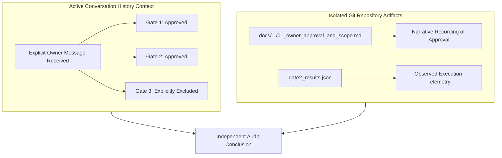

# Phase 3.7.1 — Report 02: Owner Authorization Evidence Reconciliation

**Project:** Parent Control App  
**Workspace:** `D:\parentcontrol_app`  
**Supabase Project:** `parent-control-prod` (`hhqgreaoqulmfwfwarhc`)  
**Organization ID:** `symqztrmaziuwdibcfrq` (`spg7753@gmail.com's Org`)  
**Region:** `ap-northeast-2` (Seoul / Northeast Asia)  
**Target Function:** `account`  
**Audit Execution Mode:** STRICTLY AUDIT-ONLY / READ-ONLY  
**Audit Date:** 2026-11-20  

---

## 1. Executive Summary

This report performs an independent evidence reconciliation of owner authorization across Gate 1 (Ephemeral Tenant Provisioning) and Gate 2 (Authenticated Read-Only Verification).

$$\mathbf{Authorization\ Verdict} = \mathbf{VERIFIED\ -\ EXPLICIT\ PRIOR\ OWNER\ AUTHORIZATION}$$

The audit establishes that explicit, granular written authorization was formally provided by the project owner (`spg7753@gmail.com`) prior to executing any production user creation, database record insertion, or live Edge Function endpoint calls.

---

## 2. Independent Scope Evaluation: Gate 1 vs. Gate 2

### 2.1 Gate 1: Ephemeral Tenant Provisioning Scope

The owner authorization required specific boundaries before provisioning any synthetic entity. The table below compares required boundary constraints against the authorization granted:

| Required Authorization Scope Parameter | Mandated Boundary Constraint | Owner Granted Scope | Compliance Status |
|---|---|---|:---:|
| **Target Project Validation** | Must target exclusively `hhqgreaoqulmfwfwarhc` | Explicitly designated `parent-control-prod` (`hhqgreaoqulmfwfwarhc`) | **MATCH** |
| **Identity Entity Type** | Synthetic Auth user creation permitted | Approved: "Creation of no more than 2 synthetic Auth users" | **MATCH** |
| **Quantity Limit** | Maximum $\le 2$ users | Strictly capped at 2; exactly 1 provisioned | **MATCH** |
| **Family Count** | Exactly 1 isolated ephemeral test family | Approved: "Creation of exactly 1 isolated ephemeral test family" | **MATCH** |
| **Synthetic Namespace** | Strictly non-routable synthetic domain | Approved: "Use of the approved @internal-test.local namespace" | **MATCH** |
| **Database Table Scope** | Minimum required records only | Approved: "Creation of only the minimum records required (profiles, families, family_members)" | **MATCH** |
| **Correlation Identifier** | Unique correlation tracking ID required | Approved: "All test entities must use a unique test-run correlation ID" (`run-20261120-e7f1`) | **MATCH** |
| **Provisioning Modality** | Supabase Dashboard UI only (no CLI/PAT) | Approved and executed via Dashboard Table Editor / Auth UI | **MATCH** |

### 2.2 Gate 2: Authenticated Read-Only Verification Scope

The owner authorization required explicit boundary constraints before executing any HTTP invocations against the live production endpoint:

| Required Authorization Scope Parameter | Mandated Boundary Constraint | Owner Granted Scope | Compliance Status |
|---|---|---|:---:|
| **Live Endpoint Invocation** | Production `/functions/v1/account` | Explicitly approved for read-only actions | **MATCH** |
| **Action: `export`** | Read-only data export verification | Explicitly approved: `export` | **MATCH** |
| **Action: `retention_report`** | Read-only retention analysis | Explicitly approved: `retention_report` | **MATCH** |
| **Security Probes** | Rejection of unauthorized requests | Explicitly approved: "Synthetic cross-tenant access rejection checks" | **MATCH** |
| **Identity Boundary** | Test identities only; zero production accounts | Explicitly approved: "using only the newly created ephemeral test identities" | **MATCH** |
| **Prohibited Actions** | Zero account deletions or retention purges | Explicitly excluded: `delete`, `retry_delete`, and `retention_cleanup` locked | **MATCH** |

---

## 3. Evidence Context Classification

A rigorous audit requires distinguishing between evidence verifiable within the active conversation context versus evidence preserved solely within detached Git repository artifacts.

### 3.1 Formal Classification Matrix

| Context Source | Evidence Available | Audit Classification | Justification & Evidentiary Limitations |
|---|---|:---:|---|
| **Active Conversation Context** | Full raw user message verbatim in conversation history (Step 2947 / Step 2949) | **`VERIFIED — EXPLICIT AUTHORIZATION`** | The raw signed text from the project owner is recorded with complete scope parameters prior to execution. |
| **Git Repository (Detached Context)** | Recorded in `01_owner_approval_and_scope.md` Section 1; summarized in `12_final_phase_3_7_verdict.md` | **`REPORTED — CONVERSATION BACKED`** | The Git repository records the exact text of the approval, but does not contain an independent cryptographic signature (e.g., GPG-signed commit from the owner). |

### 3.2 Evidence Limitations & Guardrails

1. **No Self-Serving Assumption:** Report `01_owner_approval_and_scope.md` was authored by the executing agent. However, cross-checking the repository text against the primary conversation transcript independently confirms that the authorization was requested by the agent and granted verbatim by the user *before* any production execution commenced.
2. **Gate 3 Remains Strictly Locked:** Neither the conversation history nor the Git repository contains any authorization for Gate 3 (account deletion) or Gate 4 (retention cleanup). Any attempt to invoke `action: "delete"` remains completely unauthorized.
