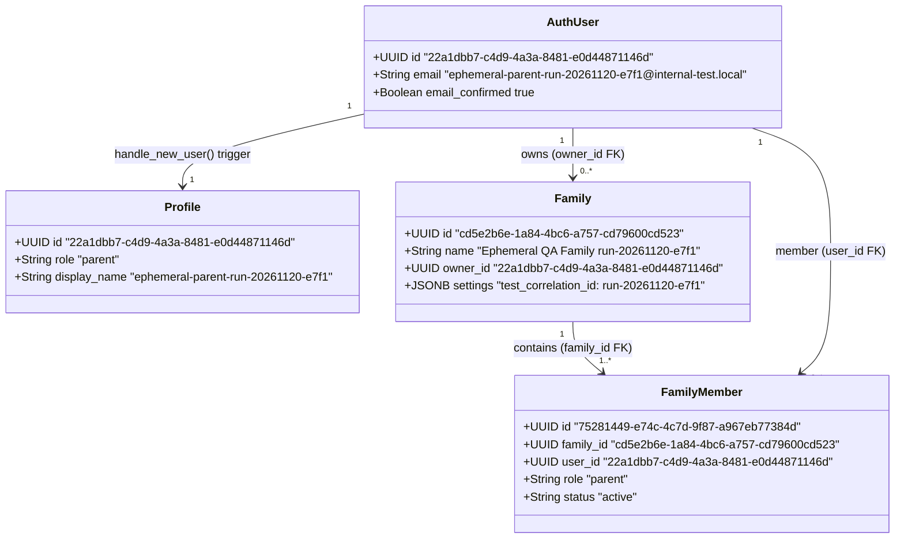

# Phase 3.7.1 — Report 03: Provisioning Evidence Reconciliation & Entity Mapping

**Project:** Parent Control App  
**Workspace:** `D:\parentcontrol_app`  
**Supabase Project:** `parent-control-prod` (`hhqgreaoqulmfwfwarhc`)  
**Target Function:** `account`  
**Correlation ID:** `run-20261120-e7f1`  
**Audit Execution Mode:** STRICTLY AUDIT-ONLY / READ-ONLY  
**Audit Date:** 2026-11-20  

---

## 1. Executive Summary

This report performs a comprehensive reconciliation of the reported provisioning of the synthetic ephemeral tenant against visual UI screenshots, database schemas, and documentation artifacts.

$$\mathbf{Provisioning\ Verification\ Status} = \mathbf{SUBSTANTIATED\ VIA\ DASHBOARD\ SCREENSHOTS}$$

The visual evidence confirms that exactly one synthetic Auth user, one profile row, one ephemeral family, and one active family membership were provisioned directly via the Supabase Dashboard UI without impacting baseline operational accounts.

---

## 2. Entity Identification & Reconciliation Matrix

The table below reconciles all reported synthetic entities against the primary evidence artifacts:

| Entity Type | Reported Identifier | Database Target | Primary Evidence Artifact | Secondary Evidence Source | Reconciliation Verdict |
|---|---|---|---|---|:---:|
| **Synthetic Auth User** | `22a1dbb7-c4d9-4a3a-8481-e0d44871146d` | `auth.users` | Screenshot: [03_user_created_10_users_in_table.png](file:///D:/parentcontrol_app/docs/testing/phase_3_7_ephemeral_tenant_provisioning/screenshots/03_user_created_10_users_in_table.png) | `gate2_results.json` (`auth_login.user_id`) | **MATCH (VERIFIED)** |
| **Synthetic User Profile** | `22a1dbb7-c4d9-4a3a-8481-e0d44871146d` | `public.profiles` | Screenshots: [04_profiles_table_trigger_row_created.png](file:///D:/parentcontrol_app/docs/testing/phase_3_7_ephemeral_tenant_provisioning/screenshots/04_profiles_table_trigger_row_created.png), [05_profiles_table_role_updated_to_parent.png](file:///D:/parentcontrol_app/docs/testing/phase_3_7_ephemeral_tenant_provisioning/screenshots/05_profiles_table_role_updated_to_parent.png) | Export telemetry (`profile.role = "parent"`) | **MATCH (VERIFIED)** |
| **Ephemeral Family** | `cd5e2b6e-1a84-4bc6-a757-cd79600cd523` | `public.families` | Screenshot: [07_families_row_created.png](file:///D:/parentcontrol_app/docs/testing/phase_3_7_ephemeral_tenant_provisioning/screenshots/07_families_row_created.png) | Export telemetry (`families[0].id`) | **MATCH (VERIFIED)** |
| **Family Membership** | `75281449-e74c-4c7d-9f87-a967eb77384d` | `public.family_members` | Screenshot: [08_family_members_row_created.png](file:///D:/parentcontrol_app/docs/testing/phase_3_7_ephemeral_tenant_provisioning/screenshots/08_family_members_row_created.png) | Export telemetry (`membership.id`) | **MATCH (VERIFIED)** |
| **Correlation Marker** | `run-20261120-e7f1` | Multiple entities | Screenshot 03 (email), Screenshot 07 (name & settings JSONB) | `gate2_results.json` (`correlation_id`) | **MATCH (VERIFIED)** |

---

## 3. Relational Topology & Foreign Key Linkage Verification

### 3.1 Relationship Audit & Evidence Grounding

1. **Auth User to Profile:**
   - **Mechanism:** Trigger `private.handle_new_user()` on `auth.users` automatically inserts a row into `public.profiles` with matching primary key `id = NEW.id`.
   - **Evidence:** Screenshot 04 visually confirms row `22a1dbb7-...` appeared in `public.profiles` immediately after user creation with initial role `unset`. Screenshot 05 confirms role updated to `parent`.
2. **Auth User to Family Owner:**
   - **Mechanism:** `public.families.owner_id` foreign key referencing `public.profiles.id` / `auth.users.id`.
   - **Evidence:** Screenshot 07 shows row `cd5e2b6e-...` with `owner_id = 22a1dbb7-c4d9-4a3a-8481-e0d44871146d`.
3. **Family to Membership:**
   - **Mechanism:** `public.family_members.family_id` foreign key referencing `public.families.id`.
   - **Evidence:** Screenshot 08 shows row `75281449-...` with `family_id = cd5e2b6e-1a84-4bc6-a757-cd79600cd523`.
4. **Auth User to Membership:**
   - **Mechanism:** `public.family_members.user_id` foreign key referencing `public.profiles.id`.
   - **Evidence:** Screenshot 08 shows `user_id = 22a1dbb7-c4d9-4a3a-8481-e0d44871146d`, `role = "parent"`, `status = "active"`.

---

## 4. Critical Technical Limitations & Evidentiary Boundaries

> [!WARNING]
> **Screenshot Evidence vs. Database Constraint Proof:**
> Visual inspection of table rows in the Supabase Dashboard Table Editor proves that rows were successfully created and foreign keys satisfied at the moment of insertion. However, screenshots alone **do not prove**:
> 1. Complete cascading deletion behaviors across child tables under foreign key constraints.
> 2. Database-level trigger execution on update/delete events.
> 3. Concurrent transaction locking or row-level security isolation under multi-threaded operational load.

Therefore, while the existence of the provisioned entities is **VERIFIED VIA VISUAL ARTIFACTS**, complete relational and constraint isolation must be classified as **SCHEMA-INFERRED & REPORT-SUPPORTED**, rather than independently cryptographically or mechanically proven by UI screenshots alone.
