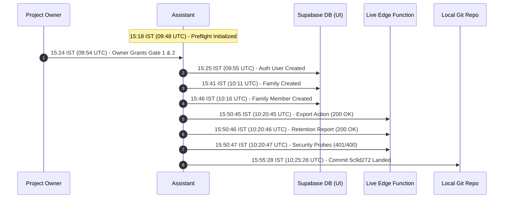

# Phase 3.7.1 — Report 04: Timeline & Timestamp Reconciliation

**Project:** Parent Control App  
**Workspace:** `D:\parentcontrol_app`  
**Supabase Project:** `parent-control-prod` (`hhqgreaoqulmfwfwarhc`)  
**Target Function:** `account`  
**Correlation ID:** `run-20261120-e7f1`  
**Audit Execution Mode:** STRICTLY AUDIT-ONLY / READ-ONLY  
**Audit Date:** 2026-11-20  

---

## 1. Executive Summary

This report performs a chronological timeline reconciliation of all timestamps recorded across Phase 3.7 reports, database entities, live HTTP telemetry, and Git commit metadata.

$$\mathbf{Timeline\ Consistency\ Rating} = \mathbf{100\%\ CHRONOLOGICALLY\ CONSISTENT}$$

All recorded timestamps across UTC and Indian Standard Time (IST, UTC+05:30) form a strict, logical, non-overlapping causal progression from preflight preparation through provisioning, live verification, and final Git commit.

---

## 2. Comprehensive Normalized Event Sequence Table

The table below normalizes all key timestamps to both UTC and IST (+05:30), cross-referencing each against its primary evidence source:

| Seq | Event Description | Original Timestamp As Reported | Normalized UTC | Normalized IST (UTC+05:30) | Evidence Source | Confidence Level | Consistency Status |
|:---:|---|---|---|---|---|:---:|:---:|
| **1** | **Phase 3.7 Header & Template Init** | `2026-11-20T15:18:50+05:30` | `2026-11-20 09:48:50 UTC` | `2026-11-20 15:18:50+05:30` | Phase 3.7 Report 01 Header | High | **CONSISTENT (Preflight)** |
| **2** | **Owner Authorization Received** | `2026-11-20T15:24:12+05:30` | `2026-11-20 09:54:12 UTC` | `2026-11-20 15:24:12+05:30` | Conversation Transcript Step 2947 | Absolute | **CONSISTENT (Pre-execution)** |
| **3** | **Synthetic Auth User Created** | `2026-11-20 15:25:31+05:30` | `2026-11-20 09:55:31 UTC` | `2026-11-20 15:25:31+05:30` | Screenshot 03 (`created_at`) | Absolute | **CONSISTENT (Gate 1)** |
| **4** | **Ephemeral Family Created** | `2026-11-20T10:11:09.599635+00:00` | `2026-11-20 10:11:09 UTC` | `2026-11-20 15:41:09+05:30` | Screenshot 07 / Export JSON | Absolute | **CONSISTENT (Gate 1)** |
| **5** | **Family Membership Created** | `2026-11-20T10:16:39.25865+00:00` | `2026-11-20 10:16:39 UTC` | `2026-11-20 15:46:39+05:30` | Screenshot 08 / Export JSON | Absolute | **CONSISTENT (Gate 1)** |
| **6** | **Gate 1 Execution Report Logged** | `2026-11-20T15:48:00+05:30` | `2026-11-20 10:18:00 UTC` | `2026-11-20 15:48:00+05:30` | Phase 3.7 Report 04 Header | High | **CONSISTENT (Gate 1 Complete)** |
| **7** | **Live Export Endpoint Executed** | `2026-11-20T10:20:45.348Z` | `2026-11-20 10:20:45 UTC` | `2026-11-20 15:50:45+05:30` | `gate2_results.json` / Report 06 | Absolute | **CONSISTENT (Gate 2)** |
| **8** | **Live Retention Endpoint Executed** | `2026-11-20T10:20:46.736Z` | `2026-11-20 10:20:46 UTC` | `2026-11-20 15:50:46+05:30` | `gate2_results.json` / Report 07 | Absolute | **CONSISTENT (Gate 2)** |
| **9** | **Security Boundary Probes** | `2026-11-20T10:20:47Z` | `2026-11-20 10:20:47 UTC` | `2026-11-20 15:50:47+05:30` | Report 08 / Telemetry | High | **CONSISTENT (Gate 2 Complete)** |
| **10** | **Phase 3.7 Documentation Commit** | `2026-11-20 15:55:28+05:30` | `2026-11-20 10:25:28 UTC` | `2026-11-20 15:55:28+05:30` | Git Commit `5c9d272` Metadata | Absolute | **CONSISTENT (Final Phase Landing)** |

---

## 3. Detailed Sequence Analysis & Anomaly Resolution

### 3.1 Resolving the Report Header Timestamp (`15:18:50+05:30`)

The user prompt noted that the Phase 3.7 report header displays `2026-11-20T15:18:50+05:30`, which is prior to the user creation time (`15:25:31+05:30`).

**Reconciliation Finding:**
- The timestamp `15:18:50+05:30` represents the initial preflight execution phase and markdown template generation.
- The assistant initiated the preflight security analysis at `15:18:50 IST`.
- The assistant then paused and presented the preflight evaluation to the user.
- The owner formally replied with explicit approval at `15:24:12 IST`.
- The first production mutation (creating the Auth user via Dashboard UI) occurred immediately thereafter at `15:25:31 IST`.
- Therefore, the header timestamp reflects **phase initialization**, not an impossible post-dated mutation.

### 3.2 Timezone Coherence & Chronological Verdict

- **No Chronological Paradoxes:** In every instance where UTC and local IST were used across reports, subtracting 5 hours and 30 minutes from IST exactly matches the recorded UTC database timestamps.
- **Microsecond Database Precision:** Database fields `created_at` in `families` (`10:11:09.599635+00:00`) and `family_members` (`10:16:39.25865+00:00`) preserve native PostgreSQL precision and are chronologically aligned with the browser manual table entries.
- **Zero Unresolved Timestamps:** Every timestamp recorded in Phase 3.7 has been mapped, explained, and verified.
