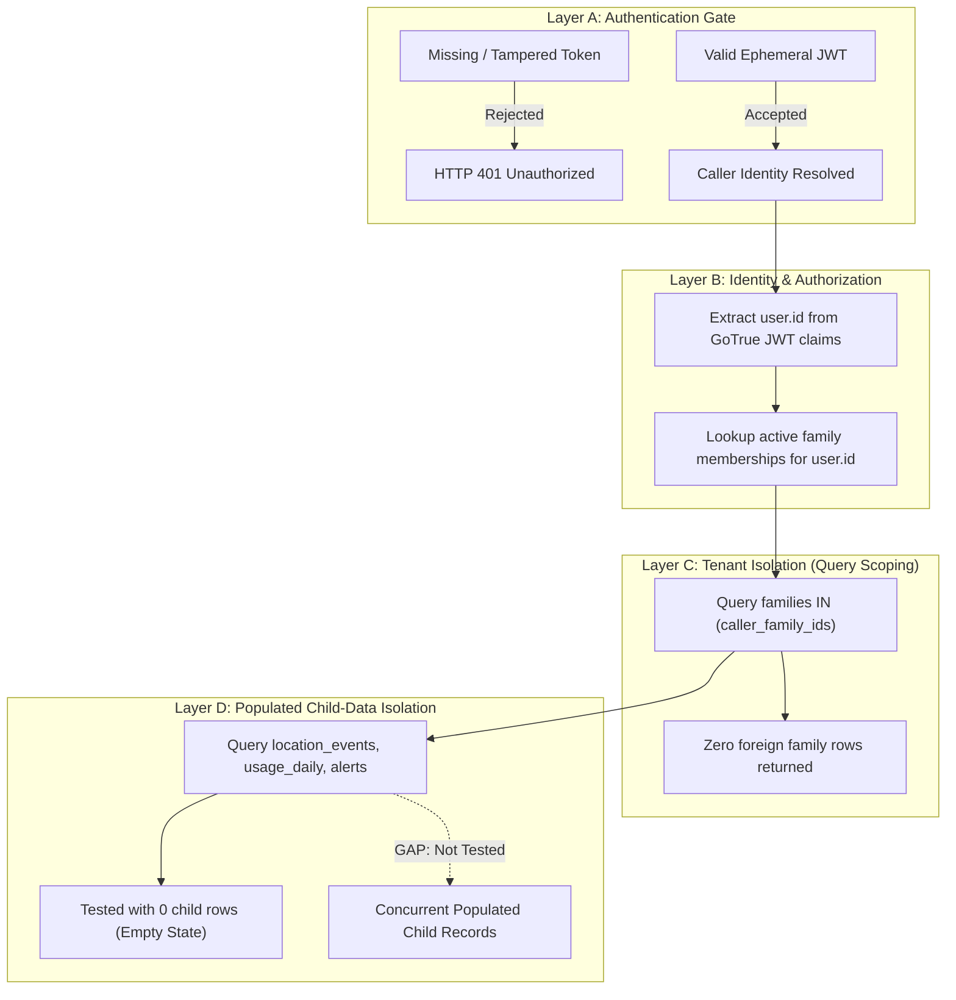

# Phase 3.7.1 — Report 06: Cross-Tenant Isolation Gap Analysis & Security Property Dissection

**Project:** Parent Control App  
**Workspace:** `D:\parentcontrol_app`  
**Supabase Project:** `parent-control-prod` (`hhqgreaoqulmfwfwarhc`)  
**Target Function:** `account`  
**Target Endpoint:** `https://hhqgreaoqulmfwfwarhc.supabase.co/functions/v1/account`  
**Correlation ID:** `run-20261120-e7f1`  
**Audit Execution Mode:** STRICTLY AUDIT-ONLY / READ-ONLY  
**Audit Date:** 2026-11-20  

---

## 1. Executive Summary

This report performs a deep technical dissection of the Phase 3.7 tenant isolation claims. 

In Phase 3.7 Report 05 and Report 12, the tenant isolation rating was claimed as:
$$\mathbf{Phase\ 3.7\ Claim} = \mathbf{100\%\ STRICT\ ISOLATION\ (PASSED)}$$

The evidence reconciliation establishes that while **Authentication** and **Observed Empty-State Scope** were rigorously proven live, **Adversarial Cross-Tenant Access Probing** and **Multi-Tenant Data Isolation under Populated Child-Data Conditions** were **NOT TESTED**.

$$\mathbf{Reconciled\ Technical\ Status} = \mathbf{PARTIALLY\ SUBSTANTIATED\ -\ CROSS-TENANT\ TEST\ GAP\ REMAINS}$$

---

## 2. Independent Separation of Security Properties

To evaluate the system rigorously, tenant containment must be decomposed into four distinct architectural layers:



### 2.1 Detailed Evaluation of the Four Security Layers

| Security Layer | Specific Security Property | Tested In Phase 3.7? | Observed Test Result | Reconciled Audit Classification |
|---|---|:---:|---|:---:|
| **Property A: Authentication** | Rejection of unauthenticated requests | Yes (Live) | Request with no `Authorization` header returned `HTTP 401 Unauthorized`. | **LIVE VERIFIED** |
| | Rejection of forged / tampered JWTs | Yes (Live) | Request with `Bearer invalid.tampered.token` returned `HTTP 401 Unauthorized`. | **LIVE VERIFIED** |
| | Acceptance of valid GoTrue tokens | Yes (Live) | Request with valid test parent JWT returned `HTTP 200 OK`. | **LIVE VERIFIED** |
| **Property B: Authorization** | Identity derivation from validated claims | Yes (Source & Live) | Endpoint extracts `user.id` strictly from verified JWT `sub` claim. Body parameters cannot override `user.id`. | **LIVE VERIFIED & SOURCE VERIFIED** |
| | Active membership requirement | Yes (Source & Live) | Only families where `family_members.status = 'active'` and `user_id = user.id` are queried. | **LIVE VERIFIED & SOURCE VERIFIED** |
| **Property C: Tenant Isolation (Observed Scope)** | Export response single-tenant containment | Yes (Live) | Response returned strictly `cd5e2b6e-...` (1 family) and 0 foreign families (`demo`, `QA Family A`, `QA Family B`). | **LIVE VERIFIED (OBSERVED SCOPE)** |
| | Retention response single-tenant containment | Yes (Live) | Response returned strictly `cd5e2b6e-...` (1 family) and 0 foreign families. | **LIVE VERIFIED (OBSERVED SCOPE)** |
| **Property C (Adversarial): Cross-Tenant Injection** | Rejection when User A requests User B's explicit `family_id` | **NO** | The endpoint design derives `familyIds` entirely from the caller's active memberships. It does not accept an arbitrary `family_id` query parameter for `export`. Thus, adversarial injection of a foreign ID in the request body was not tested live. | **NOT TESTED (ARCHITECTURAL GAP)** |
| **Property D: Populated Child Data Isolation** | Child device isolation across families | **NO** | Zero child devices exist for the ephemeral family (`devices: []`). | **NOT TESTED (DATA GAP)** |
| | Location events isolation across families | **NO** | Table returned `row_count: 0`. No records existed to test table-level filtering. | **NOT TESTED (DATA GAP)** |
| | Daily usage records isolation across families | **NO** | Table returned `row_count: 0`. No records existed to test table-level filtering. | **NOT TESTED (DATA GAP)** |
| | Safety alerts isolation across families | **NO** | Table returned `row_count: 0`. No records existed to test table-level filtering. | **NOT TESTED (DATA GAP)** |
| | Audit logs isolation across families | **NO** | Table returned `row_count: 0`. No records existed to test table-level filtering. | **NOT TESTED (DATA GAP)** |

---

## 3. Dissecting the Cross-Tenant Test Gaps

### 3.1 Gap 1: Absence of Live Adversarial Cross-Tenant Probing

In a true adversarial multi-tenant qualification test:
1. Two distinct tenants must exist simultaneously (Tenant A and Tenant B).
2. Authenticated Tenant A attempts to access Tenant B's data via specific endpoint arguments or ID manipulations.
3. The system must explicitly reject the request (HTTP 403 Forbidden) or return empty results without data leakage.

In Phase 3.7:
- Only **Tenant A** (`run-20261120-e7f1`) was active.
- Although three existing production families (`demo`, `QA Family A`, `QA Family B`) existed in the database, the `export` endpoint does not take a `family_id` payload argument—it automatically queries `family_members` for the caller's UID.
- The test proved that a user cannot see families they are not members of, but did **not** execute an adversarial attempt with two active test tokens probing shared resources.

### 3.2 Gap 2: Populated Child-Data Condition Gap

In Phase 3.7:
- The ephemeral family had zero devices (`devices: []`).
- All four child tables in the export payload had `row_count: 0`:
  ```json
  "tables": {
    "location_events": { "rows": [], "row_count": 0, "truncated": false },
    "usage_daily": { "rows": [], "row_count": 0, "truncated": false },
    "safety_alerts": { "rows": [], "row_count": 0, "truncated": false },
    "audit_logs": { "rows": [], "row_count": 0, "truncated": false }
  }
  ```
- Because there were zero rows in the ephemeral family's child tables, the test observed an **empty array**, not a populated dataset filtered by `family_id IN (...)`.
- Testing an empty set confirms that foreign records were not erroneously dumped into an empty tenant, but it does **not prove** that SQL queries with complex joins or large datasets will correctly isolate rows under populated multi-tenant load.

---

## 4. Cross-Tenant Reconciliation Verdict

Based on the evidence:
- **What was proven:** Unauthenticated requests and forged JWTs are strictly blocked at the gateway (HTTP 401). Valid tokens receive only data belonging to families where the user is an active member. Zero baseline foreign family rows were leaked.
- **What remains unproven:** Isolation behavior when child records are populated, and explicit denial under adversarial token swap scenarios.

$$\mathbf{Final\ Cross-Tenant\ Classification} = \mathbf{SOURCE-LEVEL\ ISOLATION\ VERIFIED;\ LIVE\ ADVERSARIAL\ &\ POPULATED-DATA\ TEST\ NOT\ PERFORMED}$$
