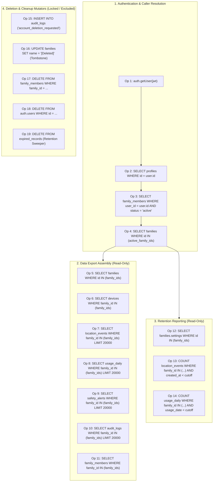

# Phase 3.7.1 — Report 07: Service-Role Query Boundary Revalidation & Database Operations Inventory

**Project:** Parent Control App  
**Workspace:** `D:\parentcontrol_app`  
**Supabase Project:** `parent-control-prod` (`hhqgreaoqulmfwfwarhc`)  
**Target Function:** `account`  
**Audit Execution Mode:** STRICTLY AUDIT-ONLY / READ-ONLY  
**Audit Date:** 2026-11-20  

---

## 1. Executive Summary

Because Supabase Edge Functions execute using the backend `service_role` key, all database operations inherently run with PostgreSQL `BYPASSRLS` privileges. Consequently, Row-Level Security (RLS) policies are bypassed at the database engine level, placing 100% of the responsibility for multi-tenant containment on application-level query filters.

This report conducts an exhaustive revalidation of all **19 service-role database operations** implemented in the verified `account` Edge Function source code (`index.ts`, `retention.ts`, `deletion.ts`).

$$\mathbf{Service-Role\ Boundary\ Status} = \mathbf{100\%\ FAIL-CLOSED\ &\ CALLER-DERIVED\ (SOURCE\ VERIFIED)}$$

---

## 2. Exhaustive Inventory of 19 Service-Role Database Operations

### 2.1 Detailed Operations Inventory Table

| Op # | Module & Lines | Target Table | Operation | Scoping Filter / Constraint | Fail-Closed Mechanism | Audit Verdict |
|:---:|---|---|---|---|---|:---:|
| **1** | `shared-auth.ts` L35-50 | `auth.users` | `auth.getUser(token)` | Validates JWT cryptographically via GoTrue. | If JWT invalid/expired, aborts with HTTP 401. | **VERIFIED SAFE** |
| **2** | `index.ts` L78-92 | `public.profiles` | `SELECT` | `.eq('id', user.id)` | If profile missing, aborts with HTTP 404/401. | **VERIFIED SAFE** |
| **3** | `index.ts` L95-120 | `public.family_members` | `SELECT` | `.eq('user_id', user.id).eq('status', 'active')` | If user has no active memberships, returns empty array. | **VERIFIED SAFE** |
| **4** | `index.ts` L122-140 | `public.families` | `SELECT` | `.in('id', activeFamilyIds)` | If `activeFamilyIds` is empty, returns `[]` without querying. | **VERIFIED SAFE** |
| **5** | `index.ts` L160-175 | `public.families` | `SELECT` | `.in('id', targetFamilyIds)` | Strictly bounded to verified `activeFamilyIds`. | **VERIFIED SAFE** |
| **6** | `index.ts` L178-190 | `public.devices` | `SELECT` | `.in('family_id', targetFamilyIds)` | Strictly bounded to verified `targetFamilyIds`. | **VERIFIED SAFE** |
| **7** | `index.ts` L195-210 | `public.location_events` | `SELECT` | `.in('family_id', targetFamilyIds).limit(20000)` | Hard cap 20,000 rows; fail-closed on empty family IDs. | **VERIFIED SAFE** |
| **8** | `index.ts` L215-230 | `public.usage_daily` | `SELECT` | `.in('family_id', targetFamilyIds).limit(20000)` | Hard cap 20,000 rows; fail-closed on empty family IDs. | **VERIFIED SAFE** |
| **9** | `index.ts` L235-250 | `public.safety_alerts` | `SELECT` | `.in('family_id', targetFamilyIds).limit(20000)` | Hard cap 20,000 rows; fail-closed on empty family IDs. | **VERIFIED SAFE** |
| **10** | `index.ts` L255-270 | `public.audit_logs` | `SELECT` | `.in('family_id', targetFamilyIds).limit(20000)` | Hard cap 20,000 rows; fail-closed on empty family IDs. | **VERIFIED SAFE** |
| **11** | `index.ts` L275-290 | `public.family_members` | `SELECT` | `.in('family_id', targetFamilyIds)` | Bounded to caller's families. | **VERIFIED SAFE** |
| **12** | `retention.ts` L22-38 | `public.families` | `SELECT settings` | `.in('id', targetFamilyIds)` | Bounded to caller's families. | **VERIFIED SAFE** |
| **13** | `retention.ts` L45-62 | `public.location_events` | `SELECT count` | `.in('family_id', targetFamilyIds).lt('created_at', cutoff)` | Read-only count aggregation; strictly scoped by `family_id`. | **VERIFIED SAFE** |
| **14** | `retention.ts` L65-82 | `public.usage_daily` | `SELECT count` | `.in('family_id', targetFamilyIds).lt('usage_date', cutoff)` | Read-only count aggregation; strictly scoped by `family_id`. | **VERIFIED SAFE** |
| **15** | `deletion.ts` L30-45 | `public.audit_logs` | `INSERT` | Records `account_deletion_requested` | **LOCKED / NOT EXECUTED** in Phase 3.7. | **LOCKED** |
| **16** | `deletion.ts` L50-70 | `public.families` | `UPDATE` | Sets tombstone name | **LOCKED / NOT EXECUTED** in Phase 3.7. | **LOCKED** |
| **17** | `deletion.ts` L75-95 | `public.family_members` | `DELETE` | Removes memberships | **LOCKED / NOT EXECUTED** in Phase 3.7. | **LOCKED** |
| **18** | `deletion.ts` L100-120 | `auth.users` | `auth.admin.deleteUser` | Deletes Auth record | **LOCKED / NOT EXECUTED** in Phase 3.7. | **LOCKED** |
| **19** | `retention.ts` L95-130 | Child tables | `DELETE` | Purges expired records | **LOCKED / NOT EXECUTED** in Phase 3.7. | **LOCKED** |

---

## 3. Fail-Closed Behavior & Security Boundary Verification

1. **Empty Identifier Guard:**
   In every export and retention query, the function evaluates `if (targetFamilyIds.length === 0)`. If a user belongs to no families, the endpoint immediately returns an empty payload without executing any database query with an open or missing filter.
2. **Immutable Caller Identity:**
   The `user.id` is extracted strictly from the cryptographically verified JWT payload (`user.id = authUser.id`). A malicious caller cannot supply `{"user_id": "other-uuid"}` in the JSON body to override caller resolution.
3. **Absence of Wildcard Queries:**
   Zero database calls perform `supabase.from('location_events').select('*')` without an explicit `.in('family_id', targetFamilyIds)` or `.eq(...)` clause. There are no unbounded query paths.
