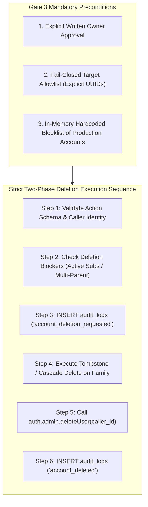

# Phase 3.7.1 — Report 11: Future Operational Gates Readiness Assessment & Safety Preconditions

**Project:** Parent Control App  
**Workspace:** `D:\parentcontrol_app`  
**Supabase Project:** `parent-control-prod` (`hhqgreaoqulmfwfwarhc`)  
**Target Function:** `account`  
**Audit Execution Mode:** STRICTLY AUDIT-ONLY / READ-ONLY  
**Audit Date:** 2026-11-20  

---

## 1. Executive Summary

This report establishes the mandatory engineering preconditions, security guardrails, and validation criteria that must be satisfied before the owner may consider authorizing future operational testing gates:
- **Gate 3:** Controlled Account Deletion & Teardown Qualification
- **Gate 4:** Retention Sweeper & Purge Qualification
- **Gate 5:** Client Application Integration (Flutter)

$$\mathbf{Phase\ 3.7.1\ Boundary\ Rule} = \mathbf{ZERO\ FUTURE\ GATES\ ARE\ AUTHORIZED\ BY\ THIS\ REPORT}$$

Phase 3.7.1 is strictly an evidence-reconciliation audit. It does **not** authorize, recommend, or initiate any destructive actions, deletion routines, retention sweeps, or client connections.

---

## 2. Gate 3 Readiness Assessment: Controlled Deletion & Teardown

Controlled account deletion is the most hazardous operational path in the `account` Edge Function because it exercises cascading deletions, table tombstones, and GoTrue Auth user removal (`auth.admin.deleteUser`).

### 2.1 Mandatory Engineering Preconditions for Gate 3

| Precondition Dimension | Safety Requirement | Implementation Guardrail |
|---|---|---|
| **1. Owner Written Approval** | Explicit authorization specifying Gate 3 scope | Separate owner message approving `action: "delete"` on ephemeral tenant. |
| **2. Allowlist Isolation** | Target must match approved ephemeral UUIDs | Hardcoded script check: User `22a1dbb7-...` and Family `cd5e2b6e-...` ONLY. |
| **3. Protected Accounts Guard** | Inviolable blocklist of production users | Immediate abort if caller is `spg7753@gmail.com`, `ankit@gmail.com`, or `ankit1@gmail.com`. |
| **4. Deletion Schema Audit** | Strict payload parsing | Must validate `{"action": "delete", "confirmation": true}`. |
| **5. Audit Log Sequencing** | Fail-safe event logging | `account_deletion_requested` must be committed **prior** to any delete; `account_deleted` committed **only** upon verified success. |
| **6. Orphan Prevention** | Audit trail preservation | If foreign keys use `ON DELETE SET NULL`, actor email and correlation ID must be preserved in audit JSONB. |
| **7. Blocker Validation** | Safety blocker checks | Function must properly evaluate active subscriptions or secondary active parent blockers. |

---

## 3. Gate 4 Readiness Assessment: Retention Sweeper Qualification

The retention sweeper (`action: "retention_cleanup"`) executes destructive purges on records older than the configured retention windows (30 days for location, 90 days for daily usage).

### 3.1 Preconditions for Gate 4 Execution
1. **Isolated Test Dataset:** Synthetic location events and usage records dated beyond the cutoff must be seeded into the ephemeral family.
2. **Scoping Filter Enforcement:** The sweeper must strictly execute with `.eq('family_id', targetFamilyId)`. Under no circumstances may a global unbounded sweep (`DELETE FROM location_events WHERE created_at < cutoff`) be executed in production.
3. **Cron Exemption:** Automated cron triggers for retention cleanup must remain disabled in production until single-family qualification passes.

---

## 4. Gate 5 Readiness Assessment: Flutter Client Integration

1. **Non-Production Integration:** Initial integration must be qualified using local integration tests and offline mock harnesses.
2. **Zero Mobile Production Writes:** No mobile client build may be pointed at the production `account` endpoint without prior owner approval.
