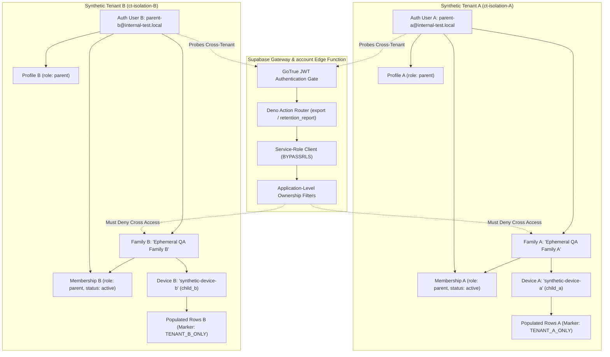

# Phase 3.7.2 — Report 02: Adversarial Two-Tenant Threat Model & CT-01 to CT-10 Scenarios

**Project:** Parent Control App  
**Workspace:** `D:\parentcontrol_app`  
**Supabase Project:** `parent-control-prod` (`hhqgreaoqulmfwfwarhc`)  
**Target Function:** `account`  
**Production Endpoint:** `https://hhqgreaoqulmfwfwarhc.supabase.co/functions/v1/account`  
**Execution Mode:** STRICTLY READ-ONLY / TEST PLANNING / SOURCE REVIEW  
**Audit Date:** 2026-11-20  

---

## 1. Executive Summary

This report establishes the formal adversarial two-tenant model and defines the comprehensive cross-tenant threat matrix spanning ten exhaustive scenarios (**CT-01 through CT-10**). 

The model addresses the two core technical gaps identified in Phase 3.7.1:
1. **Adversarial Token Probing:** Subjecting the production endpoint to simultaneous, mutually hostile synthetic identities attempting cross-boundary access.
2. **Populated Multi-Tenant Child Data:** Verifying that database query filters strictly partition rows across families when child tables contain actual records.

---

## 2. Adversarial Two-Tenant Model Specification

### 2.1 Specification of Tenant Entities

| Entity Component | Synthetic Tenant A Specification | Synthetic Tenant B Specification | Isolation Constraint |
|---|---|---|---|
| **Auth User** | `parent-a-<run_id>@internal-test.local` | `parent-b-<run_id>@internal-test.local` | Independent GoTrue accounts; unique passwords. |
| **Profile** | Role: `parent`, Name: `Parent A <run_id>` | Role: `parent`, Name: `Parent B <run_id>` | Linked via primary key `id = auth.users.id`. |
| **Family** | `Family A <run_id>`, `owner_id = User A` | `Family B <run_id>`, `owner_id = User B` | Distinct UUIDs; mutually exclusive ownership. |
| **Membership** | `user_id = User A`, `family_id = Family A` | `user_id = User B`, `family_id = Family B` | Strict single-tenant association. |
| **Child Identity** | `child-a-<run_id>@internal-test.local` | `child-b-<run_id>@internal-test.local` | Role: `child`; linked to respective family. |
| **Synthetic Device** | `synthetic-dev-a-<run_id>` | `synthetic-dev-b-<run_id>` | `family_id` strictly partitioned. |
| **Child-Data Rows** | Seeded with marker `TENANT_A_ONLY` | Seeded with marker `TENANT_B_ONLY` | Inviolable data discrimination markers. |

### 2.2 Handling of the Existing Ephemeral Tenant (`run-20261120-e7f1`)

The repository currently contains the dormant tenant from Phase 3.7 (`22a1dbb7-...` / `cd5e2b6e-...`).
- **Option 1 (Reuse existing as Tenant A):** Lowers provisioning burden by 50%, but couples the new test run with an unconfirmed historical state and risks correlation pollution.
- **Option 2 (Create clean isolated pair A & B):** Guarantees 100% deterministic state, uniform timestamps, and unambiguous correlation tagging for both sides of the adversarial probe.
- **Option 3 (Separate Project):** Highest safety, but requires separate Supabase infrastructure.

**Recommendation:** If executed in production under separate owner approval, **Option 2 (Clean Isolated Pair)** is recommended for scientific rigor. The existing Phase 3.7 tenant must remain completely untouched until Gate CT-C teardown.

---

## 3. Comprehensive Cross-Tenant Threat Matrix (Scenarios CT-01 to CT-10)

### Scenario CT-01: Foreign Family Data Export
- **Threat Description:** Authenticated User A attempts to export data, seeking to extract records belonging to Family B.
- **Preconditions:** Both Tenant A and Tenant B exist with populated data (`TENANT_A_ONLY` and `TENANT_B_ONLY`).
- **Required Fixture:** User A valid token, Family B populated rows.
- **Request Shape:** `POST /account` with `Authorization: Bearer <User_A_JWT>`, Body: `{"action": "export"}`.
- **Expected Result:** HTTP 200 OK. Response contains strictly Family A and `TENANT_A_ONLY` rows. Exactly zero Family B rows and zero `TENANT_B_ONLY` markers.
- **Database Query Boundary:** `family_members` lookup filters by `user_id = authUser.id`. `loadFamilies` and `fetchCapped` scope strictly to `familyIds` from caller's active memberships.
- **Evidence Required:** Sanitized export JSON summary confirming `families_count: 1`, `family_id: Family_A`, zero `TENANT_B_ONLY` string occurrences.
- **Risk if Test Fails:** Critical information disclosure; total multi-tenant breach.

### Scenario CT-02: Foreign Family ID Injection in Request Body
- **Threat Description:** Adversary User A crafts a malicious payload explicitly providing Family B's UUID in the request body (`{"action": "export", "family_id": "<Family_B_UUID>"}`).
- **Preconditions:** User A knows Family B's UUID.
- **Required Fixture:** User A valid token, Family B UUID.
- **Request Shape:** `POST /account` with `Authorization: Bearer <User_A_JWT>`, Body: `{"action": "export", "family_id": "<Family_B_UUID>"}`.
- **Expected Result:** HTTP 200 OK. Injected `family_id` is completely ignored. Export returns strictly Family A data.
- **Database Query Boundary:** Source review confirms `exportAccount` derives `familyIds` exclusively from `loadActiveMemberships(db, userId)` and ignores body parameters.
- **Evidence Required:** Sanitized JSON showing returned family matches Family A; Family B not present.
- **Risk if Test Fails:** Direct IDOR (Insecure Direct Object Reference) vulnerability.

### Scenario CT-03: Foreign Family Retention Report Inspection
- **Threat Description:** User A attempts to inspect retention windows and event cutoffs for Family B.
- **Preconditions:** Tenant A and Tenant B provisioned.
- **Required Fixture:** User A valid token, Family B settings configured.
- **Request Shape:** `POST /account` with `Authorization: Bearer <User_A_JWT>`, Body: `{"action": "retention_report", "family_id": "<Family_B_UUID>"}`.
- **Expected Result:** HTTP 200 OK. Returns `scope: "family"`, reporting retention metrics solely for Family A.
- **Database Query Boundary:** `retentionReport` loads memberships exclusively for `auth.user.id`.
- **Evidence Required:** Retention report payload confirming `families[0].family_id = Family_A`.
- **Risk if Test Fails:** Privacy leak of family configuration and usage activity levels.

### Scenario CT-04: Inactive or Revoked Family Membership
- **Threat Description:** User A has a valid Auth token, but their membership status in Family A is set to `status = 'suspended'` or `'revoked'`.
- **Preconditions:** User A membership modified or secondary test user provisioned with inactive status.
- **Required Fixture:** User with inactive membership.
- **Request Shape:** `POST /account` with `Authorization: Bearer <Inactive_User_JWT>`, Body: `{"action": "export"}`.
- **Expected Result:** HTTP 200 OK. Returns `scope: "not_reported"`, `families: []`, and empty child tables (`row_count: 0`).
- **Database Query Boundary:** `loadActiveMemberships` applies `.eq("status", "active")`. Non-active rows excluded.
- **Evidence Required:** Export summary showing 0 families and 0 devices.
- **Risk if Test Fails:** Revoked or suspended members retain access to family tracking data.

### Scenario CT-05: Parent vs. Child Role Boundary Enforcement
- **Threat Description:** A synthetic Child user attempts to export data or access the retention report to view parent-wide records or other siblings' location trails.
- **Preconditions:** Synthetic child user created with `profile.role = 'child'` and active child membership.
- **Required Fixture:** Valid Child JWT, paired synthetic device.
- **Request Shape:** `POST /account` with `Authorization: Bearer <Child_JWT>`, Body: `{"action": "export"}`.
- **Expected Result:** HTTP 200 OK. Returns `scope: "device"`. Devices array contains *only* the child's own device (`child_user_id = caller`). Child tables filter strictly by `device_id IN (ownDeviceIds)`. Zero whole-family location events returned.
- **Database Query Boundary:** `resolveRetentionScope` evaluates `role === 'child' && isMemberOf('child')` $\to$ `scope: "device"`. `exportAccount` switches to `.eq("child_user_id", userId)` and `.in("device_id", childDeviceIds)`.
- **Evidence Required:** Sanitized export summary showing `scope: "device"`, 0 foreign devices, and only own device rows.
- **Risk if Test Fails:** Child account escalates privilege to view parent audit logs or cross-family telemetry.

### Scenario CT-06: Multiple Active Family Memberships Containment
- **Threat Description:** In a blended family scenario where User A legitimately belongs to Family A and Family C, ensure that Family B (unrelated) is not exposed.
- **Preconditions:** User A linked to two authorized families; Tenant B completely separate.
- **Required Fixture:** User A with 2 active memberships.
- **Request Shape:** `POST /account` with `Authorization: Bearer <User_A_JWT>`, Body: `{"action": "export"}`.
- **Expected Result:** HTTP 200 OK. Returns exactly Family A and Family C. Zero records from Family B.
- **Database Query Boundary:** `loadFamilies` queries `.in("id", [Family_A, Family_C])`.
- **Evidence Required:** Payload contains exactly 2 authorized families; zero foreign entries.
- **Risk if Test Fails:** Query expansion flaw exposing foreign tenants during multi-membership processing.

### Scenario CT-07: Empty Authorization Scope (Zero Memberships)
- **Threat Description:** A freshly registered user with zero family associations calls `export` or `retention_report`.
- **Preconditions:** User has valid GoTrue JWT but zero rows in `family_members`.
- **Required Fixture:** Unaffiliated user token.
- **Request Shape:** `POST /account` with `Authorization: Bearer <Unaffiliated_User_JWT>`, Body: `{"action": "export"}`.
- **Expected Result:** HTTP 200 OK. Returns `scope: "not_reported"`, `families: []`, and empty child tables. No database exception thrown.
- **Database Query Boundary:** Empty array guard `if (familyIds.length === 0)` triggers fail-closed branch (`.eq("id", NO_MATCH_UUID)`).
- **Evidence Required:** Payload showing 0 families, 0 devices, 0 events.
- **Risk if Test Fails:** Unbounded SQL query (`SELECT * FROM location_events`) executing without WHERE clause, dumping production database.

### Scenario CT-08: Injected Foreign Child or Device Identifier
- **Threat Description:** User A supplies Device B's identifier in request parameters.
- **Preconditions:** Device A belongs to Family A; Device B belongs to Family B.
- **Required Fixture:** User A token, Device B UUID.
- **Request Shape:** `POST /account` with `Authorization: Bearer <User_A_JWT>`, Body: `{"action": "export", "device_id": "<Device_B_UUID>"}`.
- **Expected Result:** HTTP 200 OK. Injected device parameter is ignored. Query derives devices strictly from `family_id IN (authorizedFamilyIds)` or `child_user_id = caller`.
- **Database Query Boundary:** Application queries `devices` strictly via caller's authorized family IDs.
- **Evidence Required:** Export contains strictly Device A.
- **Risk if Test Fails:** Cross-tenant device spoofing and location trail extraction.

### Scenario CT-09: Cross-Tenant Audit Log Isolation
- **Threat Description:** User A attempts to view Tenant B's administrative and security audit trail.
- **Preconditions:** Both tenants generated audit log entries (e.g., pairing, settings change).
- **Required Fixture:** Audit log rows populated for Family A and Family B.
- **Request Shape:** `POST /account` with `Authorization: Bearer <User_A_JWT>`, Body: `{"action": "export"}`.
- **Expected Result:** HTTP 200 OK. `audit_logs` section contains strictly Family A events.
- **Database Query Boundary:** `fetchCapped(db, "audit_logs", ...)` filters strictly by `.in("family_id", familyIds)`.
- **Evidence Required:** Audit log export records contain only `family_id = Family_A`.
- **Risk if Test Fails:** Disclosure of administrator activity, member emails, and IP/session metadata.

### Scenario CT-10: Pagination and Row-Cap Scope Boundary (fetchCapped)
- **Threat Description:** An adversary attempts to trigger pagination offsets or exceed the 20,000 row cap to ascertain if subsequent pages leak foreign data or drop tenant filters.
- **Preconditions:** Synthetic tenant contains $> 1,000$ records (triggering multi-page `fetchCapped`).
- **Required Fixture:** Multi-page dataset in Family A.
- **Request Shape:** `POST /account` with `Authorization: Bearer <User_A_JWT>`, Body: `{"action": "export"}`.
- **Expected Result:** HTTP 200 OK. All pages retain `.in("family_id", familyIds)`. If $> 20,000$ rows, `truncated: true` is set, and zero foreign rows enter the array.
- **Database Query Boundary:** `fetchCapped` re-executes the exact `filter` callback on every `from += EXPORT_PAGE_SIZE` iteration.
- **Evidence Required:** Multi-page export output containing exclusively Family A markers.
- **Risk if Test Fails:** PostgREST pagination loop dropping WHERE clause on subsequent pages.
