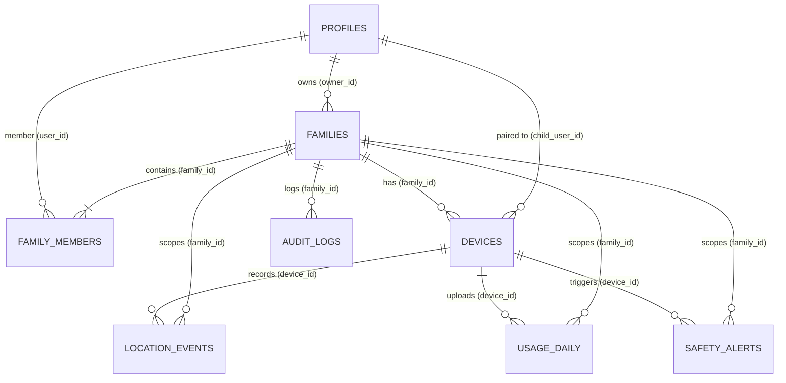

# Phase 3.7.2 — Report 04: Populated Synthetic Data Fixture Design & Schema Constraints

**Project:** Parent Control App  
**Workspace:** `D:\parentcontrol_app`  
**Supabase Project:** `parent-control-prod` (`hhqgreaoqulmfwfwarhc`)  
**Target Function:** `account`  
**Execution Mode:** STRICTLY READ-ONLY / TEST PLANNING / SOURCE REVIEW  
**Audit Date:** 2026-11-20  

---

## 1. Executive Summary

In Phase 3.7, the live export returned zero records in all child-data tables (`location_events`, `usage_daily`, `safety_alerts`, `audit_logs`). While this confirmed that foreign rows were not leaked into an empty tenant, it left multi-tenant isolation under populated data conditions untested.

This report specifies the schema-backed, privacy-preserving synthetic fixture dataset designed to prove multi-tenant isolation under populated conditions.

$$\mathbf{Synthetic\ Data\ Principle} = \mathbf{100\%\ ARTIFICIAL\ -\ ZERO\ PII\ -\ UNAMBIGUOUS\ TENANT\ DISCRIMINATION}$$

---

## 2. Unambiguous Tenant Discrimination Markers

To ensure that any cross-tenant data leakage is detected immediately and unambiguously:
- **Tenant A Fixtures:** Every synthetic record embeds the immutable string marker `TENANT_A_ONLY`.
- **Tenant B Fixtures:** Every synthetic record embeds the immutable string marker `TENANT_B_ONLY`.

Under this contract:
- An export requested by User A must contain strictly `TENANT_A_ONLY` markers and **zero** instances of `TENANT_B_ONLY`.
- An export requested by User B must contain strictly `TENANT_B_ONLY` markers and **zero** instances of `TENANT_A_ONLY`.

---

## 3. Schema-Backed Fixture Specification by Database Table

### 3.1 Table: `public.devices`
- **Schema Reference:** `supabase/migrations/20260101000000_core.sql` L120-155.
- **Required Columns:** `id`, `family_id`, `child_user_id`, `installation_id`, `display_name`, `platform`, `status`.
- **Foreign Keys:** `family_id REFERENCES public.families(id) ON DELETE CASCADE`, `child_user_id REFERENCES public.profiles(id) ON DELETE CASCADE`.
- **Tenant A Fixture:**
  - `installation_id`: `inst-synth-device-a-TENANT_A_ONLY`
  - `display_name`: `Device A [TENANT_A_ONLY]`
  - `platform`: `android`
  - `status`: `active`
- **Tenant B Fixture:**
  - `installation_id`: `inst-synth-device-b-TENANT_B_ONLY`
  - `display_name`: `Device B [TENANT_B_ONLY]`
  - `platform`: `android`
  - `status`: `active`

### 3.2 Table: `public.location_events`
- **Schema Reference:** `core.sql` L245-265.
- **Required Columns:** `id`, `device_id`, `family_id`, `lat`, `lng`, `accuracy_m`, `recorded_at`, `source`.
- **Check Constraints:** `lat BETWEEN -90 AND 90`, `lng BETWEEN -180 AND 180`, `accuracy_m >= 0`.
- **Prohibited Data:** Real GPS coordinates of real locations.
- **Tenant A Fixture (Artificial Coordinates):**
  - `lat`: `10.0001` (Off the coast of South America / Atlantic Ocean)
  - `lng`: `-20.0001`
  - `accuracy_m`: `5.0`
  - `source`: `synthetic_TENANT_A_ONLY`
  - `recorded_at`: `2026-11-20T12:00:00Z`
- **Tenant B Fixture (Artificial Coordinates):**
  - `lat`: `20.0002` (Mid-Pacific Ocean)
  - `lng`: `-140.0002`
  - `accuracy_m`: `5.0`
  - `source`: `synthetic_TENANT_B_ONLY`
  - `recorded_at`: `2026-11-20T12:00:00Z`

### 3.3 Table: `public.usage_daily`
- **Schema Reference:** `core.sql` L220-240.
- **Required Columns:** `id`, `device_id`, `family_id`, `day`, `package_name`, `app_label`, `total_ms`, `source`.
- **Check Constraints:** `total_ms >= 0`, `char_length(package_name) <= 150`.
- **Tenant A Fixture:**
  - `day`: `2026-11-20`
  - `package_name`: `com.synthetic.qa.app.TENANT_A_ONLY`
  - `app_label`: `App Alpha [TENANT_A_ONLY]`
  - `total_ms`: `3600000` (1 hour)
  - `source`: `usage_stats_TENANT_A_ONLY`
- **Tenant B Fixture:**
  - `day`: `2026-11-20`
  - `package_name`: `com.synthetic.qa.app.TENANT_B_ONLY`
  - `app_label`: `App Beta [TENANT_B_ONLY]`
  - `total_ms`: `7200000` (2 hours)
  - `source`: `usage_stats_TENANT_B_ONLY`

### 3.4 Table: `public.safety_alerts`
- **Schema Reference:** `core.sql` L270-295.
- **Required Columns:** `id`, `family_id`, `device_id`, `type`, `severity`, `message`, `payload`.
- **Check Constraints:** `type IN ('low_battery', 'offline', 'geofence_enter', 'geofence_exit', 'app_blocked', 'permission_missing', 'other')`, `severity IN ('info', 'warning', 'critical')`.
- **Tenant A Fixture:**
  - `type`: `low_battery`
  - `severity`: `warning`
  - `message`: `Synthetic battery alert for TENANT_A_ONLY`
  - `payload`: `{"marker": "TENANT_A_ONLY", "battery_level": 15}`
- **Tenant B Fixture:**
  - `type`: `app_blocked`
  - `severity`: `info`
  - `message`: `Synthetic app blocked alert for TENANT_B_ONLY`
  - `payload`: `{"marker": "TENANT_B_ONLY", "blocked_app": "com.test.b"}`

### 3.5 Table: `public.audit_logs`
- **Schema Reference:** `core.sql` L310-335.
- **Required Columns:** `id`, `family_id`, `actor_user_id`, `device_id`, `event_type`, `target_type`, `target_id`, `metadata`.
- **Tenant A Fixture:**
  - `event_type`: `device_policy_updated`
  - `target_type`: `device`
  - `metadata`: `{"test_marker": "TENANT_A_ONLY", "correlation_id": "<run_id>"}`
- **Tenant B Fixture:**
  - `event_type`: `device_policy_updated`
  - `target_type`: `device`
  - `metadata`: `{"test_marker": "TENANT_B_ONLY", "correlation_id": "<run_id>"}`

---

## 4. Minimum Fixture Volume & PostgREST Pagination Plan

| Table Name | Tenant A Record Count | Tenant B Record Count | Purpose in Test Suite | PostgREST Paging Exercised? |
|---|:---:|:---:|---|:---:|
| `public.devices` | 1 | 1 | Exercises device ownership filtering | No (1 page) |
| `public.location_events` | 5 | 5 | Validates multi-row coordinate isolation | No (Basic filtering) |
| `public.usage_daily` | 5 | 5 | Validates daily aggregate isolation | No (Basic filtering) |
| `public.safety_alerts` | 3 | 3 | Validates event alert isolation | No (Basic filtering) |
| `public.audit_logs` | 3 | 3 | Validates audit trail isolation | No (Basic filtering) |
| **Optional Paging Fixture (CT-10)** | 1,050 | 0 | Exercises `fetchCapped` multi-page loop | **Yes (Page 1 $\to$ Page 2)** |

> [!NOTE]
> For standard cross-tenant verification (CT-01 to CT-09), a minimal set of 17 records per tenant provides 100% conclusive evidence of data separation. Scenario CT-10 (pagination) can be executed independently if the owner specifically authorizes multi-page stress testing.
