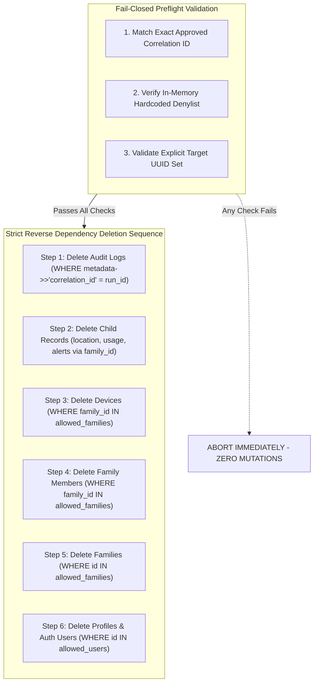

# Phase 3.7.2 — Report 05: Correlation Tracking & Fail-Safe Cleanup Architecture

**Project:** Parent Control App  
**Workspace:** `D:\parentcontrol_app`  
**Supabase Project:** `parent-control-prod` (`hhqgreaoqulmfwfwarhc`)  
**Target Function:** `account`  
**Execution Mode:** STRICTLY READ-ONLY / TEST PLANNING / SOURCE REVIEW  
**Audit Date:** 2026-11-20  

---

## 1. Executive Summary

This report establishes the correlation tracking architecture and fail-safe teardown safeguards for any future cross-tenant operational execution. 

Phase 3.7.1 established that while correlation markers exist in user emails and family settings, core PostgreSQL tables do not feature a native `test_correlation_id` column. Furthermore, foreign key constraints on `public.audit_logs` utilize `ON DELETE SET NULL`, creating a risk of untraceable orphan logs upon tenant deletion.

$$\mathbf{Cleanup\ Safety\ Mandate} = \mathbf{EXPLICIT\ UUID\ ALLOWLIST\ -\ HARDCODED\ PROTECTED\ DENYLIST\ -\ ZERO\ WILDCARDS}$$

---

## 2. Proposed Run-Specific Correlation Identifier Format

To distinguish future adversarial test runs from historical runs (such as `run-20261120-e7f1`), all future synthetic entities must adhere to a standardized identifier pattern:

$$\mathbf{Format:} \quad \texttt{ct-isolation-YYYYMMDD-<short_hex>}$$
$$\mathbf{Example:} \quad \texttt{ct-isolation-20261121-a4b2}$$

*(Note: The above is a proposed specification only; no identifier is registered or active in this planning phase).*

---

## 3. Entity-Level Correlation Mapping Architecture

The table below defines how the correlation identifier must be stamped across every layer of the synthetic tenant hierarchy:

| Record Type | Primary Location of Marker | Secondary Fallback Marker | Foreign Key Linkage |
|---|---|---|---|
| **Auth User (Parent A/B)** | `email: parent-<a|b>-<run_id>@internal-test.local` | `user_metadata->>'test_run_id'` | Primary Key `id` |
| **User Profile** | `display_name: Parent <A|B> <run_id>` | Inherited from Auth UID | `profiles.id = auth.users.id` |
| **Family** | `name: Ephemeral Family <A|B> <run_id>` | `settings->>'test_correlation_id'` | `owner_id = profiles.id` |
| **Family Membership** | Inherited from `family_id` & `user_id` | N/A | `family_id`, `user_id` FKs |
| **Synthetic Device** | `display_name: Device <A|B> [<run_id>]` | `installation_id: inst-<a|b>-<run_id>` | `family_id`, `child_user_id` FKs |
| **Child Data Tables** | `source: synth_<run_id>` | Embedded marker in text fields | `family_id`, `device_id` FKs |
| **Audit Logs** | `metadata->>'correlation_id': <run_id>` | `metadata->>'test_marker'` | `family_id`, `actor_user_id` (SET NULL) |

---

## 4. Resolving the Audit Log Orphan Risk (`ON DELETE SET NULL`)

### 4.1 The Technical Vulnerability
In `supabase/migrations/20260101000000_core.sql`:
```sql
create table public.audit_logs (
  id uuid primary key default gen_random_uuid(),
  family_id uuid references public.families (id) on delete set null,
  actor_user_id uuid references public.profiles (id) on delete set null,
  device_id uuid references public.devices (id) on delete set null, ...
```
If a test parent user or family is deleted from the database:
1. The PostgreSQL engine executes `ON DELETE SET NULL`.
2. `audit_logs.family_id` becomes `NULL`.
3. `audit_logs.actor_user_id` becomes `NULL`.
4. The audit log row is decoupled from the tenant, leaving an untraceable orphan record in the production audit table.

### 4.2 Mandatory Mitigation Strategy
To guarantee complete lifecycle auditability and eliminate orphan records:
1. **Metadata Stamping:** Every audit event generated by synthetic testing must explicitly include `correlation_id: "<run_id>"` inside the `metadata` JSONB column.
2. **Pre-Deletion Audit Archive:** Prior to invoking any cascade deletion on families or users, the teardown harness must query and record all audit log UUIDs matching `metadata->>'correlation_id' = '<run_id>'`.
3. **Deterministic Cleanup:** During teardown (Gate CT-C), audit logs must be deleted **first** by their explicit primary keys (`id IN (...)`) while their foreign key relationships remain intact, preventing any row from ever transitioning to `NULL` references.

---

## 5. Teardown Safety & Fail-Closed Guardrails



### 5.1 Inviolable Protected Account Denylist
Under no circumstances may any cleanup query touch:
- `spg7753@gmail.com` (`symqztrmaziuwdibcfrq` owner)
- `ankit@gmail.com`
- `ankit1@gmail.com`

Any teardown script must enforce an in-memory assertion:
```typescript
const PROTECTED_EMAILS = ["spg7753@gmail.com", "ankit@gmail.com", "ankit1@gmail.com"];
if (PROTECTED_EMAILS.some(p => targetEmail.toLowerCase().includes(p.toLowerCase()))) {
  throw new Error("SECURITY ABORT: Attempted operation on protected account!");
}
```

### 5.2 Strict Prohibitions
- **Zero Wildcard Cleanup:** Queries such as `DELETE FROM auth.users WHERE email LIKE '%test%'` are strictly prohibited.
- **Zero Open Scopes:** Every DELETE statement must supply explicit, fully resolved UUIDs (`id IN ('uuid1', 'uuid2')`).
- **Zero Automatic TTL Sweepers:** A documented TTL is an expiration guideline; no autonomous background sweeper may be enabled.
