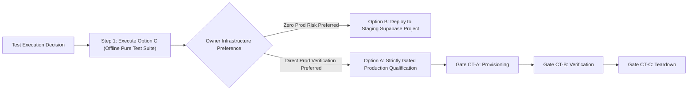

# Phase 3.7.2 — Report 06: Execution Architecture Comparison & Environment Selection

**Project:** Parent Control App  
**Workspace:** `D:\parentcontrol_app`  
**Supabase Project:** `parent-control-prod` (`hhqgreaoqulmfwfwarhc`)  
**Target Function:** `account`  
**Execution Mode:** STRICTLY READ-ONLY / TEST PLANNING / SOURCE REVIEW  
**Audit Date:** 2026-11-20  

---

## 1. Executive Summary

This report performs a comprehensive architectural comparison of three candidate environments for executing the adversarial two-tenant isolation test:
- **Option A:** Existing Production Supabase Project (`parent-control-prod`)
- **Option B:** Dedicated Separate Supabase Non-Production Project
- **Option C:** Local / Offline Deno Test Harness

$$\mathbf{Recommended\ Execution\ Strategy} = \mathbf{TIERED:\ OPTION\ C\ (OFFLINE\ PREFLIGHT)\ \longrightarrow\ OPTION\ B\ (SAFEST\ LIVE)\ OR\ A\ (GATED\ PROD)}$$

---

## 2. Detailed Architectural Comparison Matrix

| Evaluation Dimension | Option A: Existing Production (`parent-control-prod`) | Option B: Separate Supabase Test Project | Option C: Local / Offline Deno Harness |
|---|---|---|---|
| **Production Risk / Blast Radius** | **High** (Runs in production database alongside live users) | **Zero** (Completely isolated infrastructure) | **Zero** (Runs entirely in local memory / dev runner) |
| **Service-Role Parity (`BYPASSRLS`)** | **100% Exact** (Live PostgreSQL engine, real service-role token) | **100% Exact** (Live PostgreSQL engine, real service-role token) | **Simulated** (Mock PostgREST or SQLite layer; may not capture exact PostgREST nuances) |
| **Edge Function Runtime Parity** | **100% Exact** (Live Deno Deploy runtime in `ap-northeast-2`) | **100% Exact** (Identical Supabase Edge Functions environment) | **Partial** (Local `deno test` runner, mocked network boundaries) |
| **Data Contamination Risk** | Requires strict correlation filters and manual UI provisioning | Isolated test database; drop/recreate anytime | None; ephemeral in-memory state |
| **Setup & Operational Burden** | Low (Environment already exists and is configured) | Medium (Requires creating a new Supabase project and pushing migrations) | Low (Zero cloud infrastructure required) |
| **Approval Burden** | **Very High** (Requires explicit multi-gate owner authorization) | Low (Owner authorizes disposable test sandbox) | None (Internal offline development) |
| **Adversarial Multi-Tenant Fidelity** | **Maximum** (Proves isolation against live production traffic) | **Maximum** (Identical cloud architecture, zero blast radius) | **High for Logic, Low for Cloud Network** |

---

## 3. In-Depth Evaluation of the Three Options

### 3.1 Option A: Production Environment (`parent-control-prod`)
- **Advantages:** Zero infrastructure setup required; directly tests the live deployed `account` Edge Function in its production operating environment.
- **Risks:** Bypasses PostgreSQL Row-Level Security via `service_role` key. A flawed query or missing filter could theoretically expose baseline data or impact database CPU/RAM.
- **Mandatory Guardrails if Chosen:** Requires strict multi-gate approval (Gate CT-A, CT-B, CT-C), synthetic data discrimination markers (`TENANT_A_ONLY`), and an inviolable protected account denylist.

### 3.2 Option B: Dedicated Non-Production Supabase Project
- **Advantages:** Provides 100% architectural fidelity (real GoTrue Auth, real PostgreSQL database, real PostgREST queries, real Edge Functions) while reducing production blast radius to **absolute zero**. Eliminates all risk of accidental data disclosure or orphaned audit logs in the production project.
- **Effort:** Requires the owner to provision a staging Supabase project (e.g. `parent-control-staging`), apply migrations `supabase db push`, and deploy Edge Functions.
- **Verdict:** **Scientifically and architecturally the superior option** for destructive or adversarial qualification testing.

### 3.3 Option C: Local / Offline Deno Test Harness
- **Advantages:** Zero network calls, zero credentials, instant execution, completely free. As proven by `supabase/functions/account/scope_test.ts` (390 lines), pure scope resolution logic can be 100% verified locally.
- **Limitations:** Cannot verify live PostgREST SQL generation, live GoTrue JWT cookie/header handling, or edge gateway HTTP routing quirks.
- **Verdict:** Essential as a preflight verification step prior to any cloud deployment.

---

## 4. Final Recommendation & Decision Pathway

1. **Step 1 (Mandatory Preflight):** Run the complete offline test suite (Option C) to ensure all query assembling and scope filtering logic passes 100%.
2. **Step 2 (Cloud Execution):** 
   - **Preferred Path:** If the owner has an available staging or development Supabase project, execute the cross-tenant suite in **Option B**.
   - **Alternative Path:** If the owner specifically requests production verification in `parent-control-prod`, execute under **Option A** adhering strictly to the approval-gated contract defined in Report 07 and Report 08.
