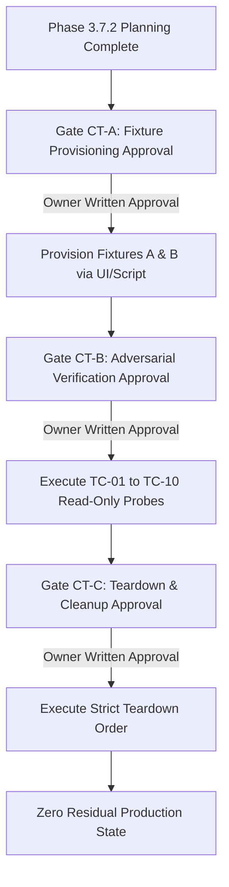

# Phase 3.7.2 — Report 08: Owner Authorization Matrix & Multi-Gate Approval Boundaries

**Project:** Parent Control App  
**Workspace:** `D:\parentcontrol_app`  
**Supabase Project:** `parent-control-prod` (`hhqgreaoqulmfwfwarhc`)  
**Target Function:** `account`  
**Execution Mode:** STRICTLY READ-ONLY / TEST PLANNING / SOURCE REVIEW  
**Audit Date:** 2026-11-20  

---

## 1. Executive Summary

This report establishes the explicit, formal **Owner Authorization Matrix** governing operational boundaries across historical, current, and future testing phases.

$$\mathbf{Operational\ Principle} = \mathbf{ALL\ FUTURE\ GATES\ DEFAULT\ TO\ PENDING\ -\ ZERO\ IMPLIED\ AUTHORIZATION}$$

Historical permissions granted in Phase 3.7 (such as the permission to create up to two synthetic users) were fully utilized and closed with the conclusion of Phase 3.7.1. They do **not** convey blanket or implied authorization for any future execution.

---

## 2. Activity Authorization Matrix

The table below demarcates authorized activities from prohibited and pending activities:

| Operational Activity | Phase 3.7 Historical Scope | Phase 3.7.2 Current Scope | Future Approval Gate Required | Current Execution Status |
|---|---|---|---|:---:|
| **Repository & Source Inspection** | Permitted | Permitted | Not Required | **AUTHORIZED & COMPLETED** |
| **Inspect Prior Reports & Telemetry** | Permitted | Permitted | Not Required | **AUTHORIZED & COMPLETED** |
| **Read-Only Dashboard Inspection** | Permitted under strict rules | Permitted if necessary | Not Required | **AUTHORIZED AS READ-ONLY** |
| **Run Offline Tests (`scope_test.ts`)** | Permitted | Permitted | Not Required | **AUTHORIZED (OFFLINE ONLY)** |
| **Provision Synthetic Parent Users (A/B)** | Authorized (max 2, utilized) | **PROHIBITED** | **Gate CT-A Approval Required** | **PENDING — LOCKED** |
| **Provision Synthetic Families (A/B)** | Authorized (1 family, utilized) | **PROHIBITED** | **Gate CT-A Approval Required** | **PENDING — LOCKED** |
| **Seed Populated Child-Data Rows** | Not authorized | **PROHIBITED** | **Gate CT-A Approval Required** | **PENDING — LOCKED** |
| **Invoke Endpoint with User A Token** | Authorized (utilized in 3.7) | **PROHIBITED** | **Gate CT-B Approval Required** | **PENDING — LOCKED** |
| **Invoke Endpoint with User B Token** | Not authorized | **PROHIBITED** | **Gate CT-B Approval Required** | **PENDING — LOCKED** |
| **Adversarial Body Parameter Injections** | Not authorized | **PROHIBITED** | **Gate CT-B Approval Required** | **PENDING — LOCKED** |
| **Execute Account Deletion (`delete`)** | Strictly prohibited | **PROHIBITED** | **Gate CT-C / Gate 3 Required** | **PENDING — LOCKED** |
| **Execute Retention Sweeper (`cleanup`)** | Strictly prohibited | **PROHIBITED** | **Gate 4 Approval Required** | **PENDING — LOCKED** |
| **Deploy or Modify Edge Functions** | Deployed in Phase 3.4.7 | **PROHIBITED** | Separate Release Approval | **LOCKED** |
| **Modify Database Schema / Migrations** | Prohibited | **PROHIBITED** | Separate DDL Approval | **LOCKED** |

---

## 3. Future Operational Approval Gates (CT-A, CT-B, CT-C)

To maintain absolute containment over production state, any future cross-tenant qualification must be unbundled into three distinct, non-overlapping approval gates:

### 3.1 Gate CT-A: Synthetic Fixture Provisioning
- **Scope:** Authorizes the creation of synthetic test fixtures for Tenant A and Tenant B.
- **Strict Caps:** Maximum 2 synthetic parent users, 2 synthetic child profiles, 2 families, 2 devices, and $\le 20$ child rows per family.
- **Mandatory Namespace:** Must strictly use `@internal-test.local`.
- **Pre-execution Status:** `PENDING — NO EXECUTION AUTHORIZED`.

### 3.2 Gate CT-B: Adversarial Cross-Tenant Verification
- **Scope:** Authorizes read-only invocations against `https://hhqgreaoqulmfwfwarhc.supabase.co/functions/v1/account`.
- **Permitted Actions:** `export` and `retention_report` ONLY.
- **Strict Caps:** Maximum 15 total HTTP invocations across TC-01 through TC-10.
- **Prohibitions:** Zero deletions, zero data mutations.
- **Pre-execution Status:** `PENDING — NO EXECUTION AUTHORIZED`.

### 3.3 Gate CT-C: Teardown & Cleanup
- **Scope:** Authorizes the clean, cascade deletion of strictly the provisioned synthetic test entities.
- **Targeting:** Requires an explicit UUID allowlist matching the correlation ID.
- **Protected Accounts:** Immediate abort if any protected account is targeted.
- **Pre-execution Status:** `PENDING — NO EXECUTION AUTHORIZED`.
