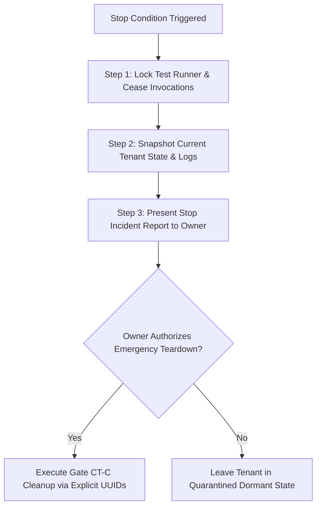

# Phase 3.7.2 — Report 09: Safety Guardrails, Stop Conditions & Rollback Plan

**Project:** Parent Control App  
**Workspace:** `D:\parentcontrol_app`  
**Supabase Project:** `parent-control-prod` (`hhqgreaoqulmfwfwarhc`)  
**Target Function:** `account`  
**Execution Mode:** STRICTLY READ-ONLY / TEST PLANNING / SOURCE REVIEW  
**Audit Date:** 2026-11-20  

---

## 1. Executive Summary

This report establishes the fail-safe operational guardrails, the **thirteen explicit stop-condition triggers**, and the emergency rollback and containment procedures governing any future cross-tenant qualification.

$$\mathbf{Safety\ Invariant} = \mathbf{IMMEDIATE\ HALT\ ON\ ANOMALY\ -\ ZERO\ AUTO-REPAIR\ -\ PRESERVE\ EVIDENCE}$$

If any anomalous state, unexpected record, or cross-tenant leakage is detected during execution, the test harness must immediately abort all operations without attempting automatic remediation or destructive repair.

---

## 2. Thirteen Inviolable Stop Conditions

Execution of any future test phase must terminate immediately upon encountering any of the following thirteen trigger conditions:

| Stop Trigger ID | Anomaly Condition | Technical Risk | Required Immediate Action |
|:---:|---|---|---|
| **SC-01** | **Project Ref Mismatch** (`project_ref != 'hhqgreaoqulmfwfwarhc'`) | Target environment contamination | Immediately terminate execution; zero requests sent. |
| **SC-02** | **Protected Account Detection** (Target email matches `spg7753@gmail.com`, `ankit@gmail.com`, `ankit1@gmail.com`) | Severe production disruption | Fatal abort; immediately quarantine process. |
| **SC-03** | **Non-Synthetic Test Identity** (Domain not ending in `@internal-test.local`) | Colliding with real customer identity | Abort; refuse to authenticate or request tokens. |
| **SC-04** | **Family Ownership Mismatch** (`owner_id` does not match test user UUID) | Tenant graph corruption | Abort provisioning or verification immediately. |
| **SC-05** | **Ambiguous Membership Status** (`status != 'active'`) | Unpredictable RLS / filter behavior | Halt test run; inspect membership state. |
| **SC-06** | **Unbounded Query Path** (Query executed without explicit `.in()` or `.eq()`) | Production database data dump | Terminate function invocation; report code flaw. |
| **SC-07** | **Cross-Tenant Data Exposure** (`TENANT_B_ONLY` observed in Tenant A payload) | **Critical Tenant Isolation Breach** | **HALT IMMEDIATELY. Preserve payload evidence.** |
| **SC-08** | **Unexpected Database Mutation** (Write observed during read-only export/report) | Unintended production state change | Abort test sequence; initiate audit inspection. |
| **SC-09** | **Unexpected Endpoint Write** (HTTP 200 on prohibited action like `delete`) | Safety gate bypass | Abort; inspect Edge Function routing. |
| **SC-10** | **Real Personal Data Observed** (Real GPS, real names in test responses) | Privacy breach | Abort; redact output; report security incident. |
| **SC-11** | **Incomplete Correlation Tagging** (Missing correlation ID in metadata) | Untraceable database records | Pause provisioning; refuse to proceed to Gate CT-B. |
| **SC-12** | **Ambiguous Cleanup Targeting** (Teardown query lacking explicit UUIDs) | Accidental deletion of production rows | Fatal abort; refuse to execute DELETE statement. |
| **SC-13** | **Dashboard Verification Unavailable** (Browser session lost or unverified) | Loss of ground truth visual audit | Pause execution until session is re-established. |

---

## 3. Immediate Action Procedure on Stop Trigger

When a stop condition is triggered:
1. **Halt Execution Immediately:** Stop all HTTP requests, database transactions, and script execution instantly.
2. **Zero Automatic Repair:** Never attempt automated remediation, retry scripts, or compensatory writes. Automated repair in a corrupted state can exacerbate data contamination.
3. **Quarantine State:** Preserve the in-memory test runner log, HTTP response payloads, and database snapshot.
4. **Notify Project Owner:** Generate an immediate security incident summary detailing the exact trigger ID, timestamp, target entity, and observed response.

---

## 4. Rollback & Emergency Teardown Plan

If execution is aborted mid-flight (e.g. after Gate CT-A provisioning but before Gate CT-B completion), the following rollback procedure must be executed under explicit owner direction:

1. **Step 1: Lock & Preserve:** Mark all test identities dormant in GoTrue.
2. **Step 2: Explicit Target Compilation:** Query and record the exact UUIDs of only the created test entities (`profiles.id`, `families.id`, `family_members.id`, `devices.id`).
3. **Step 3: Verification Against Denylist:** Assert that zero protected accounts appear in the rollback target set.
4. **Step 4: Cascade Deletion in Dependency Order:** Delete child data $\to$ devices $\to$ family members $\to$ families $\to$ profiles $\to$ Auth users.
