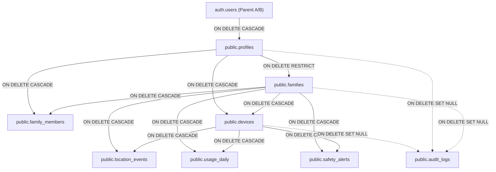

# Phase 3.7.3 — Report 08: Fixture Dependency Graph & Cleanup Safety Preflight

**Project:** Parent Control App  
**Workspace:** `D:\parentcontrol_app`  
**Production Supabase Project:** `parent-control-prod` (`hhqgreaoqulmfwfwarhc`)  
**Target Function:** `account`  
**Execution Mode:** STRICTLY READ-ONLY / STAGING QUALIFICATION / OFFLINE PREFLIGHT  
**Audit Date:** 2026-11-20  

---

## 1. Executive Summary

This report analyzes the relational dependency graph of all synthetic fixture entities, verifies PostgreSQL cascade delete behaviors, confirms the schema viability of JSONB audit metadata stamping, and establishes the reverse-dependency cleanup sequence.

$$\mathbf{Cleanup\ Safety\ Status} = \mathbf{FAIL-CLOSED\ ORDER\ ESTABLISHED\ -\ METADATA\ SUPPORT\ VERIFIED}$$

---

## 2. Relational Foreign-Key Graph & Delete Behaviors



### 2.1 Critical Dependency Analysis:
1. **Child Data Tables (`CASCADE`):**
   `location_events`, `usage_daily`, `safety_alerts`, and `devices` have `ON DELETE CASCADE` foreign keys referencing `families` and `devices`. Deleting a parent family or device cleanly cascades down to these records.
2. **Family Ownership (`RESTRICT`):**
   `families.owner_id` references `profiles.id` with default `ON DELETE RESTRICT`. A profile cannot be deleted while it still owns a family row. Therefore, families must be deleted **before** user profiles.
3. **Audit Log Decoupling (`SET NULL`):**
   `audit_logs.family_id`, `actor_user_id`, and `device_id` all utilize `ON DELETE SET NULL`. If parent records are deleted first, audit logs will be orphaned with `NULL` foreign keys, rendering them untraceable.

---

## 3. Schema Verification of Audit Log Metadata Stamping

Phase 3.7.2 proposed stamping `"correlation_id": "<run_id>"` inside `audit_logs.metadata`.

### Schema Verification in `20260101000000_core.sql` L310-335:
```sql
create table public.audit_logs (
  id uuid primary key default gen_random_uuid(),
  family_id uuid references public.families (id) on delete set null,
  actor_user_id uuid references public.profiles (id) on delete set null,
  device_id uuid references public.devices (id) on delete set null,
  event_type text not null check (char_length(event_type) between 1 and 80),
  target_type text check (target_type is null or char_length(target_type) <= 40),
  target_id text check (target_id is null or char_length(target_id) <= 128),
  metadata jsonb not null default '{}'::jsonb
    check (jsonb_typeof(metadata) = 'object'),
  created_at timestamptz not null default now()
);
```

**Verification Finding:**
- **Fully Supported:** The column `metadata` is a native PostgreSQL `jsonb` type with constraint `jsonb_typeof(metadata) = 'object'`.
- **Orphan Survival:** Stamping `{"correlation_id": "<run_id>"}` into `metadata` is 100% schema-valid. When `family_id` or `actor_user_id` become `NULL`, the JSONB metadata remains completely intact and indexed.
- **Teardown Precondition:** This eliminates the untraceable orphan risk and satisfies the prerequisite for Gate CT-C approval.

---

## 4. Strict Reverse-Dependency Cleanup Sequence (Gate CT-C)

To guarantee that no orphan rows, broken constraints, or dangling records ever remain in the database, cleanup must be executed strictly in this reverse order:

| Step | Target Table | Deletion Filter / Scope | Justification & Safeguard |
|:---:|---|---|---|
| **1** | `public.audit_logs` | `WHERE metadata->>'correlation_id' = '<run_id>'` | Must be deleted **first** while foreign keys are intact. |
| **2** | `public.location_events` | `WHERE family_id IN (<Allowed_Family_UUIDs>)` | Direct child-row cleanup. |
| **3** | `public.usage_daily` | `WHERE family_id IN (<Allowed_Family_UUIDs>)` | Direct child-row cleanup. |
| **4** | `public.safety_alerts` | `WHERE family_id IN (<Allowed_Family_UUIDs>)` | Direct child-row cleanup. |
| **5** | `public.devices` | `WHERE family_id IN (<Allowed_Family_UUIDs>)` | Device rows removed. |
| **6** | `public.family_members` | `WHERE family_id IN (<Allowed_Family_UUIDs>)` | Membership links removed. |
| **7** | `public.families` | `WHERE id IN (<Allowed_Family_UUIDs>)` | Removes family entity; unlocks profile deletion. |
| **8** | `public.profiles` & `auth.users` | `WHERE id IN (<Allowed_User_UUIDs>)` | Auth user deletion cascades to profile. |

**Safeguard:** Every delete query must take explicit UUID sets. Zero wildcards or pattern deletes (`LIKE '%test%'`) are permitted.
