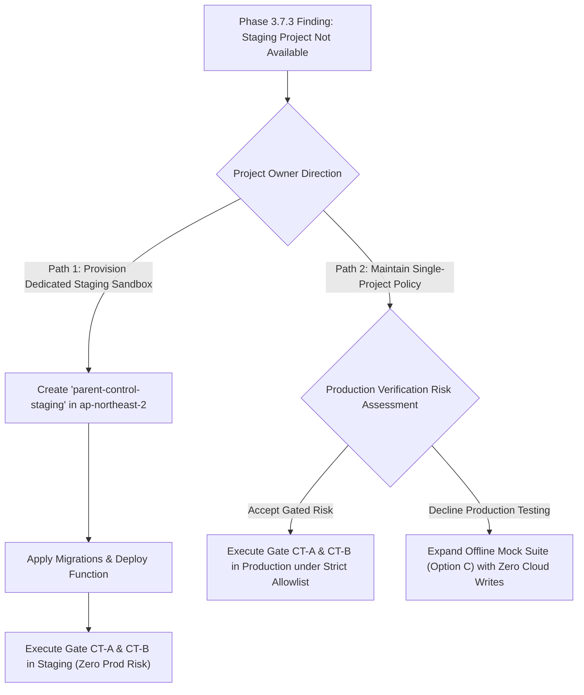

# Phase 3.7.3 — Report 10: Staging Architecture Decision & Environment Roadmap

**Project:** Parent Control App  
**Workspace:** `D:\parentcontrol_app`  
**Production Supabase Project:** `parent-control-prod` (`hhqgreaoqulmfwfwarhc`)  
**Target Function:** `account`  
**Execution Mode:** STRICTLY READ-ONLY / STAGING QUALIFICATION / OFFLINE PREFLIGHT  
**Audit Date:** 2026-11-20  

---

## 1. Executive Summary

This report delivers the architectural decision analysis comparing the three test environments (Production vs. Staging vs. Offline) in light of the empirical finding that **no separate Supabase staging project currently exists**.

$$\mathbf{Architectural\ Recommendation} = \mathbf{TIERED\ DECISION:\ PROVISION\ STAGING\ PROJECT\ OR\ REMAIN\ STRICTLY\ GATED}$$

---

## 2. In-Depth Environment Trade-Off Analysis

| Architectural Dimension | Option A: Production (`parent-control-prod`) | Option B: Dedicated Staging Project | Option C: Local / Offline Deno Harness |
|---|---|---|---|
| **Availability Today** | **Available immediately** (`hhqgreaoqulmfwfwarhc`) | **UNAVAILABLE** (Must be created by owner) | **Available immediately** (45/45 tests passing) |
| **Blast Radius & Production Risk** | **High** (Runs in production database) | **Zero** (Isolated infrastructure sandbox) | **Zero** (Local memory only) |
| **Service-Role Query Parity** | **100% Exact** (Live PostgreSQL `BYPASSRLS`) | **100% Exact** (Identical cloud engine) | **Partial** (Logic pure; mock PostgREST) |
| **Edge Function Gateway Parity** | **100% Exact** (Live Deno Deploy in Seoul) | **100% Exact** (Live Deno Deploy in Seoul) | **Simulated** (`deno test` runner) |
| **Setup & Operational Burden** | Low (Environment already online) | Medium (Owner creates project, pushes migrations) | Low (Zero cloud setup required) |
| **Owner Approval Requirement** | **Extremely Strict** (Gate CT-A, CT-B, CT-C) | Standard (Authorize disposable sandbox) | None (Offline development) |
| **Historical Owner Directive** | Owner directed 2026-10-27: *"no second project"* | Requires owner to revise historical directive | 100% compliant with historical directive |

---

## 3. Decision Pathways for the Project Owner

### Pathway 1: Provision Dedicated Staging Sandbox (Recommended Best Practice)
- **Action:** The owner creates a new free-tier Supabase project (e.g. `parent-control-staging`) in `ap-northeast-2`.
- **Justification:** Eliminates all operational risk to `parent-control-prod`, protects existing baseline families, and allows unrestricted adversarial and destructive qualification testing.
- **Effort:** ~10 minutes to provision and push repository migrations via `supabase db push`.

### Pathway 2: Reaffirm Single-Project Policy (Historical Baseline)
- If the owner upholds the 2026-10-27 directive that no second project be created:
  - **Sub-option 2A (Production Qualification):** Requires explicit owner sign-off on the Phase 3.7.2 Multi-Gate Authorization Contract (Gate CT-A, CT-B, CT-C).
  - **Sub-option 2B (Offline Verification Only):** Expand the offline Deno mock test suite to simulate PostgREST range calls without touching any cloud services.
