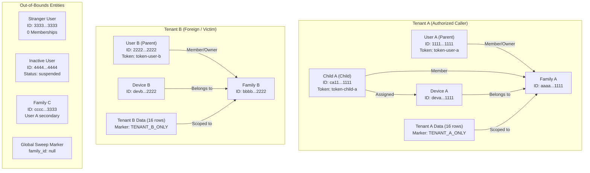

# Phase 3.7.4 — Report 04: Two-Tenant Fixture Architecture & Separation

**Project:** Parent Control App  
**Workspace:** `D:\parentcontrol_app`  
**Target Function:** `account` Edge Function  
**Execution Mode:** STRICTLY LOCAL / OFFLINE  
**Audit Date:** 2026-11-20  

---

## 1. Executive Summary

To enable rigorous adversarial testing without connecting to live cloud databases, Phase 3.7.4 implements a comprehensive in-memory two-tenant fixture within `supabase/functions/account/cross_tenant_isolation_test.ts`.

This report documents the architectural design, cryptographic separation, and foreign key relationships of the synthetic two-tenant test environment.

---

## 2. Synthetic Entity Identity Matrix

---

## 3. Structural Isolation Guarantees

### 3.1 ID Disjointness
All UUIDs are deterministically assigned with non-overlapping patterns:
- Tenant A entities use suffix `...1111` and prefix `aaaa...` or `deva...`.
- Tenant B entities use suffix `...2222` and prefix `bbbb...` or `devb...`.
- Stranger and Inactive entities use suffix `...3333` and `...4444`.

### 3.2 Data Stamping
Every row in `location_events`, `usage_daily`, `safety_alerts`, and `audit_logs` carries an explicit `marker` field:
- Tenant A records: `marker: "TENANT_A_ONLY"`
- Tenant B records: `marker: "TENANT_B_ONLY"`
- Global retention sweep record: `marker: "GLOBAL_SWEEP"`

Any leakage of a `TENANT_B_ONLY` row into a Tenant A request immediately triggers an assertion failure.

---

## 4. Token & Authentication Decoupling

`FakePostgrest` associates bearer tokens with discrete auth identity objects via `fake.setTokenUser`:
- `TOKEN_USER_A` $\implies$ `{ id: USER_A_ID, email: USER_A_EMAIL }`
- `TOKEN_USER_B` $\implies$ `{ id: USER_B_ID, email: USER_B_EMAIL }`
- `TOKEN_CHILD_A` $\implies$ `{ id: CHILD_A_ID, email: CHILD_A_EMAIL }`
- `TOKEN_STRANGER` $\implies$ `{ id: STRANGER_ID, email: STRANGER_EMAIL }`
- `TOKEN_INACTIVE` $\implies$ `{ id: INACTIVE_USER_ID, email: INACTIVE_USER_EMAIL }`

This guarantees that each test scenario can invoke `handleAccountRequest(req, { db: fake.asClient() })` with true caller separation, matching production JWT validation semantics.
