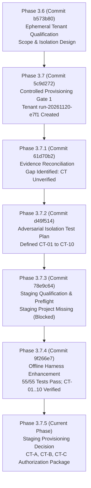

# Phase 3.7.5 — Report 01: Git Baseline & Prior Phase Evidence Audit

**Project:** Parent Control App  
**Workspace:** `D:\parentcontrol_app`  
**Production Supabase Project:** `parent-control-prod`  
**Production Project Ref:** `hhqgreaoqulmfwfwarhc`  
**Organization ID:** `symqztrmaziuwdibcfrq` (`spg7753@gmail.com's Org`)  
**Production Region:** `ap-northeast-2` (Seoul / Northeast Asia)  
**Target Function:** `account`  
**Production Endpoint:** `https://hhqgreaoqulmfwfwarhc.supabase.co/functions/v1/account`  

**Phase 3.6 Baseline Commit:** `b573b80`  
**Phase 3.7 Commit:** `5c9d272`  
**Phase 3.7.1 Commit:** `61d70b2`  
**Phase 3.7.2 Commit:** `d49f514`  
**Phase 3.7.3 Commit:** `78e9c64`  
**Phase 3.7.4 Commit:** `9f266e7269698b264baff30396dfec14b7f758e4`  

**Existing Production Synthetic Tenant:** `run-20261120-e7f1` (Dormant, preserved untouched)  
**Protected Operational Identities:** `spg7753@gmail.com`, `ankit@gmail.com`, `ankit1@gmail.com`  
**Execution Mode:** OWNER DECISION / AUTHORIZATION PREPARATION / READ-ONLY  
**Current Authorization Status:** `NOT AUTHORIZED` (Zero cloud or staging mutations permitted)  
**Audit Date:** 2026-11-20  

---

## 1. Executive Summary

This report establishes the verified Git baseline, audits the lineage of prior verification phases (Phases 3.6 through 3.7.4), and confirms that the workspace working tree is pristine before preparing the Phase 3.7.5 staging environment decision package.

Phase 3.7.4 concluded with commit `9f266e7`, establishing that the offline test harness successfully executed all 10 adversarial cross-tenant isolation scenarios (**CT-01 through CT-10**) across 55 passing unit tests. Phase 3.7.5 builds upon this offline verification by presenting an explicit, auditable owner decision package to determine whether to create a dedicated Supabase staging project (`parent-control-staging`) for live cloud verification.

---

## 2. Git Repository & Working Tree Status

The repository state was verified directly via Git commands at the beginning of Phase 3.7.5:

| Property | Verified Value | Evidence Classification | Status |
|---|---|---|:---:|
| **Working Directory** | `D:\parentcontrol_app` | `SOURCE VERIFIED` | Confirmed |
| **Active Branch** | `main` | `SOURCE VERIFIED` | Confirmed |
| **Exact HEAD Commit** | `9f266e7269698b264baff30396dfec14b7f758e4` | `SOURCE VERIFIED` | Confirmed |
| **HEAD Commit Message** | `test: strengthen offline cross-tenant isolation coverage` | `SOURCE VERIFIED` | Confirmed |
| **Working Tree State** | Pristine (0 modified, 0 staged, 0 untracked files) | `SOURCE VERIFIED` | Clean |

---

## 3. Prior Phase Evidence Lineage

| Phase | Commit | Scope & Key Finding | Evidence State |
|---|---|---|:---:|
| **Phase 3.6** | `b573b80` | Designed ephemeral tenant qualification and strict isolation boundaries. | `REPORTED` |
| **Phase 3.7** | `5c9d272` | Executed Gate 1 provisioning of production synthetic tenant `run-20261120-e7f1`. | `DASHBOARD VERIFIED` |
| **Phase 3.7.1** | `61d70b2` | Reconciled evidence; identified remaining gap: live cross-tenant testing had not occurred. | `REPORTED` |
| **Phase 3.7.2** | `d49f514` | Formally specified adversarial test scenarios CT-01 through CT-10 and authorization gates. | `SOURCE VERIFIED` |
| **Phase 3.7.3** | `78e9c64` | Evaluated staging feasibility; concluded `parent-control-staging` does not exist (`BLOCKED`). | `REPORTED` |
| **Phase 3.7.4** | `9f266e7` | Enhanced `FakePostgrest` mock and verified CT-01 through CT-10 offline (55 tests passing). | `OFFLINE TEST VERIFIED` |
| **Phase 3.7.5** | *Current* | Owner decision package for staging project creation & independently gated authorization. | `PROPOSED` |

---

## 4. Protected Assets & Operating Boundaries

Throughout Phase 3.7.5, strict protective guardrails are maintained:
1. **Production Project Untouched:** Project `parent-control-prod` (`hhqgreaoqulmfwfwarhc`) remains strictly read-only.
2. **Existing Synthetic Tenant Untouched:** Production tenant `run-20261120-e7f1` remains dormant and unaltered.
3. **Operational Accounts Untouched:** `spg7753@gmail.com`, `ankit@gmail.com`, and `ankit1@gmail.com` are strictly excluded from any test or provisioning scope.
4. **No Automated Cloud Actions:** Zero Supabase cloud resources (projects, users, databases, functions, secrets) may be created or modified during this phase.
