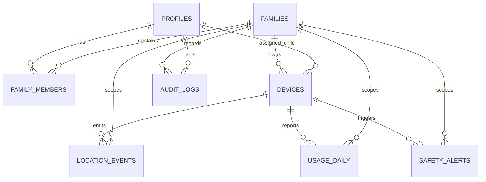

# Phase 3.7.5 — Report 05: Schema, Auth & Edge Function Parity Requirements

**Project:** Parent Control App  
**Workspace:** `D:\parentcontrol_app`  
**Execution Mode:** SPECIFICATION / AUDIT REQUIREMENTS / READ-ONLY  
**Audit Date:** 2026-11-20  

---

## 1. Executive Summary

A staging environment is only valid for cross-tenant isolation testing if it establishes strict structural and behavioral parity with production. Applying migration files locally does not prove staging deployment; every schema entity, Auth setting, and Edge Function component must be audited after deployment.

This report establishes the complete pre-flight checklist for Database Schema, Row-Level Security, Grants, Supabase Auth, and Edge Function runtime configuration.

---

## 2. Database Schema Parity Requirements

The 8 core application tables must be deployed in staging with complete structural parity against repository migrations (`supabase/migrations/`):

### Table-by-Table Structural Checklist

| Table | Required Columns & Constraints | Parity Verification Check | Status |
|---|---|---|:---:|
| `profiles` | `id (PK, FK auth.users)`, `role (CHECK in 'unset','parent','child')`, `display_name`, `created_at`, `updated_at` | Primary key linked to GoTrue user; role enum constraint | `PROPOSED` |
| `families` | `id (PK UUID)`, `name`, `owner_id (FK profiles)`, `settings (JSONB)`, `created_at`, `deleted_at` | Soft-delete column; JSONB settings default | `PROPOSED` |
| `family_members` | `id (PK)`, `family_id (FK)`, `user_id (FK)`, `role`, `status (CHECK 'active','suspended','left')` | Unique `(family_id, user_id)`; cascade delete | `PROPOSED` |
| `devices` | `id (PK)`, `family_id (FK)`, `child_user_id (FK)`, `secret_hash`, `status`, `policy_version` | Device-family foreign key; child assignment FK | `PROPOSED` |
| `location_events` | `id (PK)`, `family_id (FK)`, `device_id (FK)`, `recorded_at (TIMESTAMPTZ)`, `lat`, `lon` | Indexed on `family_id`, `device_id`, `recorded_at` | `PROPOSED` |
| `usage_daily` | `id (PK)`, `family_id (FK)`, `device_id (FK)`, `day (DATE)`, `package_name`, `screen_time_seconds` | Unique `(device_id, day, package_name)`; indexed | `PROPOSED` |
| `safety_alerts` | `id (PK)`, `family_id (FK)`, `device_id (FK)`, `alert_type`, `severity`, `created_at` | Foreign keys to family and device; severity enum | `PROPOSED` |
| `audit_logs` | `id (PK)`, `family_id (nullable FK)`, `actor_user_id (nullable FK)`, `event_type`, `created_at` | Nullable `family_id` for global sweeps; indexed | `PROPOSED` |

### RLS, Policies & Database Grants
- **RLS Enabled:** Every one of the 8 tables must have Row-Level Security enabled (`ALTER TABLE ... ENABLE ROW LEVEL SECURITY`).
- **Service-Role Grants:** `service_role` must have `ALL` grants to permit administrative queries.
- **Trigger Integrity:** The `on_auth_user_created` trigger must automatically populate a corresponding row in `public.profiles` upon user registration in GoTrue.

---

## 3. Supabase Auth Configuration Parity

The staging Supabase project must be configured with exact Auth parity:

| Auth Configuration | Target Staging Setting | Verification Check | Status |
|---|---|---|:---:|
| **Provider** | Email / Password enabled | Phone/OAuth disabled | `PROPOSED` |
| **Email Confirmation** | Auto-confirm enabled (or manual admin confirm) | Synthetic `@internal-test.local` users must be verified | `PROPOSED` |
| **Synthetic Acceptance** | Unrestricted domain registration | Allows `@internal-test.local` namespace | `PROPOSED` |
| **JWT Expiration** | 3600 seconds default | Tokens remain valid during test run | `PROPOSED` |
| **Profile Creation** | Automated trigger on `auth.users` | Creates profile with `role: 'parent'` or `'child'` | `PROPOSED` |
| **Active Membership** | Handled in `public.family_members` | Status must default to `'active'` | `PROPOSED` |

---

## 4. Edge Function Deployment & Runtime Parity

The staging `account` Edge Function package must be identical to the production package verified in Phase 3.4.7:

1. **Package Files:** Must include all 9 flat-bundle files:
   - `index.ts` (Entrypoint router)
   - `deletion.ts` (Deletion, export, retention handlers)
   - `retention.ts` (Retention calculations & scope rules)
   - `validation.ts` (Input validation)
   - `shared-auth.ts`, `shared-audit.ts`, `shared-cors.ts`, `shared-crypto.ts`, `shared-envelope.ts`
2. **Environment Variables:**
   - `SUPABASE_URL`: Pointing exclusively to the new staging project URL.
   - `SUPABASE_SERVICE_ROLE_KEY`: Staging service-role key only.
3. **Deployment Verification:**
   - SHA-256 source hash comparison against local flat package.
   - CORS preflight (`OPTIONS`) test response `200 OK`.
   - Healthcheck `/account` ping without authorization returns `401 Unauthorized`.
