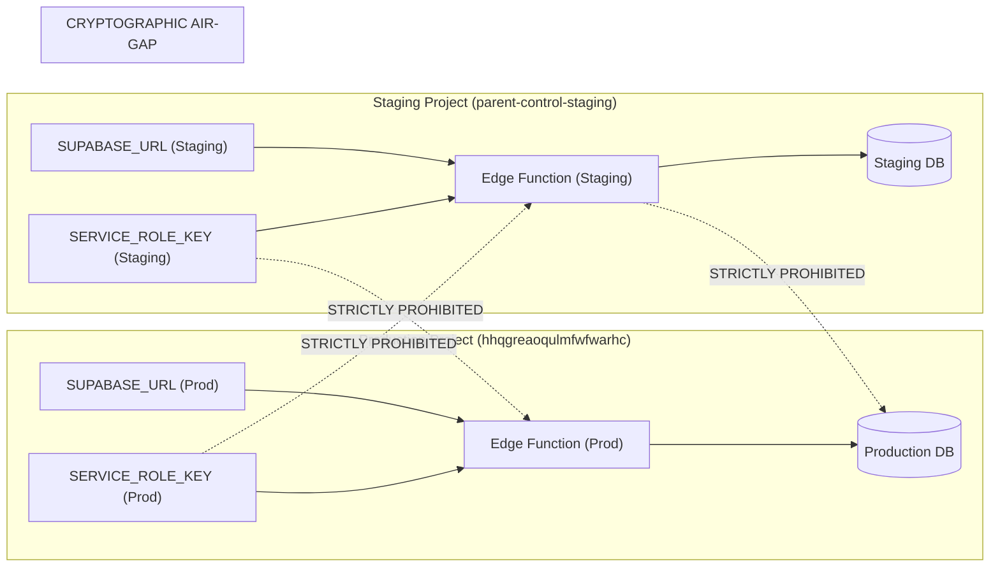

# Phase 3.7.5 — Report 06: Secret & Environment Isolation Requirements

**Project:** Parent Control App  
**Workspace:** `D:\parentcontrol_app`  
**Execution Mode:** SECURITY & CREDENTIAL SAFEGUARDS / READ-ONLY  
**Audit Date:** 2026-11-20  

---

## 1. Executive Summary

A core vulnerability in staging environments is accidental credential mixing or silent fallback to production databases. If a staging Edge Function or test script contains a production API key or references `hhqgreaoqulmfwfwarhc.supabase.co`, test operations could mutate production data.

This report establishes the mandatory cryptographic and operational boundaries that prevent credential contamination, secret exposure, and silent fallback.

---

## 2. Mandatory Secret Isolation Boundaries



---

## 3. Credential Segregation Checklist

| Boundary Item | Isolation Requirement | Verification Rule | Status |
|---|---|---|:---:|
| **Project URL** | Distinct 20-character staging domain | Must NOT match `hhqgreaoqulmfwfwarhc.supabase.co` | `PROPOSED` |
| **Publishable / Anon Key** | Unique staging JWT signed by staging secret | Different signature and header claims | `PROPOSED` |
| **Service-Role Secret** | Unique staging administrative key | Must have zero database access to production | `PROPOSED` |
| **Database Password** | Generated independently in Dashboard | Never reused from production | `PROPOSED` |
| **Production Secret Copying** | **STRICTLY PROHIBITED** | No production keys imported into staging | `PROPOSED` |
| **Git Credential Commit** | **STRICTLY PROHIBITED** | Zero secrets stored in repository files | `PROPOSED` |

---

## 4. Silent Production Fallback Prevention

To guarantee that staging never silently connects to production:
1. **Endpoint Assertion:** Every test script or curl command must assert that the target URL matches the staging reference and rejects `hhqgreaoqulmfwfwarhc`:
   ```bash
   if [[ "$TARGET_URL" == *"hhqgreaoqulmfwfwarhc"* ]]; then
     echo "CRITICAL SECURITY FAULT: Production URL detected in staging test!"
     exit 1
   fi
   ```
2. **Key Signature Verification:** Staging JWT tokens must be verified to fail authentication against the production endpoint (returning `401 Unauthorized`), proving cryptographic key separation.
3. **No Default Fallbacks:** Environment variables in Edge Functions must fail immediately if `SUPABASE_URL` or `SUPABASE_SERVICE_ROLE_KEY` is missing, rather than falling back to hardcoded defaults.

---

## 5. Information Security & Redaction Policy

In accordance with strict repository security guidelines:
- **Zero Key Exposure:** No actual JWT secrets, service-role keys, anon keys, or database passwords shall ever be written to documentation, commit logs, artifacts, or chat responses.
- **Redacted Format:** Keys shall be referenced only by their cryptographic role (e.g., `<STAGING_SERVICE_ROLE_KEY>`) or short masked hashes.
