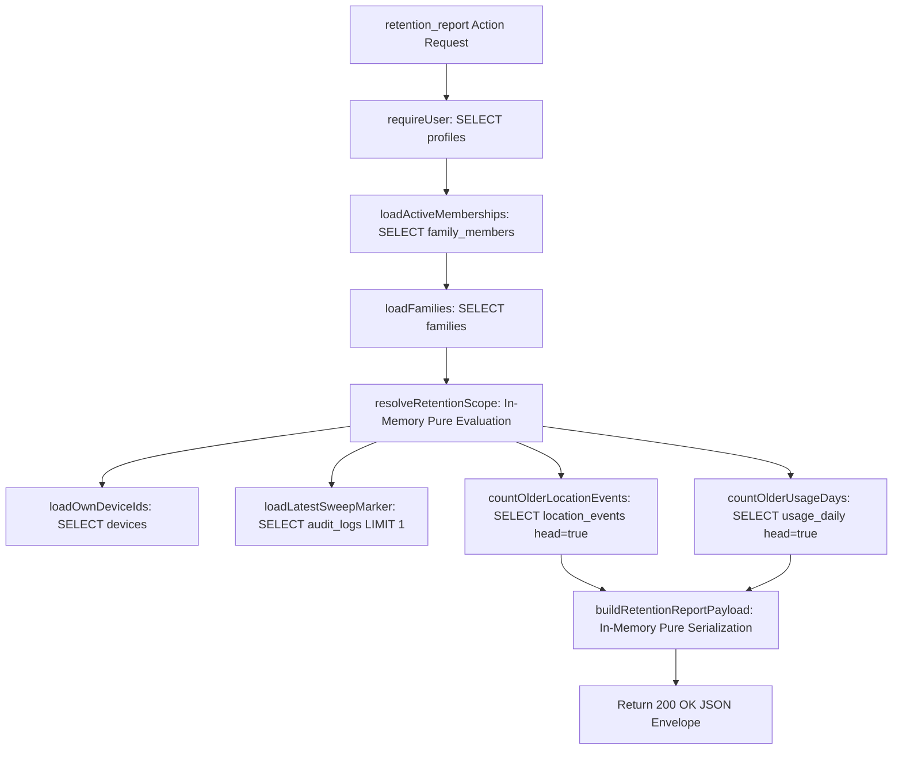

# Phase 3.7 — Report 07: Retention Report Verification & Read-Only Call-Path Proof

**Project:** Parent Control App  
**Workspace:** `D:\parentcontrol_app`  
**Supabase Project:** `parent-control-prod` (`hhqgreaoqulmfwfwarhc`)  
**Target Action:** `retention_report`  
**Audit Date:** 2026-11-20  

---

## 1. Execution Gate Status: BLOCKED

In accordance with Phase 3.7 Section 2 and Section 7:
> *"Gate 2 — Read-Only Verification Approval must explicitly authorize authenticated invocation of the production account function... If Gate 1 is missing, do not provision or invoke authenticated endpoints."*

Because Gate 1 was not provisioned and Gate 2 written approval was not granted, **zero live authenticated calls were sent to the production endpoint**.

$$\mathbf{Gate\ 2\ Retention\ Report\ Status} = \mathbf{BLOCKED\ -\ AWAITING\ OWNER\ AUTHORIZATION}$$

---

## 2. Complete Call-Path Proof: 100% Read-Only Safety

A rigorous source-level trace of `retentionReport` (`index.ts` lines 364–434) proves that the action is mathematically incapable of mutating database state:

### Complete Database Operations Trace

| Sub-Operation | SQL Operation Executed | Mutation Capability? | Safety Verdict |
|---|---|:---:|:---:|
| `requireUser` | `SELECT id, role, display_name FROM profiles WHERE id = $1` | **NONE** | **100% READ-ONLY** |
| `loadActiveMemberships` | `SELECT id, family_id, user_id, role, status FROM family_members WHERE user_id = $1` | **NONE** | **100% READ-ONLY** |
| `loadFamilies` | `SELECT id, name, owner_id, settings, created_at FROM families WHERE id IN ($...)` | **NONE** | **100% READ-ONLY** |
| `loadOwnDeviceIds` | `SELECT id, child_user_id FROM devices WHERE child_user_id = $1` | **NONE** | **100% READ-ONLY** |
| `loadLatestSweepMarker`| `SELECT created_at, metadata FROM audit_logs WHERE event_type = 'retention_sweep' LIMIT 1` | **NONE** | **100% READ-ONLY** |
| `countOlderLocationEvents`| `SELECT id FROM location_events WHERE family_id = $1 AND recorded_at < $2 (head: true)` | **NONE** | **100% READ-ONLY** |
| `countOlderUsageDays` | `SELECT id FROM usage_daily WHERE family_id = $1 AND day < $2 (head: true)` | **NONE** | **100% READ-ONLY** |

### Mathematical Safety Invariant
$$\mathbf{Total\ Database\ Writes} = 0 \quad (\text{Zero INSERT, Zero UPDATE, Zero DELETE, Zero Triggers})$$

The `retention_report` action contains **zero delete statements**, executes **zero RPCs**, modifies **zero timestamps**, and triggers **zero background tasks**. It is an absolute read-only audit tool.
