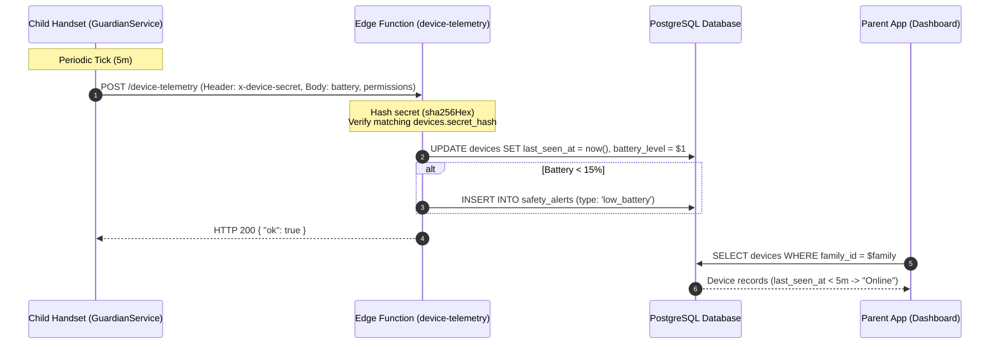
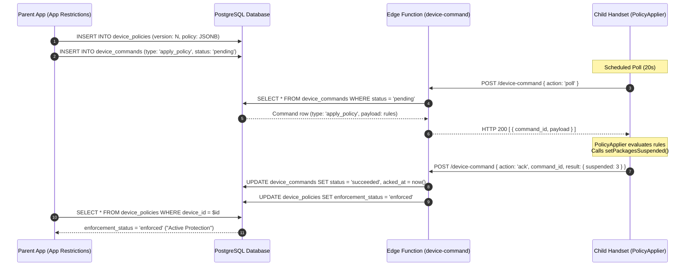
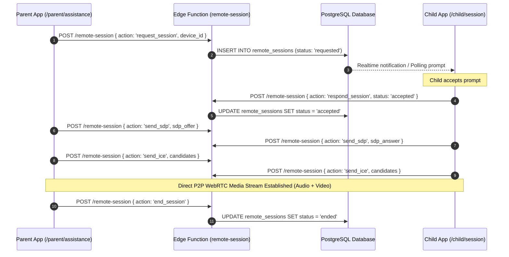

# 06 — Backend and Data Flow Inventory

**Document ID:** `HAVEN-INV-006`  
**Phase:** Pre-Testing Functional Audit  
**Workspace:** `D:\parentcontrol_app`  
**Baseline HEAD:** `0101c16d161824fd726018f1188e1a2b17c653d3`  
**Scope:** Supabase Backend, PostgreSQL Schema, Edge Functions & Telemetry Flows  

---

## 1. Executive Summary

This document provides a complete audit of the backend architecture, relational database tables, Supabase Edge Functions, Row-Level Security (RLS) policies, and distributed data flows supporting the HAVEN Parent Control platform. 

It maps every backend-dependent feature from the master inventory to its corresponding serverless endpoint, database table, RPC function, and ingress/egress sequence.

---

## 2. Supabase Edge Functions Inventory (9 Microservices)

All serverless functions are implemented in TypeScript under `supabase/functions/` and run on the Deno Deploy runtime:

| Function Name | Ingress Path | Authentication Required | Handled Actions & Operations | Core Relational Tables Mutated | Source Code Reference |
|---|---|---|---|---|---|
| **`auth-bootstrap`** | `POST /auth-bootstrap` | Supabase User JWT | `bootstrap_user`, `set_role`, `create_family` | `profiles`, `families`, `family_members` | `supabase/functions/auth-bootstrap/index.ts:35-110` |
| **`family-admin`** | `POST /family-admin` | Parent Bearer JWT | `revoke_device`, `ack_alert`, `create_safe_zone`, `delete_safe_zone`, `update_retention`, `purge_data` | `devices`, `safety_alerts`, `safe_zones`, `audit_logs` | `supabase/functions/family-admin/index.ts:40-360` |
| **`pairing`** | `POST /pairing` | Parent or Child JWT | `create_invite`, `redeem_invite`, `get_contact_id`, `list_requests`, `respond_request`, `unlink_child` | `pairing_requests`, `child_contact_ids`, `family_members` | `supabase/functions/pairing/index.ts:50-980` |
| **`device-register`** | `POST /device-register` | Child Bearer JWT | `register_device`, `verify_credentials`, `redeem_recredential_challenge` (Wave 3) | `devices`, `device_credentials` | `supabase/functions/device-register/index.ts:30-180` |
| **`device-telemetry`**| `POST /device-telemetry` | `x-device-id`, `x-device-secret` | `heartbeat`, `battery`, `permissions`, `apps_upload`, `location_upload`, `usage_upload` | `devices`, `device_apps`, `location_events`, `usage_daily`, `safety_alerts` | `supabase/functions/device-telemetry/index.ts:60-410` |
| **`device-command`**  | `POST /device-command` | `x-device-id`, `x-device-secret` | `poll_commands`, `ack_command`, `command_result` | `device_commands`, `device_policies` | `supabase/functions/device-command/index.ts:45-220` |
| **`remote-session`**  | `POST /remote-session` | Parent or Child JWT | `request_session`, `respond_session`, `send_sdp`, `send_ice`, `end_session` | `remote_sessions` | `supabase/functions/remote-session/index.ts:50-380` |
| **`account`**         | `POST /account` | Authenticated JWT | `export_data`, `delete_account` | Cascades across all user rows; calls `auth.admin.deleteUser` | `supabase/functions/account/index.ts:40-190` |
| **`cron`**            | `POST /cron` | Supabase Service Role Key | `detect_offline_devices`, `sweep_abandoned_sessions`, `retention_cleanup` | `devices`, `safety_alerts`, `remote_sessions`, `audit_logs` | `supabase/functions/cron/index.ts:25-110` |

---

## 3. Relational Database Schema Inventory (15 Core Tables)

The database schema is defined across migrations in `supabase/migrations/` (`20260101000000_core.sql` through `zone_delete_atomic_rpc.sql`):

| Table Name | Primary Key | Key Columns & Constraints | Purpose & Architectural Ownership | RLS Protection Policy |
|---|---|---|---|---|
| **`profiles`** | `id` (UUID) | `email`, `display_name`, `role in ('parent', 'child')` | User profile data bound to Supabase `auth.users` | Users can read/update their own profile |
| **`families`** | `id` (UUID) | `name`, `owner_user_id` (Parent FK) | Administrative family umbrella entity | Family members can read; owner can update |
| **`family_members`** | `(family_id, user_id)` | `role in ('parent', 'child')`, `status in ('active', 'invited')` | Membership association linking parents and children | Members can view co-members; parent can manage |
| **`child_contact_ids`**| `id` (UUID) | `child_user_id`, `contact_code` (6-char Base32 unique) | Dynamic linking codes used for pairing QR / text | Child can read own code; parent can query to link |
| **`pairing_requests`**| `id` (UUID) | `family_id`, `child_user_id`, `parent_user_id`, `status in ('pending', 'accepted', 'declined', 'cancelled')` | Asynchronous parent-child pairing invitations | Parent and child involved in invitation can access |
| **`devices`** | `id` (UUID) | `family_id`, `child_user_id`, `installation_id`, `secret_hash`, `status in ('active', 'revoked', 'pending')`, `last_seen_at` | Enrolled child hardware records and telemetry state | Family members can read; service role updates |
| **`device_policies`** | `id` (UUID) | `device_id`, `family_id`, `version >= 1`, `policy` (JSONB), `enforcement_status in ('pending', 'enforced', 'failed', 'unsupported')` | Policy definitions (app rules, screen time limits) | Parents can insert/update; child device reads |
| **`device_commands`** | `id` (UUID) | `device_id`, `family_id`, `type`, `payload` (JSONB), `status in ('pending', 'delivered', 'succeeded', 'failed', 'expired')` | Queued administrative commands sent to handset | Parents can queue; child device polls and acks |
| **`location_events`** | `id` (UUID) | `device_id`, `family_id`, `latitude`, `longitude`, `accuracy`, `speed`, `created_at` | Historical GPS coordinate breadcrumbs | Family parents can read; device posts via telemetry |
| **`safe_zones`** | `id` (UUID) | `family_id`, `name`, `latitude`, `longitude`, `radius_meters` | Geofence perimeters configured by parent | Family parents can read/write |
| **`safe_zone_states`**| `(device_id, zone_id)`| `is_inside` (Boolean), `last_transition_at` | Tracks whether child device is currently inside zone | Maintained by telemetry edge function |
| **`safety_alerts`** | `id` (UUID) | `family_id`, `device_id`, `type in ('geofence_enter', 'geofence_exit', 'low_battery', 'device_offline', 'permission_degraded')`, `acknowledged_at` | System and safety alerts surfaced to parent | Family parents can read and acknowledge |
| **`usage_daily`** | `(device_id, date, package_name)` | `total_time_seconds`, `foreground_launches` | Aggregated application usage statistics | Family parents can read; device posts hourly |
| **`remote_sessions`**| `id` (UUID) | `family_id`, `device_id`, `status in ('requested', 'accepted', 'declined', 'active', 'ended', 'failed')`, `sdp_offer`, `sdp_answer` | WebRTC session metadata and signaling state | Calling parent and child can read and update |
| **`audit_logs`** | `id` (UUID) | `family_id`, `actor_user_id`, `action`, `target_type`, `target_id`, `payload` (JSONB), `created_at` | Immutable audit trail of administrative actions | Family owner can read; purged on retention sweep |

---

## 4. End-to-End Distributed Data Flows

### 4.1 Telemetry & Heartbeat Ingress Flow

---

### 4.2 Policy Creation, Delivery & Acknowledgment Flow

---

### 4.3 WebRTC Remote Assistance Signaling Flow

---

## 5. Security & Row-Level Security (RLS) Boundaries

1. **Family Isolation**: All business tables (`devices`, `device_policies`, `device_commands`, `location_events`, `safety_alerts`, `usage_daily`, `safe_zones`) have mandatory foreign keys to `families(id)`.
2. **Private Helper Functions**: `core.sql` defines private RLS helper functions:
   - `private.is_family_member(p_family_id)`: Verifies caller's `auth.uid()` belongs to family in `family_members`.
   - `private.is_family_parent(p_family_id)`: Verifies caller has `role = 'parent'` and `status = 'active'`.
   - `private.is_device_child(p_device_id)`: Verifies caller is the assigned child user for that device.
3. **RPC Privilege Revocation**: Core mutating RPCs (`unlink_child`, `revoke_device`, `request_device_recovery`, `purge_data`) are revoked from `PUBLIC`, `anon`, and `authenticated`. They can be invoked **ONLY by the `service_role`** through authenticated Edge Functions that independently enforce business invariants.
