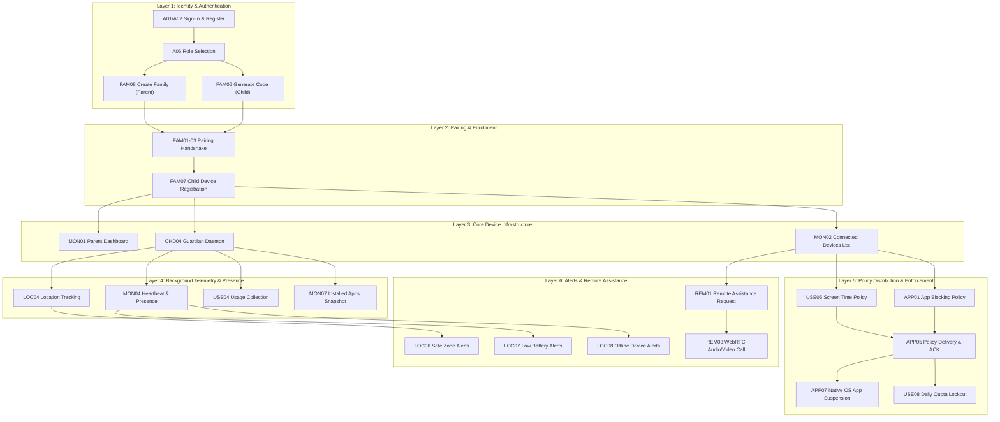

# 07 — Functionality Dependency Map

**Document ID:** `HAVEN-INV-007`  
**Phase:** Pre-Testing Functional Audit  
**Workspace:** `D:\parentcontrol_app`  
**Baseline HEAD:** `0101c16d161824fd726018f1188e1a2b17c653d3`  
**Scope:** Cross-Functional Dependency Analysis & Precedence Chains  

---

## 1. Executive Summary

This document establishes the authoritative **Functionality Dependency Map** for HAVEN Parent Control. No feature operates in complete isolation: authentication unlocks dashboards, family creation is a prerequisite for device pairing, device enrollment is required before telemetry or policies can exist, and native Android permissions govern background collection and enforcement.

Understanding these explicit dependency linkages is essential for structuring safe, deterministic manual test sequences.

---

## 2. Master System Dependency Diagram

---

## 3. Comprehensive Feature Dependency Table

| Parent Functionality ID | Dependent Functionality ID | Dependency Type | Required Condition | Failure Impact | Implemented? | Independently Testable? |
|---|---|---|---|---|---|---|
| **A01 / A02** | **A06** | Hard Prerequisite | User authenticated via Supabase Auth | Cannot select account role | Yes | No (Requires Auth) |
| **A06** | **FAM08** | Hard Prerequisite | User has `role = 'parent'` | Cannot access `/parent/family-setup` | Yes | No (Requires Parent Role) |
| **A06** | **FAM06** | Hard Prerequisite | User has `role = 'child'` | Cannot access `/child/enrollment` | Yes | No (Requires Child Role) |
| **FAM08** | **FAM01–03** | Hard Prerequisite | Active family row in `families` | Cannot issue pairing invites | Yes | No (Requires Family) |
| **FAM06** | **FAM01–02** | Hard Prerequisite | Active child contact code in DB | Cannot redeem pairing invite | Yes | No (Requires Child Code) |
| **FAM01–03** | **FAM07** | Hard Prerequisite | Pairing invite accepted/redeemed | Cannot register child hardware | Yes | No (Requires Pairing) |
| **FAM07** | **MON01–03** | Hard Prerequisite | Registered `device_id` in `devices` | Devices list & detail screens empty | Yes | No (Requires Enrolled Device) |
| **FAM07** | **CHD04** | Hard Prerequisite | `SyncConfig` stored in `SecureStore` | `GuardianService` cannot start | Yes | No (Requires Stored Secret) |
| **CHD04** | **MON04** | Hard Prerequisite | Daemon active; periodic heartbeat tick | Parent dashboard reports "Offline" | Partial (QA-003) | No (Requires Running Daemon) |
| **SET04 (Location)** | **LOC04** | Hard Prerequisite | `ACCESS_FINE_LOCATION` granted | Location tracking service fails to start | Yes | Yes (Testable via settings) |
| **LOC04** | **LOC01–02** | Data Dependency | `location_events` populated in DB | Parent map displays no pins or history | Partial | No (Requires GPS fixes) |
| **LOC04** | **LOC06** | Data Dependency | Child GPS crosses safe zone edge | Geofence enter/exit alerts never trigger | Partial | No (Requires Movement) |
| **SET04 (Usage)** | **USE04** | Hard Prerequisite | `PACKAGE_USAGE_STATS` granted | Usage reporter returns 0 apps/minutes | Yes | Yes (Testable via settings) |
| **USE04** | **USE01–02** | Data Dependency | `usage_daily` populated in DB | Screen time graphs display empty state | Partial | No (Requires Daily Usage) |
| **MON07** | **APP01–04** | Data Dependency | `device_apps` snapshotted | App restrictions list has no apps to block | Yes | No (Requires App Upload) |
| **APP01–04** | **APP05** | Functional Loop | Parent dispatches `apply_policy` | Policy never reaches child handset | Yes | No (Requires Queued Command) |
| **APP05** | **APP07** | Privilege Gate | App has Android **Device Owner** status | OS app suspension fails under Device Admin | Partial (M04) | No (Requires Device Owner) |
| **USE05** | **USE08** | Privilege Gate | App has Android **Device Owner** status | Daily screen time quota lock fails | Partial (M04) | No (Requires Device Owner) |
| **MON04** | **LOC07** | Data Dependency | Heartbeat reports `battery_level < 15%` | Low battery alerts never trigger | Yes | No (Requires Battery Drop) |
| **MON04** | **LOC08** | Time Dependency | Heartbeat absent for > 15 minutes | Offline alerts never trigger | Yes | No (Requires Inactivity) |
| **SET04 (Cam/Mic)** | **REM03** | Hard Prerequisite | `CAMERA` & `RECORD_AUDIO` granted | WebRTC call fails to access media streams | Yes | Yes (Testable via Self-Test) |
| **REM01** | **REM02** | Workflow State | Parent dispatches call invite | Child requests tab receives no prompt | Yes | No (Requires Active Invite) |
| **REM02** | **REM03** | Workflow State | Child accepts remote session invite | WebRTC peer connection cannot negotiate | Yes | No (Requires Acceptance) |

---

## 4. Key Bottlenecks and Single Points of Failure (SPOFs)

1. **The Credential Bottleneck (`FAM07` / `MON04` / `HAVEN-QA-003`)**:
   - `FAM07` creates the device secret. Every subsequent background capability (`MON04` heartbeat, `LOC04` location upload, `USE04` usage upload, `MON07` app snapshot) requires this valid secret.
   - If the secret desynchronizes (e.g. after reinstall), **all four background telemetry streams collapse simultaneously**.
2. **The Device Owner Privilege Bottleneck (`APP07` / `USE08` / `M04`)**:
   - `APP01` (App Blocking) and `USE05` (Screen Time Limit) can be configured smoothly on the Parent side.
   - However, native execution (`APP07` suspension, `USE08` lockout) is completely bottlenecked by Android OS permission requirements. Standard installs cannot achieve Device Owner, rendering enforcement partial.
3. **The Family Anchor Bottleneck (`FAM08`)**:
   - All RLS policies in PostgreSQL depend on `families(id)`. If family creation fails or parent session corrupts, all child devices, policies, commands, and alerts become orphaned.

---

## 5. Independent Testability Recommendations

- **Independently Testable Subsets (Tier 1)**:
  - `A01`–`A03`, `A06`, `A11`, `A12`: Authentication forms, input validation, password toggle.
  - `SET04`, `CHD05`: Camera/mic self-test, native permission prompts.
  - `LOC05`, `LOC11`: Safe zone editor, geofence radius slider.
  - `SET01`, `SET02`, `SET03`: Local preferences, app version display.
- **Interconnected Pre-requisite Chains (Tier 2)**:
  - Must execute in strict dependency order:
    $$\text{Auth} \longrightarrow \text{Family} \longrightarrow \text{Pairing} \longrightarrow \text{Enrollment} \longrightarrow \text{Telemetry} \longrightarrow \text{Policies}$$
