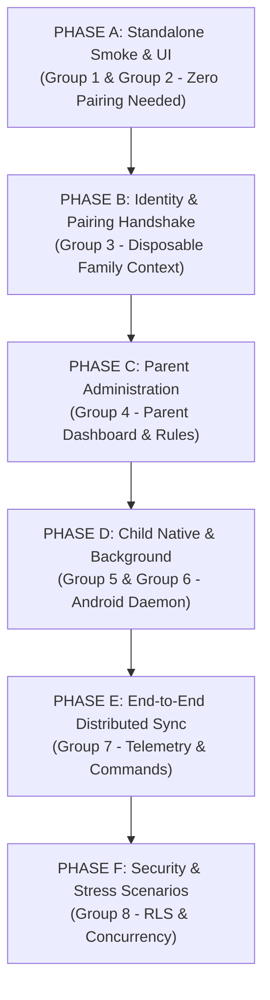

# 11 — Testing Priority and Execution Order

**Document ID:** `HAVEN-INV-011`  
**Phase:** Pre-Testing Functional Audit  
**Workspace:** `D:\parentcontrol_app`  
**Baseline HEAD:** `0101c16d161824fd726018f1188e1a2b17c653d3`  
**Scope:** Staged Manual Testing Strategy, Precedence Rules & Execution Sequences  

---

## 1. Executive Strategy & Testing Philosophy

To execute manual QA safely and efficiently without corrupting existing user sessions, invalidating credentials, or triggering cascading unhandled exceptions, manual testing must follow a **Strict Dependency-Ascending Sequence**.

Testing complex distributed workflows (such as app suspension or safe zone alerts) before verifying basic authentication and pairing will result in false-positive bug reports. By enforcing six sequential testing phases, testers isolate foundational defects before testing interconnected features.

---

## 2. Six-Phase Master Execution Sequence

---

## 3. Practical Testing Groups & Dependency Rules

### Group 1 — Basic App & Navigation (Independent)
- **Features Tested**: `A10` (Configuration), `A06` (Role Selection), `SYS01` (Offline Banner), `A11` (Password Masking Toggle), `A12` (Form Validation), `SET03` (App Version).
- **Execution Rule**: **100% INDEPENDENT**. Can be executed on any clean device or emulator without network access, credentials, or backend accounts.
- **Goal**: Verify visual rendering, button responsiveness, and input masking.

### Group 2 — Authentication & Accounts (Prerequisite for Groups 3–8)
- **Features Tested**: `A01` (Sign-in), `A02` (Registration), `A03` (Email Verification), `A04` (Splash Session Restore), `A05` (Sign-out), `A07` (Profile Overview), `A08` (GDPR Export), `A09` (Account Deletion).
- **Execution Rule**: Requires fresh disposable test accounts (`qa_parent_test@haven.test`). Must not touch existing production credentials.
- **Goal**: Lock in identity boundaries before creating family structures.

### Group 3 — Parent-Child Connection & Topology (Prerequisite for Groups 4–8)
- **Features Tested**: `FAM08` (Family Creation), `FAM06` (Child Code Display), `FAM01` (QR Scan Pairing), `FAM02` (Manual Code Pairing), `FAM03` (Pairing Request), `FAM04` (Cancel Request), `FAM05` (Child Respond), `FAM07` (Device Registration), `FAM10` (Unlink Child), `FAM11` (Child Self-Unlink).
- **Execution Rule**: Requires two simultaneous execution contexts (e.g. 1 Parent emulator + 1 Child physical handset).
- **Goal**: Establish the relational link between Parent and Child.

### Group 4 — Parent Functionalities (Prerequisite: Group 3)
- **Features Tested**: `MON01` (Dashboard), `MON02` (Devices List), `MON03` (Device Detail), `MON06` (Command History), `MON08` (Pull-to-Refresh), `MON09` (Policy Status), `MON10` (Device Filter), `USE01`–`USE03` (Screen Time), `USE05`–`USE07` (Quotas/Bedtime), `APP01`–`APP04` (App Restrictions), `LOC01`–`LOC02` (Location), `LOC05` (Safe Zones), `LOC10` (Alerts Inbox), `AUD01`–`AUD03` (Audit Logs).
- **Execution Rule**: Operates primarily from Parent app. Configures rules, views graphs, and queues commands.
- **Goal**: Validate parent oversight, policy creation, and configuration persistence.

### Group 5 — Child Functionalities (Prerequisite: Group 3)
- **Features Tested**: `CHD01` (Child Home), `CHD02` (Rules Display), `CHD03` (Requests Inbox), `CHD05` (Hardware Self-Test), `CHD06` (Policy Verification), `CHD07` (Sync Reconnect), `CHD08` (Policy Refresh), `CHD09` (Emergency Quick-Call), `LOC03` (Location Sharing Toggle).
- **Execution Rule**: Operates from Child handset. Verifies transparency, rules display, and self-test dialogs.
- **Goal**: Validate child usability, request notifications, and transparency.

### Group 6 — Android Native Behavior (Prerequisite: Group 5)
- **Features Tested**: `CHD04` (Guardian Foreground Service), `SET04` (Permission Prompts), `SET05` (Device Admin Activation), `SET06` (Background Location Launcher), `SET07` (Permission Tiles), `SET08` (Admin Revocation Warning), `APP07` (Package Suspension), `USE08` (Daily Quota Lockout).
- **Execution Rule**: Requires physical Android device (Realme RMX2161). Interacts with Android OS settings and system dialogs.
- **Goal**: Validate native daemon persistence, permission handling, and OS enforcement ceiling.

### Group 7 — Backend & Data Synchronization (Prerequisite: Groups 4, 5, 6)
- **Features Tested**: `MON04` (Heartbeat Presence), `MON05` (Permission Telemetry), `MON07` (App Snapshot Upload), `USE04` (Usage Upload), `LOC04` (Location Tracking), `LOC06`–`LOC09` (Automated Alerts), `APP05` (Command Delivery & ACK), `APP06` (Sync Request), `REM01`–`REM06` (WebRTC Live Assistance Call), `SYS02` (Periodic Polling).
- **Execution Rule**: Distributed verification testing synchronous coordination between devices across the network.
- **Goal**: Validate end-to-end data flow, telemetry ingestion, and live calling.

### Group 8 — Security & Failure Scenarios (Final Verification)
- **Features Tested**: Cross-family data isolation (RLS), expired token injection, duplicate pairing redemption, simulated network disconnect during rotation, credential recovery design.
- **Execution Rule**: Adversarial testing; intentional error injection.
- **Goal**: Validate system resilience against attacks, tampering, and connectivity drops.

---

## 4. First Recommended Testing Group for Execution

When the product owner authorizes the transition to runtime QA:

> [!TIP]
> **Recommended First Execution Group**: **Group 1 (Basic App & Navigation)** followed immediately by **Group 2 (Authentication & Accounts)**.

### Why Start with Groups 1 & 2:
1. **Zero Impact on Existing Data**: Tests can run on isolated, disposable test accounts without risking enrolled family links or physical test hardware.
2. **Immediate Usability Feedback**: Verifies screen rendering, layout scaling (confirming `HAVEN-QA-001` fix), and password masking (confirming `HAVEN-QA-002` fix).
3. **Firm Foundation**: Once authentication and navigation are proven solid, pairing and distributed features can be tested with complete confidence.
