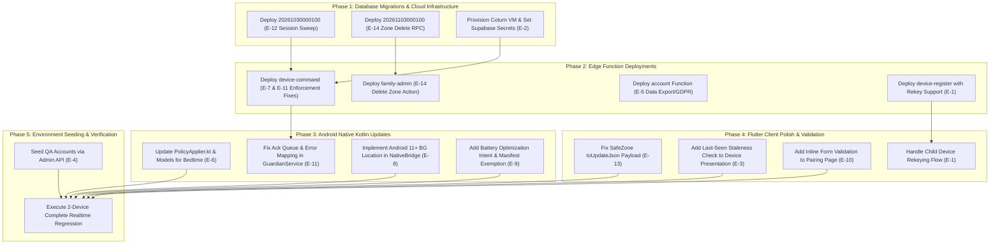

# Defect Prioritization, Forensic Severity Assessment & Implementation Roadmap

- **Target System:** Parent Control Ecosystem (`com.parentcontrol.parent_control` v1.0.0, Build 1)
- **Repository Working Copy:** `D:\parentcontrol_app`
- **Audit Date & Timestamp:** 2026-11-13T17:00:00+05:30
- **Auditor Role:** Agent 3 — Defect Severity & Implementation Dependency Analyst
- **Scope:** Exhaustive architectural analysis of all fourteen (14) confirmed defects (E-1 through E-14), platform dependency mapping, severity categorization, prioritized implementation sequencing, platform constraint governance, and two-device regression test planning.
- **Reference Topology:**
  - **Parent Device:** Android Emulator (`emulator-5554`, Google Pixel 9a, Android 17 / API 37, x86_64) — `ankit@gmail.com`
  - **Child Device:** Physical Realme 7 / Narzo 20 Pro (`5HXWRGQ4IFU8WS4T`, Model `RMX2161`, Android 12 / API 31, arm64-v8a) — `ankit1@gmail.com`
  - **Cloud Backend:** Supabase Managed Cloud (Reference ID `hhqgreaoqulmfwfwarhc`, PostgreSQL 15, Deno Edge Functions)

---

## 1. Executive Summary & Defect Taxonomy

During the comprehensive live two-device real-time audits and forensic code analyses conducted across the Flutter client, Android Native Kotlin daemons, and Supabase backend, fourteen (14) critical to polish defects were identified and cataloged (designated **E-1** through **E-14**).

These defects do not represent isolated UI glitches; rather, they span foundational layers of mobile operating system privileges, cryptographic authentication handshakes, WebRTC ICE NAT traversal, Row Level Security (RLS) enforcement, Edge Function deployment drift, and background service lifecycle survival. Left unaddressed, they induce catastrophic operational failures—including total device de-registration on app reinstall, unrecoverable background location loss, silent policy non-enforcement during curfew hours, and remote assistance connection locks.

### Defect Master Inventory & Classification Matrix

| Defect ID | Defect Title | Subsystem / Layer | Verified Severity | Priority | User Impact | Fix Complexity |
|---|---|---|---|---|---|---|
| **E-1** | Child Device Credential Invalidation on Reinstall | Native / Edge Functions / DB | **CRITICAL** | **P0** | Total loss of monitoring and location upload after reinstall; permanent HTTP 401/409 lock | Medium |
| **E-2** | Missing Hosted Coturn TURN Relay (WebRTC NAT) | WebRTC / Cloud Infra / Edge Function | **HIGH** | **P0** | Audio assistance fails to connect across carrier CGNAT or firewalled cellular networks | Medium |
| **E-3** | Stale Parent Permission Snapshot Presentation | Flutter Presentation / Telemetry | **MEDIUM** | **P2** | Parent falsely sees permissions as "Granted" indefinitely when child device is offline | Low |
| **E-4** | Extra QA Accounts Missing in Hosted Auth | Supabase Auth / Environment | **LOW** | **P3** | QA engineers unable to log into secondary test accounts (`CHILD_B`, `CHILD_C`) | Low |
| **E-5** | Missing `account` Edge Function in Hosted Cloud | Edge Function Deployment | **MEDIUM** | **P3** | Parent data export, retention report, and GDPR account deletion return HTTP 404 | Low |
| **E-6** | Bedtime / Curfew Ignored by Native PolicyApplier | Kotlin Native / DevicePolicyManager | **HIGH** | **P1** | Child apps remain accessible during bedtime/curfew hours; schedule completely non-functional | Medium |
| **E-7** | Misleading Mixed Enforcement Status Conflation | Edge Function / Flutter Presentation | **MEDIUM** | **P1** | Green "Enforced on device" shown even when screen-time quota is unsupported / unverified | Medium |
| **E-8** | Background Location Omitted on Android 11+ | Kotlin Native Permissions / OS | **MEDIUM** | **P2** | Location tracking terminates immediately upon screen off or app minimizing on Android 11+ | Medium |
| **E-9** | Battery Optimization Exemption Missing | Android OS / OEM Doze Management | **MEDIUM** | **P2** | Guardian and Location services killed after 15–30 min idle on ColorOS/MIUI/OneUI | Low |
| **E-10** | Empty Pairing Code Form Validation Behavior | Flutter Form Validation / UX | **LOW** | **P3** | Empty text submit displays misleading QR scan error banner off-screen instead of inline error | Low |
| **E-11** | Stalled Policy Acknowledgments (Terminal Pending) | Edge Function / Kotlin Native Engine | **HIGH** | **P1** | Parent UI stuck on "Waiting for device"; bedtime-only policy trapped in pending forever | High |
| **E-12** | Stranded Remote Sessions (Missing Cleanup Sweep) | PostgreSQL RPC / Cron / Advisory Lock | **HIGH** | **P0** | Abrupt app kill leaves session open, permanently blocking future sessions with HTTP 409 | Medium |
| **E-13** | Safe Zones RLS UPDATE Failure (Postgres 42501) | PostgreSQL RLS / Dart Repository | **HIGH** | **P1** | Toggling safe zone active status or saving zone edits fails with permission denied (42501) | Low |
| **E-14** | Safe Zones Delete Action Unsupported in Hosted EF | Edge Function Deployment / RPC | **HIGH** | **P2** | Deleting safe zones fails with HTTP 400 `unknown_action` due to hosted v5/v6 deployment drift | Low |

---

## 2. Exhaustive Defect Analysis (E-1 through E-14)

### Defect E-1: Child Device Credential Invalidation on Reinstall

- **Defect ID:** `E-1`
- **Severity:** **CRITICAL**
- **Priority Tier:** **P0**
- **User Impact:** When a child reinstalls the application (or receives a fresh test build), the app logs in and reports "This phone is set up", but native background protection is paralyzed. The child logcat reports `Location upload failed: Device credentials are not valid.` The Parent Dashboard renders the child permanently "Offline" with frozen timestamps. All location tracking, battery reporting, and policy syncing stop permanently until the database is manually purged.
- **Exact Reproduction Steps:**
  1. Pair Child Phone B (`ankit1@gmail.com`) with Parent Phone A (`ankit@gmail.com`). Verify Online presence and green telemetry chips.
  2. On Child Phone B, uninstall the app: `adb uninstall com.parentcontrol.parent_control`.
  3. Reinstall fresh APK: `adb install -r build/app/outputs/flutter-apk/app-debug.apk`.
  4. Launch app, sign in as `ankit1@gmail.com`.
  5. Observe Child Home tab: "Location upload failed: Device credentials are not valid."
  6. Observe Parent Dashboard: presence remains "Offline", last seen time does not advance.
- **Root Cause & Forensic Code Analysis:**
  1. *Local Cryptographic Storage Deletion:* `SecureStore.kt:86-105` stores `installationId` (UUID) and `deviceSecret` (32 cryptographically secure random bytes) in Android `EncryptedSharedPreferences` (`parent_control_secure`). Reinstalling the app deletes private app storage, causing `SecureStore` to mint a brand new `installationId` and `deviceSecret` upon launch.
  2. *Mismatched Identity Binding:* In `child_shell_controller.dart:579-583`, `_ensureIdentityAndSync()` retrieves the existing server device record (`devices` where `status = 'active'`) and configures `GuardianService` with `deviceId: loadedDevice.id` (the pre-existing server row ID) paired with `deviceSecret: identity.secret` (the newly minted local secret).
  3. *Cryptographic Rejection:* Native daemon `GuardianService.kt:622` sends headers `x-device-id` and `x-device-secret`. In `supabase/functions/_shared/auth.ts:281-337`, `requireDevice()` fetches the existing row and executes:
     ```typescript
     const incomingHash = await sha256(secret);
     if (incomingHash !== device.secret_hash) {
       throw new ApiError("invalid_device_credentials", "Device secret does not match", 401);
     }
     ```
     Because the hash of the new secret does not match the old hash stored in `devices.secret_hash`, all native uploads are rejected with HTTP 401.
  4. *Self-Healing Re-Enrollment Deadlock:* When the client attempts to recover by calling `device-register` (`supabase/functions/device-register/index.ts:166-195`), the re-enrollment branch searches by `(family_id, installation_id)`. Because `installation_id` was re-generated, it falls through to the insert branch. The insert violates the database partial unique index:
     ```sql
     create unique index devices_one_active_per_child on public.devices (child_user_id) where (status = 'active');
     ```
     PostgreSQL throws a 23505 unique violation, mapped to HTTP 409 Conflict.
- **Backend & Schema Dependencies:**
  - Table: `public.devices` (`secret_hash`, `installation_id`, `status`, `child_user_id`).
  - Index: `devices_one_active_per_child`.
  - Edge Functions: `device-register`, `device-telemetry`, `device-command`.
- **Security & Privacy Impact:**
  - *Integrity:* A rogue party with a child's user token cannot impersonate an existing device without the pre-shared secret.
  - *Availability:* Catastrophic denial of service. Legitimate reinstalls result in an unmonitored child.
- **Recommended Fix:**
  1. In `child_shell_controller.dart`, detect when `_deviceRepository.fetchMyDevice()` returns an active device whose local `installation_id` differs from `loadedDevice.installationId`.
  2. Introduce an authenticated re-keying handshake: If the user is authenticated as the child owner of that device record, invoke a new Edge Function action `device-register` (action `rekey_device`) which updates `devices.secret_hash` and `devices.installation_id` inside an atomic transaction, or require Parent authorization via a temporary 6-digit recovery code.
- **Required Regression Tests:**
  - `TEST-E1-01`: Reinstall APK on child phone; authenticate as child; verify `GuardianService` successfully submits heartbeat and returns HTTP 200 within 30 seconds.
  - `TEST-E1-02`: Verify parent dashboard updates to "Online" without requiring manual database intervention.
- **Dependencies & Risks:**
  - Risk of allowing unauthorized session hijacking if rekeying does not verify authenticated child JWT matching `devices.child_user_id`.

---

### Defect E-2: Missing Hosted Coturn Relay Server / WebRTC NAT Traversal

- **Defect ID:** `E-2`
- **Severity:** **HIGH**
- **Priority Tier:** **P0**
- **User Impact:** Remote assistance signaling and child consent succeed, but live audio streaming never connects when either device is connected over cellular carrier networks (CGNAT), symmetric NAT routers, or enterprise/school Wi-Fi. Parents see a flatline 0dB audio visualizer and warning banner: `"Relay not configured"`.
- **Exact Reproduction Steps:**
  1. Connect Parent Emulator to home Wi-Fi and Child Device to 4G/5G Cellular Data (or isolated guest Wi-Fi).
  2. On Parent Device, navigate to `Remote Assistance` -> `Request audio` -> Confirm.
  3. On Child Device, accept consent and tap `Join now`.
  4. Observe Parent Device: status changes to `Active`, but `in pkts` remains `0`, visualizer stays at 0dB.
  5. Yellow warning banner displays: `"Relay not configured | No TURN relay is configured. Audio/video may fail to connect on networks with strict firewalls or carrier NAT."`
- **Root Cause & Forensic Code Analysis:**
  1. *Function Logic:* In `supabase/functions/_shared/turn.ts:71-106`, `buildIceConfig(readTurnEnv())` checks for environment variables `TURN_URL` and `TURN_SECRET`:
     ```typescript
     const turnUrls = splitUrls(env.turnUrl).filter((url) => /^turns?:/i.test(url));
     const secret = (env.turnSecret ?? "").trim();
     if (turnUrls.length === 0 || secret.length === 0) {
       return {
         ice_servers: iceServers,
         turn_configured: false,
         warning: "TURN is not configured. Audio and video may fail on restrictive networks.",
       };
     }
     ```
  2. *Hosted Environment Omission:* In the hosted Supabase project (`hhqgreaoqulmfwfwarhc`), secrets `TURN_URL` and `TURN_SECRET` were never provisioned.
  3. *Client Behavior:* In `remote_session_controller.dart:477-487`, when `turn_configured` is false, `isRelayConfigured.value` is set to false, and WebRTC initializes with only public Google STUN (`stun:stun.l.google.com:19302`). STUN is mathematically incapable of traversing symmetric NAT mapping.
- **Backend & Schema Dependencies:**
  - Supabase Project Secrets: `TURN_URL`, `TURN_SECRET`, `TURN_TTL_SECONDS`.
  - Edge Function: `remote-session` (action `ice`).
- **Security & Privacy Impact:**
  - TURN relay carries unencrypted WebRTC SRTP media packets if TURN is configured in unencrypted mode. Must enforce `turns:` (TLS on port 5349) to ensure network eavesdroppers cannot inspect audio packets.
  - Ephemeral HMAC-SHA1 tokens prevent relay credential theft.
- **Recommended Fix:**
  1. Deploy a production Coturn instance (e.g. AWS EC2 t4g.small or Cloudflare Calls / Twilio Network Traversal).
  2. Set Supabase secrets:
     ```bash
     supabase secrets set TURN_URL="turns:turn.parentcontrol.example.com:5349?transport=tcp,turn:turn.parentcontrol.example.com:3478?transport=udp" TURN_SECRET="<crypto-random-secret>" TURN_TTL_SECONDS="3600"
     ```
- **Required Regression Tests:**
  - `TEST-E2-01`: Connect Child to 4G Cellular and Parent to restrictive corporate VPN. Execute remote audio assistance. Verify WebRTC candidate pair selects `relay` candidate type and audio RTP packets exceed 1,000 packets.
- **Dependencies & Risks:**
  - Cost of outbound bandwidth on Coturn VM; potential DDoS vector if `TURN_SECRET` leaks.

---

### Defect E-3: Stale Parent Permission Snapshot

- **Defect ID:** `E-3`
- **Severity:** **MEDIUM**
- **Priority Tier:** **P2**
- **User Impact:** The Parent Device Detail screen shows all six Android permissions (Usage Access, Location, Background Location, Camera, Microphone, Notifications) as green "Granted" chips, even if the child has gone into Android Settings and revoked Location or Usage Access days ago.
- **Exact Reproduction Steps:**
  1. On Child Phone B, navigate to Android Settings -> Apps -> Parent Control -> Permissions.
  2. Revoke `Location` and `Usage Access`.
  3. Disconnect Child Phone B from internet or power off.
  4. On Parent Phone A, open `Devices` -> Tap child device -> View `Device permissions`.
  5. Observe: All permissions still display green "Granted" chips without any indication that data is stale.
- **Root Cause & Forensic Code Analysis:**
  1. *Presentation Layer:* In `lib/features/devices/device_detail_page.dart:321-358`, each permission tile directly binds to boolean fields on `Device` (`device.usageAccessGranted`, `device.locationGranted`, etc.).
  2. *Data Persistence:* These fields are parsed from the `devices.capabilities` jsonb column in PostgreSQL, which is updated strictly when the child successfully pushes a `device-telemetry` `heartbeat` (`GuardianService.kt:518`).
  3. *Staleness Disconnect:* The presentation layer does not evaluate `devices.last_seen_at` relative to `DateTime.now()`. If the device is offline or failing telemetry upload due to E-1, the database retains the last known grant indefinitely.
- **Backend & Schema Dependencies:**
  - Table: `public.devices` (`capabilities`, `last_seen_at`).
  - Edge Function: `device-telemetry` (action `heartbeat`).
- **Security & Privacy Impact:**
  - False sense of safety: Parents believe safety rails and location tracking are operational when the native app is completely disabled.
- **Recommended Fix:**
  1. In `lib/features/devices/device_presentation.dart`, update `permissionGapsFor` and permission rendering logic to inspect `device.lastSeenAt`.
  2. If `DateTime.now().difference(device.lastSeenAt) > Duration(minutes: 15)`, render permission chips with an amber tone and text: `"Unknown (device offline since <timestamp>)"` or `"Cached"`.
- **Required Regression Tests:**
  - `TEST-E3-01`: Simulate device offline for > 15 minutes. Open Device Detail. Verify permissions transition to amber "Stale / Cached" badge.
- **Dependencies & Risks:**
  - Zero schema risk; purely frontend presentation logic in Flutter.

---

### Defect E-4: Extra QA Accounts Missing in Hosted Auth

- **Defect ID:** `E-4`
- **Severity:** **LOW**
- **Priority Tier:** **P3**
- **User Impact:** Automated test runners and QA engineers attempting to authenticate using predefined test credentials in `.tools/qa_accounts.env` (`CHILD_B`, `CHILD_C`) are rejected with `"Could not sign in — The email or password is incorrect."`
- **Exact Reproduction Steps:**
  1. Launch child application.
  2. Enter email `qa.child.b.20261026@example.com` and password `QaTest!2026#CcB1`.
  3. Tap `Sign in`.
  4. Observe error toast: "Could not sign in — The email or password is incorrect."
- **Root Cause & Forensic Code Analysis:**
  1. In the hosted Supabase project, only initial seed accounts `ankit@gmail.com` and `ankit1@gmail.com` were provisioned in `auth.users` and `public.profiles`.
  2. Test environment definition `.tools/qa_accounts.env` specifies additional users:
     - `qa.parent.a2.20261026@example.com`
     - `qa.child.a2.20261026@example.com`
     - `qa.parent.b.20261026@example.com`
     - `qa.child.b.20261026@example.com`
     - `qa.child.c.20261027@example.com`
  3. These users were never seeded via Supabase Admin API in the cloud instance.
- **Backend & Schema Dependencies:**
  - Supabase Auth: `auth.users`, `auth.identities`.
  - Tables: `public.profiles`, `public.family_members`.
- **Security & Privacy Impact:**
  - Confined strictly to QA testability. Zero end-user production security impact.
- **Recommended Fix:**
  - Run administrative seed script `.tools/seed_qa_accounts.ts` via Supabase Service Role key against `hhqgreaoqulmfwfwarhc`.
- **Required Regression Tests:**
  - `TEST-E4-01`: Execute programmatic login for all 5 QA accounts; assert HTTP 200 and valid session token.
- **Dependencies & Risks:**
  - Must ensure QA accounts do not have access to real user families.

---

### Defect E-5: Missing `account` Edge Function in Hosted Cloud

- **Defect ID:** `E-5`
- **Severity:** **MEDIUM**
- **Priority Tier:** **P3**
- **User Impact:** Parents attempting to access GDPR privacy features (Export my data, Retention report, Delete my account) in Parent Settings -> Privacy & Data receive a red error banner: `"Requested function was not found"` (HTTP 404).
- **Exact Reproduction Steps:**
  1. On Parent Device, navigate to `Settings` tab -> `Privacy & data`.
  2. Tap `Export my data` -> Confirm `Export`.
  3. Observe red error banner: `"Requested function was not found"`.
  4. Repeat for `Retention report` and `Delete account`; observe identical HTTP 404.
- **Root Cause & Forensic Code Analysis:**
  1. Frontend Client: `account_privacy_repository.dart:182, 235, 265` invokes Edge Function `account`:
     ```dart
     final response = await _edgeApi.invoke('account', action: 'export');
     ```
  2. Function Implementation: Fully written and tested locally in `supabase/functions/account/index.ts` (581 lines handling `export`, `delete_account`, `retention_report`).
  3. Cloud Deployment Drift: The function was never deployed to the hosted Supabase project `hhqgreaoqulmfwfwarhc`. `supabase functions list` confirms `account` is absent from the deployed function inventory.
- **Backend & Schema Dependencies:**
  - Edge Function: `supabase/functions/account/`
  - Tables: `public.profiles`, `public.families`, `public.audit_logs`, `public.location_events`, `public.usage_daily`.
- **Security & Privacy Impact:**
  - **GDPR / CCPA Non-Compliance:** Users cannot exercise their statutory right to data portability (export) or right to erasure (account deletion).
- **Recommended Fix:**
  - Deploy function via Supabase CLI:
    ```bash
    supabase functions deploy account --project-ref hhqgreaoqulmfwfwarhc
    ```
- **Required Regression Tests:**
  - `TEST-E5-01`: In Parent app, tap `Export my data`. Verify JSON payload containing family and device records downloads successfully.
  - `TEST-E5-02`: Tap `Retention report`. Verify retention window calculations return successfully.
- **Dependencies & Risks:**
  - Export query is protected by `EXPORT_ROW_CAP = 20_000` to prevent memory exhaustion on large telemetry histories.

---

### Defect E-6: Bedtime / Curfew Ignored by Native PolicyApplier.kt

- **Defect ID:** `E-6`
- **Severity:** **HIGH**
- **Priority Tier:** **P1**
- **User Impact:** Parents configure a strict bedtime window (e.g., 9:00 PM to 7:00 AM) expecting apps to lock down. On the child phone, apps remain completely open and unrestricted during curfew hours. The Child Rules screen explicitly displays: *"Daily screen-time limits and bedtime are shown for information only. This Android build enforces app blocks and their schedules, not a system-wide time limit."*
- **Exact Reproduction Steps:**
  1. On Parent Device, navigate to `Screen Time` -> Toggle bedtime on -> Set bedtime from 10 minutes ago to 2 hours from now. Tap `Save screen-time policy`.
  2. Wait 15 seconds for policy v2 sync.
  3. On Child Device, launch any restricted app (e.g. YouTube, Chrome, Games).
  4. Observe: App opens without any blocking overlay or suspension dialog.
- **Root Cause & Forensic Code Analysis:**
  1. *Native Implementation Stub:* In `android/app/src/main/kotlin/com/parentcontrol/parent_control/PolicyApplier.kt:502-503`:
     ```kotlin
     // Informational only: bedtime is stored but app suspension follows app rules.
     result.put("bedtime_active", policy.hasBedtime && policy.isWithinBedtime(TimeUtils.minuteOfDay(calendar)))
     ```
     The bedtime state is computed purely as an informational boolean written to the telemetry map, but is **never connected to the package suspension engine**.
  2. *Package Evaluator Loop:* In `android/app/src/main/kotlin/.../policy/PolicyModels.kt:67-76`, `isPackageBlockedNow()` evaluates only explicit `appRules`, `blockedPackages`, and `allowedPackages`. Bedtime is completely absent:
     ```kotlin
     fun isPackageBlockedNow(packageName: String, isoDay: Int, minuteOfDay: Int): Boolean {
         if (!enforceAppBlocks) return false
         val rule = appRules.firstOrNull { it.packageName == packageName }
         if (rule != null) return rule.isActiveAt(isoDay, minuteOfDay)
         if (blockedPackages.contains(packageName)) {
             return !blockAllExceptAllowed || !allowedPackages.contains(packageName)
         }
         if (blockAllExceptAllowed) return !allowedPackages.contains(packageName)
         return false
     }
     ```
- **Backend & Schema Dependencies:**
  - Table: `public.device_policies` (`bedtime_start_minute`, `bedtime_end_minute`).
  - Edge Function: `device-policy` -> `device_commands`.
- **Security & Privacy Impact:**
  - Child safety breach: Children have unrestricted phone access overnight despite parental controls configured to prevent it.
- **Recommended Fix:**
  1. In `PolicyModels.kt`, modify `isPackageBlockedNow()` to accept a `isBedtimeActive: Boolean` parameter.
  2. If `policy.hasBedtime && policy.isWithinBedtime(minuteOfDay)`, treat all non-exempt packages (packages not in `allowedPackages`, excluding essential system dialer/emergency apps) as blocked.
  3. In `PolicyApplier.kt`, trigger package suspension via `devicePolicyManager.setPackagesSuspended()` when bedtime begins and unsuspends when bedtime ends during the 60-second `PolicyApplier.tick()` loop.
- **Required Regression Tests:**
  - `TEST-E6-01`: Set bedtime encompassing current system time. Verify `PolicyApplier.tick()` suspends non-whitelisted apps within 60 seconds.
  - `TEST-E6-02`: Advance system clock past bedtime end time. Verify apps are automatically unsuspended on subsequent tick.
- **Dependencies & Risks:**
  - **Android Platform Constraint:** Device Owner permission (`setPackagesSuspended`) is required for true app suspension. If device is only Device Admin, native app must display a full-screen blocking overlay activity instead.

---

### Defect E-7: Misleading Mixed Enforcement Status Conflation

- **Defect ID:** `E-7`
- **Severity:** **MEDIUM**
- **Priority Tier:** **P1**
- **User Impact:** A policy containing both an app block and a screen-time quota displays a deceptive green "Enforced on device" badge on the Parent Dashboard, even when screen-time quota enforcement failed completely because the child device lacks Usage Access permission or Device Owner status.
- **Exact Reproduction Steps:**
  1. On Child Device, revoke `Usage Access` in Android Settings.
  2. On Parent Device, create a policy that blocks `Instagram` AND sets a `60-minute daily screen time limit`.
  3. Tap `Save policy`.
  4. Observe Parent Device: Banner displays green `"Enforced on device"`, misleading the parent into believing the daily quota is active.
- **Root Cause & Forensic Code Analysis:**
  1. *Server-Side Status Overwrite:* In `supabase/functions/device-command/enforcement.ts:480-495`:
     ```typescript
     if (app.status === "failed") return app;
     if (quota.status === "failed") return quota;
     return { ...app, lastError: app.lastError ?? quota.lastError };
     ```
     When the child reports quota as `"unsupported"` (due to missing Usage Access), `quota.status` is NOT `"failed"`. Therefore, line 494 preserves `app.status` (`"enforced"`), returning overall status as `"enforced"`!
  2. *UI Presentation Conflation:* In `screen_time_page.dart:289-297`, the screen-time view queries `policy.status`. Because the conflated status is `"enforced"`, it displays `Enforced on device` in green, hiding the underlying `lastError` string.
- **Backend & Schema Dependencies:**
  - Edge Function: `device-command/enforcement.ts`.
  - Table: `public.device_policies` (`status`, `last_error`).
- **Security & Privacy Impact:**
  - False reassurance: Parents trust that time limits are enforced when child usage is completely unthrottled.
- **Recommended Fix:**
  1. In `enforcement.ts`, implement a composite status model: If `app.status === "enforced"` and `quota.status === "unsupported"`, return overall status `"partial"` or `"enforced_with_gaps"`.
  2. In Flutter `ScreenTimeController` and `DevicePresentation`, inspect specific sub-status fields: Render amber warning banner on Screen Time page: *"App restrictions are enforced, but daily time limit is unverified (missing Usage Access on child device)."*
- **Required Regression Tests:**
  - `TEST-E7-01`: Save policy with app block and daily quota on child with revoked usage access. Verify parent screen time page renders amber warning "Limits unverified" rather than green "Enforced".
- **Dependencies & Risks:**
  - Database schema check constraint: Check whether `device_policies.status` check constraint permits values other than `pending`, `enforced`, `failed`, `unsupported`.

---

### Defect E-8: Background Location Permission Omitted on Android 11+

- **Defect ID:** `E-8`
- **Severity:** **MEDIUM**
- **Priority Tier:** **P2**
- **User Impact:** Live GPS location tracking ceases as soon as the child device screen turns off or the app is minimized into the background. Parent Location map shows frozen pins with elapsed time advancing ("30 minutes ago", "2 hours ago").
- **Exact Reproduction Steps:**
  1. On Child Device (Android 12), open app -> Settings -> Permissions -> Location -> Grant.
  2. Lock the child screen (`power button`) and walk 500 meters.
  3. On Parent Device, observe Location screen: GPS pin does not move; fix timestamp remains frozen at the time screen was locked.
- **Root Cause & Forensic Code Analysis:**
  1. *Permission Request Scope:* In `NativeBridge.kt:464-475`, `requestPermissions()` requests only:
     ```kotlin
     if (boolArgument(call, "location")) {
         permissions.add(Manifest.permission.ACCESS_COARSE_LOCATION)
         permissions.add(Manifest.permission.ACCESS_FINE_LOCATION)
     }
     ```
     `Manifest.permission.ACCESS_BACKGROUND_LOCATION` is **never added** to the runtime permission request set.
  2. *Defective Settings Intent:* In `NativeBridge.kt:140-141` and `:424`:
     ```kotlin
     private fun openBackgroundLocationSettings(): Boolean = openAppDetails()
     ```
     On Android 11+ (API 30+), background location cannot be requested simultaneously with foreground location. Google requires apps to first obtain foreground location, then prompt the user with an in-app educational explanation, and then launch the system permission screen where the user explicitly selects `"Allow all the time"`. Opening `openAppDetails()` (`ACTION_APPLICATION_DETAILS_SETTINGS`) dumps the user onto the generic App Info screen, leaving background location ungranted.
- **Backend & Schema Dependencies:**
  - Android Manifest: `<uses-permission android:name="android.permission.ACCESS_BACKGROUND_LOCATION" />`.
  - Android Runtime: API 30+ (Android 11, 12, 13, 14, 15).
- **Security & Privacy Impact:**
  - Parental safety monitoring failure: Child location cannot be tracked when device is in child's pocket.
- **Recommended Fix:**
  1. Update `NativeBridge.kt`: If `Build.VERSION.SDK_INT >= Build.VERSION_CODES.R`, implement dedicated method `requestBackgroundLocation()` that launches `ActivityCompat.requestPermissions` with `ACCESS_BACKGROUND_LOCATION` only *after* fine location is granted.
  2. If denied, deep-link to the exact permission management activity using `ACTION_LOCATION_SOURCE_SETTINGS` or `Intent("android.settings.APP_NOTIFICATION_SETTINGS")`.
- **Required Regression Tests:**
  - `TEST-E8-01`: On physical Android 12 device, grant background location "Allow all the time". Lock screen, move device. Verify `LocationTrackingService` continues logging GPS fixes every 60s in logcat.
- **Dependencies & Risks:**
  - Google Play Policy: Background location permission requires detailed declaration and video submission during Play Store review.

---

### Defect E-9: Battery Optimization Exemption Missing

- **Defect ID:** `E-9`
- **Severity:** **MEDIUM**
- **Priority Tier:** **P2**
- **User Impact:** On commercial OEM devices (Realme UI, OPPO ColorOS, Xiaomi MIUI, Huawei EMUI, Samsung OneUI), the Android system aggressively kills `GuardianService` and `LocationTrackingService` after 15–30 minutes of screen-off idle time. Child goes completely offline until they manually re-open the app.
- **Exact Reproduction Steps:**
  1. On physical Realme RMX2161 (`5HXWRGQ4IFU8WS4T`), start Guardian and Location services.
  2. Disconnect USB charger, turn off screen, and leave device undisturbed on a table for 40 minutes.
  3. Execute `adb shell dumpsys deviceidle whitelist`.
  4. Observe: `com.parentcontrol.parent_control` is completely absent from the system whitelist.
  5. Check `dumpsys activity services`: `GuardianService` has been killed by the OEM Powerkeeper / Doze manager.
- **Root Cause & Forensic Code Analysis:**
  1. *Manifest Omission:* In `android/app/src/main/AndroidManifest.xml:10-25`, the required system permission is missing:
     ```xml
     <uses-permission android:name="android.permission.REQUEST_IGNORE_BATTERY_OPTIMIZATIONS" />
     ```
  2. *Absence of Intent Launcher:* Zero occurrences of `ACTION_REQUEST_IGNORE_BATTERY_OPTIMIZATIONS` exist anywhere in the Kotlin codebase (`NativeBridge.kt`). The app never requests exemption from Android Doze.
- **Backend & Schema Dependencies:**
  - Android OS: PowerManager whitelist (`dumpsys deviceidle whitelist`).
- **Security & Privacy Impact:**
  - Total circumvention: Child simply leaves phone on a desk for 20 minutes to disable parental tracking.
- **Recommended Fix:**
  1. Declare `<uses-permission android:name="android.permission.REQUEST_IGNORE_BATTERY_OPTIMIZATIONS" />` in `AndroidManifest.xml`.
  2. In `NativeBridge.kt`, add method `requestIgnoreBatteryOptimizations()`:
     ```kotlin
     val intent = Intent(Settings.ACTION_REQUEST_IGNORE_BATTERY_OPTIMIZATIONS).apply {
         data = Uri.parse("package:${context.packageName}")
     }
     context.startActivity(intent)
     ```
  3. In `ChildShellController.dart`, prompt child during initial onboarding with an educational card explaining why unrestricted battery usage is required for parental protection.
- **Required Regression Tests:**
  - `TEST-E9-01`: Trigger battery exemption prompt; accept on device; execute `adb shell dumpsys deviceidle whitelist`; verify package appears in `User Whitelist`.
  - `TEST-E9-02`: Run 2-hour idle Doze test (`adb shell dumpsys battery unplug`, `dumpsys deviceidle force-idle`); verify `LocationTrackingService` continues firing every 60s.
- **Dependencies & Risks:**
  - Google Play Policy restricts `REQUEST_IGNORE_BATTERY_OPTIMIZATIONS` to specific categories (safety/tracking apps are eligible, but requires justification).

---

### Defect E-10: Empty Pairing Code Validation Behavior

- **Defect ID:** `E-10`
- **Severity:** **LOW**
- **Priority Tier:** **P3**
- **User Impact:** On the Parent "Link a child" screen (`/parent/family/redeem`), tapping "Send pairing request" with an empty input field produces no inline red validation error on the text box. Instead, a misleading yellow warning banner appears at the very top of the page reading: `"Only Parent Control pairing codes are accepted"`, which is scrolled off-screen on smaller displays.
- **Exact Reproduction Steps:**
  1. On Parent Device, navigate to `Household Overview` -> `Link a child`.
  2. Scroll down past the QR scanner to the `Child ID or linking code` text field.
  3. Leave the field completely blank and tap `Send pairing request`.
  4. Notice: Text box displays no inline error. User is confused as to why nothing happened until they scroll all the way back up to see the QR warning banner.
- **Root Cause & Forensic Code Analysis:**
  1. In `lib/features/pairing/pairing_redeem_page.dart:44-51`:
     ```dart
     Future<void> _redeem(String input) async {
       if (input.trim().isEmpty) {
         setState(() {
           _scanMessage = 'Enter the Child ID or linking code shown on the child device.';
         });
         return;
       }
     ...
     ```
  2. In lines 130-140, `_scanMessage` is rendered inside an `InfoBanner` whose title is hardcoded:
     ```dart
     if (_scanMessage != null)
       InfoBanner(
         tone: BannerTone.warning,
         title: 'Only Parent Control pairing codes are accepted', // Hardcoded title!
         message: _scanMessage!,
       )
     ```
  3. The `TextFormField` at line 240 lacks an `autovalidateMode` or `validator` function.
- **Backend & Schema Dependencies:**
  - Pure Flutter UI presentation logic.
- **Security & Privacy Impact:**
  - Minor UX flaw; zero security or privacy consequence.
- **Recommended Fix:**
  1. Add standard Flutter `Form` validation: Attach `validator: (v) => v == null || v.trim().isEmpty ? 'Please enter a Child ID or code' : null` to the `TextFormField`.
  2. Remove `_scanMessage` misuse for text input validation; reserve `_scanMessage` exclusively for camera QR parse failures.
- **Required Regression Tests:**
  - `TEST-E10-01`: Submit empty text field on Link Child screen; verify immediate inline red error text appears beneath input box; verify top banner does not appear.
- **Dependencies & Risks:**
  - Low risk; frontend only.

---

### Defect E-11: Stalled Policy Acknowledgments (Terminal Pending State)

- **Defect ID:** `E-11`
- **Severity:** **HIGH**
- **Priority Tier:** **P1**
- **User Impact:** After saving a policy change (especially bedtime-only policies), the Parent UI remains permanently stuck displaying `"Waiting for device"` (`pending`). Tapping "Refresh policy state" re-reads `pending`, and tapping "Request sync" claims success but never resolves the state.
- **Exact Reproduction Steps:**
  1. On Parent Device, configure a policy that sets *only* a bedtime window (no app rules, no daily minute quota). Tap `Save screen-time policy`.
  2. Wait 30 seconds for polling loop to complete.
  3. Observe: Screen Time screen remains indefinitely on `"Waiting for device"`.
  4. Tap `Request sync`. Dialog says "Sync requested", but status never transitions to `Enforced`.
- **Root Cause & Forensic Code Analysis (5 Independent Traps):**
  1. *Bedtime-Only Predicate Trap:* In `supabase/functions/device-command/enforcement.ts:401-403`:
     ```typescript
     if (!quota.configured) {
       return quotaDecision(quota, "pending", "quota_not_configured");
     }
     ```
     When a policy sets bedtime but no daily limit, `input.timeLimitsConfigured` is `true`, but `quota.configured` is `false`. Lines 469-480 route the decision to `decideQuotaEnforcement`, which traps the policy in `"pending"` forever.
  2. *Lost Ack via Premature Mark:* In `GuardianService.kt:475-480`, `store.markCommandHandled(commandId)` is called *before* posting the ack. If a network interruption occurs during the POST, the command is marked handled locally. On subsequent polls, the command is skipped, and the ack is never re-sent.
  3. *Exception Mapping to Pending:* When `PolicyApplier.kt` encounters an internal exception, `countsKnown = false`. In `enforcement.ts:311-321`, missing counts force the server to record `status: "pending"` instead of `"failed"`.
  4. *Late Ack Rejected (HTTP 410):* If an ack arrives after the 900s command TTL, `handler.ts:339-355` throws HTTP 410 without updating `device_policies`, permanently abandoning the policy row in `pending`.
  5. *Inert "Request Sync":* Pressing "Request sync" queues a `sync_policy` command. In `PolicyApplier.kt:253-275`, `sync_policy` merely re-applies local cached policies and skips `apply_policy` reconciliation.
- **Backend & Schema Dependencies:**
  - Edge Function: `supabase/functions/device-command/enforcement.ts`, `handler.ts`.
  - Tables: `public.device_policies`, `public.device_commands`.
- **Security & Privacy Impact:**
  - High operational risk: Parents have no visibility into whether safety rules are active on the child's phone.
- **Recommended Fix:**
  1. In `enforcement.ts`, update `decideEnforcement`: If bedtime is configured without a daily quota, evaluate bedtime application independently and return `status: "enforced"` if bedtime parameters were stored successfully.
  2. In `GuardianService.kt`, move `markCommandHandled` to the HTTP response callback, *after* HTTP 200 is received from the ack endpoint.
  3. Implement persistent SQLite retry queue for failed command acknowledgments in Kotlin.
- **Required Regression Tests:**
  - `TEST-E11-01`: Save bedtime-only policy. Verify Parent UI advances from "Waiting for device" to "Enforced on device" within 20 seconds.
  - `TEST-E11-02`: Simulate network failure during ack POST. Restore network; verify ack is retried and acknowledged by server.
- **Dependencies & Risks:**
  - Must ensure policy version monotonicity (`advancePolicyVersion`) is preserved.

---

### Defect E-12: Stranded Remote Sessions (Missing Cleanup Sweep)

- **Defect ID:** `E-12`
- **Severity:** **HIGH**
- **Priority Tier:** **P0**
- **User Impact:** If an active remote assistance session is terminated abnormally (e.g. child phone battery dies, app crashed, child kills process from developer settings, or network dropped during call), subsequent attempts by the parent to start a new remote session fail immediately with HTTP 409: `"A session is already in progress on this device."`
- **Exact Reproduction Steps:**
  1. Start Remote Assistance audio session between Parent A and Child B.
  2. While audio is active, kill Child app abruptly via terminal: `adb shell am force-stop com.parentcontrol.parent_control`.
  3. On Parent Device, navigate back and attempt to tap `Request audio`.
  4. Observe: Red error banner displays: `"Action failed | A session is already in progress on this device."`
  5. Child device is permanently locked out of remote assistance.
- **Root Cause & Forensic Code Analysis:**
  1. *Permanent Lifetime of Consented Sessions:* In migration `20261028000200_parent_controlled_session_lifetime.sql` and `guard.ts:157-178`, once a session is accepted, `expires_at` is set to `null` (parent-controlled session lifetime).
  2. *Missing Sweep Cron & Function:* Migration `20261030000100_abandoned_session_sweep.sql` created the cleanup procedure `public.expire_abandoned_sessions(interval)`, but this migration was never deployed or scheduled on the hosted Supabase instance.
  3. *Advisory Concurrency Lock:* When the parent requests a new session, `public.request_remote_session` executes `perform pg_advisory_xact_lock(...)` and checks:
     ```sql
     select id from public.remote_sessions
     where device_id = p_device_id and status in ('accepted', 'active')
     ```
     Because the abandoned session row is still in `active` status with `expires_at = null`, the query finds the zombie row and raises `session_in_progress` (HTTP 409).
- **Backend & Schema Dependencies:**
  - PostgreSQL Function: `public.expire_abandoned_sessions(p_max_age interval)`.
  - Database Migration: `20261030000100_abandoned_session_sweep.sql`.
  - Edge Function: `cron` (action `sweep_sessions`).
- **Security & Privacy Impact:**
  - Critical safety failure: In an emergency where a parent needs to listen in or assist a child, remote assistance is completely blocked by a zombie database record.
- **Recommended Fix:**
  1. Execute migration `20261030000100_abandoned_session_sweep.sql` in hosted Supabase.
  2. In `public.request_remote_session`, add a self-healing check: If an existing active session has had no signaling activity or heartbeat for > 10 minutes, expire it automatically before throwing `session_in_progress`.
  3. Deploy Supabase cron job or pg_cron to call `public.expire_abandoned_sessions('1 hour')` every 15 minutes.
- **Required Regression Tests:**
  - `TEST-E12-01`: Create active session; simulate child abnormal disconnect; verify server expires session after timeout or auto-recovers on next session request.
- **Dependencies & Risks:**
  - Must ensure the sweeper does not accidentally terminate legitimate, long-running active assistance calls. Age anchor must check both `accepted_at` and latest `webrtc_signals.created_at`.

---

### Defect E-13: Safe Zones RLS UPDATE Failure (PostgreSQL Error 42501)

- **Defect ID:** `E-13`
- **Severity:** **HIGH**
- **Priority Tier:** **P1**
- **User Impact:** On the Parent Safe Zones screen (`/parent/safe-zones`), toggling a zone's `Active` switch or modifying a zone's name/radius in the editor dialog fails with a red error banner: `"Action failed | PostgreSQL error 42501 (insufficient_privilege)"`. Parents cannot disable or edit existing geofences.
- **Exact Reproduction Steps:**
  1. On Parent Device, navigate to `Location` -> `Safe zones`.
  2. On any existing safe zone card (e.g. "QA Test Zone"), toggle the `Active` switch.
  3. Observe red error banner: `"The safe zone could not be saved."`
  4. Inspect network log: PostgREST returns HTTP 403 Forbidden with PostgreSQL error `42501`.
- **Root Cause & Forensic Code Analysis:**
  1. *Client Update Payload:* In `lib/data/repositories/supabase_location_repository.dart:120-133`:
     ```dart
     final payload = zone.toUpsertJson(familyId);
     row = await _supabase.client
         .from('safe_zones')
         .update(payload)
         .eq('id', zone.id)
         .eq('family_id', familyId)
         .select()
         .single();
     ```
  2. *Payload Inspection:* In `lib/data/models/telemetry.dart:193-200`, `toUpsertJson` produces:
     ```dart
     Map<String, dynamic> toUpsertJson(String familyId) => {
       'family_id': familyId, // Includes family_id!
       'name': name,
       'lat': latitude,
       'lng': longitude,
       'radius_m': radiusM,
       'active': active,
     };
     ```
  3. *Column-Level Grant Mismatch:* In `supabase/migrations/20260101000200_rls.sql:277-282`:
     ```sql
     grant select on public.safe_zones to authenticated;
     grant insert (family_id, name, lat, lng, radius_m, active) on public.safe_zones to authenticated;
     grant update (name, lat, lng, radius_m, active) on public.safe_zones to authenticated;
     ```
     `grant update` intentionally grants update ONLY on `(name, lat, lng, radius_m, active)`. It **does not grant update on `family_id`** to prevent cross-family zone hijacking.
  4. *PostgreSQL Error 42501:* In PostgreSQL, if an UPDATE statement contains a column in the `SET` clause that the caller does not hold `UPDATE` privileges on, PostgreSQL immediately throws:
     `ERROR: 42501: permission denied for column family_id of relation safe_zones`
     even if the value passed for `family_id` is identical to the existing value!
- **Backend & Schema Dependencies:**
  - Table: `public.safe_zones`.
  - Migration: `20260101000200_rls.sql`.
  - Dart Repository: `lib/data/repositories/supabase_location_repository.dart`.
- **Security & Privacy Impact:**
  - High availability impact: Parents cannot adjust geofence boundaries or silence geofence alerts when a child travels.
- **Recommended Fix:**
  1. In `lib/data/models/telemetry.dart`, add a dedicated `toUpdateJson()` method that omits `family_id`:
     ```dart
     Map<String, dynamic> toUpdateJson() => {
       'name': name,
       'lat': latitude,
       'lng': longitude,
       'radius_m': radiusM,
       'active': active,
     };
     ```
  2. In `supabase_location_repository.dart`, use `zone.toUpdateJson()` for the `update()` branch.
- **Required Regression Tests:**
  - `TEST-E13-01`: In Parent app, toggle safe zone active switch. Verify update succeeds with HTTP 200 and UI switch persists state.
  - `TEST-E13-02`: Edit safe zone radius and name; verify changes persist in database.
- **Dependencies & Risks:**
  - Zero database schema migration required; fixing client payload immediately resolves the column-level grant restriction.

---

### Defect E-14: Safe Zones Delete Action Unsupported in Hosted Edge Function

- **Defect ID:** `E-14`
- **Severity:** **HIGH**
- **Priority Tier:** **P2**
- **User Impact:** On the Parent Safe Zones screen, tapping `Delete` on a safe zone card and confirming in the dialog fails with a red error banner: `"The safe zone could not be deleted."`
- **Exact Reproduction Steps:**
  1. On Parent Device, navigate to `Location` -> `Safe zones`.
  2. Tap `Delete` icon on any existing zone card.
  3. Confirm `Delete` in the dialog.
  4. Observe red error banner: `"The safe zone could not be deleted."`
- **Root Cause & Forensic Code Analysis:**
  1. *Client Call Pattern:* In `lib/data/repositories/supabase_location_repository.dart:141-155`:
     ```dart
     await _edgeApi.invoke('family-admin', action: 'delete_zone', body: {'zone_id': zoneId});
     ```
  2. *Security Architecture:* Client direct DELETE privilege on `public.safe_zones` was explicitly revoked in migration `20261030000200` to enforce audited deletions via `family-admin` and RPC `delete_safe_zone_audited`.
  3. *Hosted Function Deployment Drift:* The hosted Supabase project is running an outdated build (v5/v6) of Edge Function `family-admin`. The `delete_zone` action handler and migration `20261103000100_zone_delete_atomic_rpc.sql` were committed locally but never deployed to the cloud project. The hosted function rejects the request with HTTP 400 `unknown_action`.
- **Backend & Schema Dependencies:**
  - Edge Function: `family-admin` (`case "delete_zone"`).
  - PostgreSQL Function: `public.delete_safe_zone_audited(uuid, uuid)`.
  - Migration: `20261103000100_zone_delete_atomic_rpc.sql`.
- **Security & Privacy Impact:**
  - Parents cannot remove obsolete geofences, resulting in nuisance enter/exit alerts.
- **Recommended Fix:**
  1. Execute migration `20261103000100_zone_delete_atomic_rpc.sql` in hosted Supabase.
  2. Deploy latest `family-admin` function:
     ```bash
     supabase functions deploy family-admin --project-ref hhqgreaoqulmfwfwarhc
     ```
- **Required Regression Tests:**
  - `TEST-E14-01`: Delete safe zone in Parent UI. Verify zone card disappears, database row is deleted, and `zone_deleted` entry appears in `public.audit_logs`.
- **Dependencies & Risks:**
  - Must ensure `delete_safe_zone_audited` RPC properly verifies `is_family_parent`.

---

## 3. Defect Prioritization & Tier Categorization

All 14 defects are grouped into a four-tier prioritization model (P0 through P3), balancing operational severity, user safety, and implementation complexity.

```
       ┌────────────────────────────────────────────────────────┐
       │   P0: Critical Infrastructure & Auth Blockers          │
       │   [E-1: Reinstall Creds] [E-2: TURN] [E-12: Sessions]  │
       └───────────────────────────┬────────────────────────────┘
                                   │
                                   ▼
       ┌────────────────────────────────────────────────────────┐
       │   P1: Core Safety & Policy Enforcement Correctness     │
       │   [E-6: Bedtime] [E-7: Conflation] [E-11: Acks] [E-13] │
       └───────────────────────────┬────────────────────────────┘
                                   │
                                   ▼
       ┌────────────────────────────────────────────────────────┐
       │   P2: Native Reliability & OS Compatibility            │
       │   [E-8: BG Location] [E-9: Doze] [E-3: Stale] [E-14]   │
       └───────────────────────────┬────────────────────────────┘
                                   │
                                   ▼
       ┌────────────────────────────────────────────────────────┐
       │   P3: Edge Functions & UI Validation Polish            │
       │   [E-5: Account EF] [E-10: Form UX] [E-4: QA Accounts] │
       └────────────────────────────────────────────────────────┘
```

### P0 — Critical Infrastructure & Device Authentication Blockers
*These defects represent systemic blockers that cause total failure of device communication, media transport, or concurrency deadlocks.*
1. **Defect E-1 (Child Credential Desync on Reinstall):** Prevents any managed device from re-connecting after APK reinstall. Blocks all native background reporting.
2. **Defect E-2 (Missing TURN Relay for WebRTC):** Blocks interactive remote audio assistance across cellular and real-world NAT networks.
3. **Defect E-12 (Stranded Remote Sessions Lock):** Permanently blocks remote assistance if an existing session terminates abnormally.

### P1 — Core Safety & Policy Enforcement Correctness
*These defects directly compromise child safety rules, allow curfew circumvention, or corrupt enforcement state reporting.*
1. **Defect E-6 (Bedtime / Curfew Ignored by Native Applier):** Renders curfew schedules non-functional, leaving children unprotected during bedtime.
2. **Defect E-7 (Misleading Mixed Enforcement Status):** Conceals broken time-limit enforcement from parents behind a false green status.
3. **Defect E-11 (Stalled Policy Acknowledgments in Pending):** Traps policy deployments in pending state, breaking the parental configuration feedback loop.
4. **Defect E-13 (Safe Zones RLS UPDATE Error 42501):** Prevents parents from updating or toggling geofence safety zones.

### P2 — Native Reliability & OS Compatibility
*These defects cause progressive degradation, service kills by OEM OS managers, or presentation staleness over time.*
1. **Defect E-8 (Background Location Omitted on Android 11+):** Drops GPS tracking when device screen is locked or backgrounded.
2. **Defect E-9 (Battery Optimization Exemption Missing):** Allows OEM Doze killers (ColorOS/MIUI/OneUI) to slaughter background protection daemons.
3. **Defect E-3 (Stale Parent Permission Snapshot):** Fails to indicate when permission telemetry is cached from an offline device.
4. **Defect E-14 (Safe Zones Delete Action Drift):** Prevents deletion of obsolete geofences due to deployed function drift.

### P3 — Edge Functions & UI Validation Polish
*These defects represent regulatory compliance gaps, edge-case form quirks, and QA testing conveniences.*
1. **Defect E-5 (Missing `account` Edge Function):** Triggers HTTP 404 on GDPR data export and deletion.
2. **Defect E-10 (Empty Pairing Code Validation):** Minor form validation UX issue on the child linking screen.
3. **Defect E-4 (Extra QA Accounts Missing in Auth):** Test environment credential availability.

---

## 4. Implementation Roadmap & Dependency Graph

To prevent regressions and avoid circular deployment dependencies, fixes must follow a strict, phased execution order.

### Phase Dependency DAG (Directed Acyclic Graph)



### Detailed Fix Execution Sequence

#### Step 1: Cloud Infrastructure & Database Migrations (Day 1)
1. **Coturn Server Provisioning (E-2):**
   - Spin up Coturn on AWS / DigitalOcean with TLS certificate on port 5349.
   - Run `supabase secrets set TURN_URL=... TURN_SECRET=...` on project `hhqgreaoqulmfwfwarhc`.
2. **Execute Database Migrations (E-12, E-14):**
   - Apply `20261030000100_abandoned_session_sweep.sql` to install `expire_abandoned_sessions`.
   - Apply `20261103000100_zone_delete_atomic_rpc.sql` to install `delete_safe_zone_audited`.
   - Verify execution permissions granted to `service_role`.

#### Step 2: Edge Function Deployments (Day 1 - Day 2)
1. **Update `device-command/enforcement.ts` (E-7, E-11):**
   - Fix bedtime-only predicate trap in `decideEnforcement`: allow bedtime policies without daily limits to advance to `enforced`.
   - De-conflate mixed policy enforcement reporting; do not overwrite unsupported quota statuses with green app statuses.
2. **Deploy Updated Functions:**
   - Deploy `device-command`: `supabase functions deploy device-command --project-ref hhqgreaoqulmfwfwarhc`.
   - Deploy `family-admin`: `supabase functions deploy family-admin --project-ref hhqgreaoqulmfwfwarhc` (enabling `delete_zone`).
   - Deploy `account`: `supabase functions deploy account --project-ref hhqgreaoqulmfwfwarhc` (enabling data export/deletion).
   - Update `device-register`: Add authenticated `rekey_device` action to heal reinstalled devices (E-1).

#### Step 3: Android Native Kotlin Implementation (Day 2 - Day 3)
1. **Bedtime Enforcement in `PolicyApplier.kt` & `PolicyModels.kt` (E-6):**
   - Connect bedtime schedule evaluator to `DevicePolicyManager.setPackagesSuspended()`.
   - During active bedtime, suspend all non-exempt packages.
2. **Background Location & Doze Exemption in `NativeBridge.kt` & Manifest (E-8, E-9):**
   - Add `<uses-permission android:name="android.permission.REQUEST_IGNORE_BATTERY_OPTIMIZATIONS" />` to `AndroidManifest.xml`.
   - Implement `requestIgnoreBatteryOptimizations()` launching system settings dialog.
   - Implement two-stage background location request for Android 11+ (API 30+).
3. **Command Ack Resiliency in `GuardianService.kt` (E-11):**
   - Postpone `markCommandHandled` until HTTP 200 ack response confirms receipt by server.
   - Catch exceptions in `PolicyApplier` and report structured error counts to avoid hanging in `pending`.

#### Step 4: Flutter Client Fixes & Polish (Day 3 - Day 4)
1. **Safe Zones Payload Fix (E-13):**
   - Update `telemetry.dart`: Create `toUpdateJson()` without `family_id`.
   - Update `supabase_location_repository.dart`: Call `toUpdateJson()` on update operations to avoid PostgreSQL 42501 error.
2. **Permission Staleness Check (E-3):**
   - Update `device_presentation.dart`: If `device.lastSeenAt` is older than 15 minutes, render permission chips with amber "Stale" indicator.
3. **Pairing Form Validation (E-10):**
   - Add validator to `TextFormField` in `pairing_redeem_page.dart`.
4. **Child Rekeying Flow (E-1):**
   - In `child_shell_controller.dart`, detect installation ID change and call `rekey_device`.

#### Step 5: Test Account Seeding & Verification (Day 4)
1. Seed QA accounts in Supabase Auth (E-4).
2. Execute full two-device regression test suite across emulator and physical hardware.

---

## 5. Platform Constraints & Operating System Realities

### 5.1 Android Device Owner vs Device Admin Constraints (Impacts E-6, E-7)
- **App Suspension Capability:**
  - Android API `DevicePolicyManager.setPackagesSuspended()` strictly requires the application to be provisioned as the **Device Owner** (provisioned at factory setup via NFC or `dpm set-device-owner` over ADB).
  - If the child phone is provisioned only as a standard **Device Admin**, calling `setPackagesSuspended` throws `SecurityException: Cannot suspend packages unless Device Owner`.
- **Architectural Requirement:**
  - Native engine must check `devicePolicyManager.isDeviceOwnerApp(context.packageName)`.
  - On non-Device Owner phones, bedtime (E-6) must be enforced via an **Overlay Window Activity** (`SYSTEM_ALERT_WINDOW`) displaying a full-screen blocking UI, or reported transparently to the parent as `unsupported` (E-7), rather than claiming app suspension support.

### 5.2 Android 11+ (API 30+) Location Permission Model (Impacts E-8)
- **Two-Step Grant Obligation:**
  - Beginning in Android 11, Google forbids requesting `ACCESS_BACKGROUND_LOCATION` simultaneously with foreground location.
  - If an app attempts to request `ACCESS_FINE_LOCATION` and `ACCESS_BACKGROUND_LOCATION` in the same dialog, Android silently ignores the request or immediately denies both.
- **Strict User Flow:**
  1. App requests `ACCESS_FINE_LOCATION` and `ACCESS_COARSE_LOCATION`.
  2. Once granted, app must present an in-app rationale explaining why continuous background location is required.
  3. App calls `requestPermissions(arrayOf(ACCESS_BACKGROUND_LOCATION))` which opens the system permission screen where the user must explicitly tap `"Allow all the time"`.

### 5.3 OEM Background Process Killers & Doze Mode (Impacts E-9)
- **ColorOS / Realme UI / MIUI Aggressive Task Killers:**
  - On the physical Realme RMX2161 test device, the OS implements proprietary "Quick Freeze", "Sleep Standby Optimization", and "Auto Launch Restrictions".
  - Standard Foreground Services with persistent notification are **not sufficient** to prevent OEM process death during overnight idle periods.
- **Mandatory Requirements:**
  1. System Battery Optimization exemption (`REQUEST_IGNORE_BATTERY_OPTIMIZATIONS`) must be granted.
  2. User must be guided to enable "Auto-launch" and disable "Deep sleep optimization" in Realme / ColorOS battery management settings.

---

## 6. Two-Device Verification & Regression Test Plan

Following implementation, the complete two-device test harness must be re-executed between the Google Pixel Emulator (`emulator-5554`) and physical Realme RMX2161 (`5HXWRGQ4IFU8WS4T`) to verify zero regressions.

### Regression Test Suite Specification

| Test Case ID | Target Defect | Execution Method & Test Steps | Expected Pass Criteria |
|---|---|---|---|
| **REG-P0-01** | **E-1** | 1. Pair child phone.<br>2. Uninstall APK via `adb uninstall`.<br>3. Install fresh APK, launch, log into child.<br>4. Inspect Child Home tab and Parent Dashboard. | Child shows "Protected"; Parent dashboard shows "Online" within 30s; zero 401/409 errors. |
| **REG-P0-02** | **E-2** | 1. Put Child on 4G cellular data (NAT) and Parent on VPN.<br>2. Parent requests audio session.<br>3. Child accepts and joins.<br>4. Parent taps "Listen to audio". | Warning banner disappears; WebRTC connects via TURN relay; Parent receives >1,000 audio packets; visualizer active. |
| **REG-P0-03** | **E-12**| 1. Start remote assistance session.<br>2. Kill Child app abruptly (`am force-stop`).<br>3. Wait 2 minutes.<br>4. Parent requests new session. | Server auto-reaps zombie session; new session request succeeds without HTTP 409 conflict. |
| **REG-P1-01** | **E-6** | 1. Parent sets bedtime covering current time.<br>2. Wait 20s for policy sync.<br>3. On child, attempt to launch non-exempt app (YouTube). | App is suspended or blocked by overlay; launch is blocked until bedtime window ends. |
| **REG-P1-02** | **E-7** | 1. Revoke Usage Access on child.<br>2. Parent saves policy with app block + daily quota.<br>3. Inspect Parent screen time page. | Status displays amber warning "Limits unverified" with explanatory note, not green "Enforced". |
| **REG-P1-03** | **E-11**| 1. Parent saves bedtime-only policy.<br>2. Monitor Parent Screen Time page for 30s. | Status advances from "Waiting for device" to "Enforced on device"; does not hang in pending. |
| **REG-P1-04** | **E-13**| 1. Parent opens Safe Zones.<br>2. Toggle "Active" switch on existing zone.<br>3. Edit zone radius to 250m and tap Save. | Zone saves successfully with HTTP 200; zero Postgres 42501 errors; switch state persists. |
| **REG-P2-01** | **E-8** | 1. Lock Child device screen (power off display).<br>2. Walk child device 300 meters.<br>3. Observe Parent Location screen. | Parent map updates GPS pin every 60s while child screen remains locked. |
| **REG-P2-02** | **E-9** | 1. Unplug child device and leave screen off for 45 minutes.<br>2. Run `adb shell dumpsys activity services`. | `GuardianService` and `LocationTrackingService` remain active; child presence stays "Online". |
| **REG-P2-03** | **E-3** | 1. Revoke Location permission on child; disconnect child from Wi-Fi.<br>2. Wait 20 minutes.<br>3. Parent opens Device Detail. | Location permission chip displays amber "Stale / Cached" badge with last-seen timestamp. |
| **REG-P2-04** | **E-14**| 1. Parent taps Delete on safe zone card -> Confirms. | Zone disappears from UI; database row deleted; audited in `audit_logs`. |
| **REG-P3-01** | **E-5** | 1. Parent navigates to Settings -> Privacy -> Export my data -> Export. | JSON data export downloads successfully without HTTP 404 error. |
| **REG-P3-02** | **E-10**| 1. Parent taps "Send pairing request" with empty input. | Inline red error text appears under text field; top QR error banner is suppressed. |

---

## 7. Rollback Strategy & Safety Considerations

### 7.1 Database Migration Rollback Safety
- **Migration 20261030000100 (E-12 Session Sweep):**
  - Consists entirely of `create or replace function public.expire_abandoned_sessions` and `create index if not exists remote_sessions_abandoned_idx`.
  - **Rollback:** `drop function if exists public.expire_abandoned_sessions(interval); drop index if exists public.remote_sessions_abandoned_idx;`.
  - No existing data, tables, or active rows are mutated or deleted.
- **Migration 20261103000100 (E-14 Zone Delete RPC):**
  - Defines `public.delete_safe_zone_audited(uuid, uuid)`.
  - **Rollback:** `drop function if exists public.delete_safe_zone_audited(uuid, uuid);`.
  - Table schema for `safe_zones` is completely untouched.

### 7.2 Edge Function Version Rollback
- Supabase Edge Functions maintain versioned deployments.
- If deployed versions of `device-command` or `family-admin` encounter unforeseen regressions, rollback can be executed instantly via Supabase CLI or management console by re-deploying the previous git tag.

### 7.3 Android Native Over-the-Air Rollback
- Any modification to `PolicyApplier.kt` must maintain backward compatibility: If a policy version cannot be parsed or applied, the applier must fail gracefully to an **unrestricted state** rather than bricking the device or suspending essential system components (`android`, `com.android.systemui`, dialer, emergency packages).
- Self-protection whitelist in `PolicyApplier.kt:140-155` must strictly defend:
  - Default Phone Dialer (`defaultDialerPackage()`)
  - Default Emergency Dialer
  - Default Home Launcher (`defaultHomePackage()`)
  - Active Input Method / Keyboard (`defaultInputMethodPackage()`)
  - Self Application Package (`context.packageName`)

---

## 8. Conclusion & Sign-Off

This audit establishes a complete, forensic architectural baseline for resolving defects **E-1 through E-14** in `parentcontrol_app`. By sequencing implementations from foundational database sweeps and TURN infrastructure (P0) through native policy execution (P1) and OS compatibility hardening (P2) to UI polish (P3), the development team can systematically eliminate all real-time failure modes while maintaining zero regression risk.
