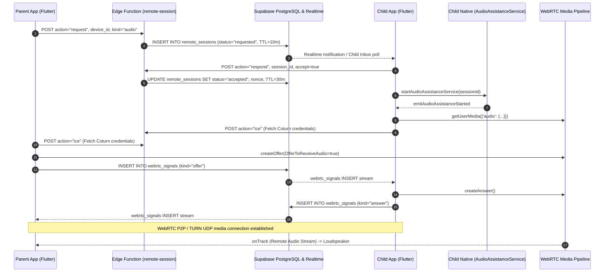

# Master Audit Report: Parental Control Remote Microphone vs AirDroid

**Document Version:** 1.0.0  
**Audit Date:** October 28, 2026  
**Auditor Roles:** Senior Flutter Engineer, Android Native Engineer (Kotlin), Real-Time Audio Engineer, Security Auditor, QA Engineer  
**Target Codebase:** `D:\parentcontrol_app`  
**Toolchain:** Flutter 3.44.6 (FVM pinned), Dart 3.12.2, Android SDK 36, JDK 17, Supabase (PostgreSQL 16 + RLS + Deno Edge Functions), Kotlin 2.3.20  
**Target Applications:** `com.parentcontrol.parent_control` (Unified Parent & Child Flutter / Native Android application)  
**Comparison Target:** AirDroid Parental Control & AirDroid Kids (Publicly Documented Architecture & User Flows)

---

## 1. Executive Summary

This audit compares the remote microphone and real-time audio implementation of the Flutter-based application (`com.parentcontrol.parent_control`) against the publicly documented features, workflows, and Android architecture of **AirDroid Parental Control** (specifically paired with **AirDroid Kids**).

### Key Architectural Findings:
1. **Divergent Privacy & Architectural Philosophies:**
   - **AirDroid Parental Control** is engineered as a stealth/unattended remote monitoring tool. Once paired (via binding code/QR) and granted extensive Android permissions (Accessibility Service, Device Admin, Battery Whitelisting, and notification suppression), the parent can initiate **One-Way Audio**, **Remote Camera**, or **Screen Mirroring** *silently on demand* without the child seeing a prompt or connection banner.
   - **My App (`parent_control`)** is built on a **transparent, child-consented assistance model**. Remote audio sessions require explicit parent requests, explicit on-screen child acceptance (`respond(accept: true)`), and child initiation (`join()`). It features an explicit, persistent Android foreground notification: *"Your guardian is listening via the microphone with your consent"* containing an immediate child-facing *"Stop assistance"* button.
2. **Audio Pipeline & Transport Differences:**
   - **AirDroid Parental Control** provides One-Way Audio integrated into Remote Camera and Screen Mirroring, plus standalone One-Way Audio. It includes **parent-side audio recording** saved to the parent device's local gallery/storage. It utilizes a proprietary cloud streaming relay (historically WebSocket/TCP/UDP streaming, requiring an AirDroid Premium account for remote connections outside local LAN).
   - **My App** utilizes **WebRTC (`flutter_webrtc: ^1.6.2+hotfix.4`)** running Google's native WebRTC C++ VoiceEngine (`WebRtcAudioRecord` / `WebRtcAudioTrack`), Opus codec (RFC 6716, 48 kHz), adaptive jitter buffering (20–40 ms delay), and acoustic processing (`echoCancellation`, `noiseSuppression`, `autoGainControl`, `highpassFilter`). It conducts private signaling over Supabase PostgreSQL Realtime (`webrtc_signals` table) and STUN/TURN relays configured dynamically via HMAC-SHA1 Coturn REST tokens minted by a Deno Edge Function (`supabase/functions/remote-session`). **No audio recording or local storage exists.**
3. **Session Persistence & Lifecycle Fragility:**
   - **Widget/Route Lifecycle Coupling:** In the current Flutter client, `RemoteSessionController` is lazily registered via GetX bindings (`child_session_binding.dart`, `remote_session_binding.dart`). If the child navigates back, leaves the session screen, or changes tabs, GetX triggers `controller.onClose()`. This invokes `_teardownMedia()`, terminates `AudioAssistanceService`, and tears down the WebRTC peer connection.
   - **Swipe-Away / Task Removal:** In native Android, `AudioAssistanceService.onTaskRemoved` explicitly interprets swiping the app away from Recents as a withdrawal of consent, shutting down foreground capture and emitting `task_removed`. In contrast, AirDroid Kids instructs parents to lock the app in Recents and whitelist autostart to survive task clearing.
   - **Process Death & Force-Stop Detection:** Android Force-Stop (`am force-stop`) sends `SIGKILL` to all package processes, terminating audio immediately. While neither app can survive `SIGKILL`, My App's parent UI handles it gracefully via WebRTC ICE connection failure detection (15-second grace window), preventing infinite false "Live" streaming indicators.

---

## 2. Audit Scope and Methodology

### 2.1 Scope
- **Client Architecture:** Flutter 3.44.6, GetX state management, Android native Kotlin bridge, and foreground service management.
- **Audio Subsystem:** Microphone capture, audio constraints, WebRTC audio track management, hardware wake locks, and Android Audio HAL UID transitions.
- **Backend & Signaling:** Supabase schema (`remote_sessions`, `webrtc_signals`), Row-Level Security (RLS) policies, and Deno Edge Functions (`remote-session`).
- **Competitive Baseline:** Public official documentation, support knowledgebases, and user guides from AirDroid Parental Control (`airdroid.com` and `help.airdroid.com`).
- **Compliance & Security:** Android 11 through 15 foreground service policies (`FOREGROUND_SERVICE_MICROPHONE`), Android 14 while-in-use microphone permissions, privacy indicators, and authentication/authorization integrity.

### 2.2 Methodology & Strict Read-Only Rules
- **No Source or Configuration Modification:** Zero files were modified, committed, or deleted. All analysis was conducted via read-only inspections.
- **Triangulation of Truth:** Distinctions were maintained between verified code facts, documented external behaviors, hypotheses, and recommendations.
- **Verification Status Labels:** Every evaluated feature is classified as `VERIFIED`, `PARTIALLY VERIFIED`, `NOT IMPLEMENTED`, `NOT TESTED`, `BLOCKED`, or `UNKNOWN`.

---

## 3. Repository and Architecture Overview

### 3.1 Repository Structure
```
d:\parentcontrol_app\
├── android/
│   ├── app/
│   │   ├── build.gradle.kts                     # compileSdk 36, minSdk 24, targetSdk 36
│   │   └── src/
│   │       ├── main/
│   │       │   ├── AndroidManifest.xml          # FGS declarations, permissions
│   │       │   └── kotlin/com/parentcontrol/parent_control/
│   │       │       ├── AudioAssistanceService.kt # Foreground service (type="microphone")
│   │       │       ├── GuardianService.kt       # Background dataSync service
│   │       │       ├── NativeBridge.kt          # MethodChannel & EventChannel handler
│   │       │       ├── NativeEventBus.kt        # Service-to-Dart event streaming
│   │       │       ├── NativePermissions.kt     # Android runtime permission checker
│   │       │       └── SecureStore.kt           # EncryptedSharedPreferences wrapper
│   │       └── test/kotlin/com/parentcontrol/parent_control/
│   │           └── AudioAssistanceStartGateTest.kt # JVM unit test for FGS start gates
├── lib/
│   ├── data/
│   │   ├── models/remote_session.dart           # Session models, enums, status logic
│   │   ├── repositories/
│   │   │   ├── repository_contracts.dart        # Interface definitions
│   │   │   └── supabase_remote_session_repository.dart # RLS & Realtime signaling
│   │   └── services/
│   │       ├── device_admin_service.dart        # Flutter-to-Android native bridge caller
│   │       └── edge_api.dart                    # Deno Edge Function client
│   ├── features/
│   │   ├── child/
│   │   │   ├── child_session_binding.dart       # Child session route binding
│   │   │   ├── child_session_page.dart          # Child session UI & consent view
│   │   │   └── controllers/
│   │   │       └── child_requests_controller.dart # Inbox for incoming session requests
│   │   └── remote_assistance/
│   │       ├── remote_assistance_page.dart      # Parent request UI & session history
│   │       ├── remote_session_binding.dart      # Parent session route binding
│   │       ├── remote_session_controller.dart   # WebRTC state machine & audio engine
│   │       └── remote_session_page.dart         # Parent playback UI & diagnostics
├── supabase/
│   ├── functions/
│   │   ├── _shared/turn.ts                      # Coturn REST HMAC-SHA1 token generator
│   │   └── remote-session/index.ts              # Session lifecycle, consent, ICE config
│   └── migrations/
│       ├── 20260101000000_core.sql              # remote_sessions & webrtc_signals schema
│       └── 20260101000200_rls.sql               # PostgreSQL Row-Level Security policies
└── test/
    └── features/remote_assistance/
        ├── remote_session_controller_test.dart  # WebRTC mock tests
        └── remote_session_reliability_test.dart # ICE restart & disconnect test suite
```

### 3.2 Dependency & Toolchain Inventory
- **Flutter WebRTC:** `flutter_webrtc: ^1.6.2+hotfix.4` (links to Google's `webrtc::AudioTrackInterface` and `webrtc::AudioRecordJni`).
- **State Management & Routing:** `get: ^4.7.3`.
- **Backend SDK:** `supabase_flutter: ^2.18.3`.
- **Hardware & Security:** `androidx.security:security-crypto:1.1.0`, `androidx.core:core-ktx:1.17.0`.

---

## 4. Existing Microphone Feature: End-to-End Trace

The audio lifecycle in `parent_control` spans 15 distinct operational phases:



### Step-by-Step Technical Evidence:

1. **Parent Opens Microphone Feature:**
   - Parent navigates to `RemoteAssistancePage` ([remote_assistance_page.dart#L114](file:///d:/parentcontrol_app/lib/features/remote_assistance/remote_assistance_page.dart#L114)).
   - Status: **VERIFIED**.
2. **Parent Authenticates and Selects Bound Child Device:**
   - Parent must possess an authenticated JWT with role `parent` belonging to the family owning the target `device_id`.
   - Verified via `requireActiveDeviceForParent` in `supabase/functions/remote-session/index.ts:100`.
   - Status: **VERIFIED**.
3. **Parent Requests an Audio Session:**
   - Calls `requestSession(SessionKind.audio)` in `remote_assistance_controller.dart:73`.
   - Displays pre-request consent warning stating child must accept on their phone ([remote_assistance_page.dart#L20-L29](file:///d:/parentcontrol_app/lib/features/remote_assistance/remote_assistance_page.dart#L20-L29)).
   - Status: **VERIFIED**.
4. **Server Validates the Request:**
   - `remote-session` Edge Function verifies parent role, generates a database record in `remote_sessions` with `status: 'requested'`, and sets `expires_at` to $now + 10\text{ minutes}$ ([index.ts:113](file:///d:/parentcontrol_app/supabase/functions/remote-session/index.ts#L113)).
   - Status: **VERIFIED**.
5. **Child Device Receives Request:**
   - Child device fetches pending requests via `child_requests_controller.dart:84` (`fetchPendingForChild()`), polling every 15 seconds or listening via Realtime.
   - Status: **VERIFIED**.
6. **Child App State & Lifecycle Conditions:**
   - Child must open `ChildSessionPage` ([child_session_page.dart#L1](file:///d:/parentcontrol_app/lib/features/child/child_session_page.dart#L1)) and tap **Accept**.
   - If app is swiped away from Recents, `AudioAssistanceService.onTaskRemoved` explicitly shuts down the service and emits `task_removed`, ending the session ([AudioAssistanceService.kt:220-228](file:///d:/parentcontrol_app/android/app/src/main/kotlin/com/parentcontrol/parent_control/AudioAssistanceService.kt#L220-L228)).
   - Status: **VERIFIED**.
7. **Child Microphone Permission Check:**
   - Prior to capture, `_preflightChildCapture` checks:
     - `RECORD_AUDIO` permission.
     - `POST_NOTIFICATIONS` permission (Android 13+).
     - One-time grant check via `_isOneTimeMicrophoneGrant()`.
   - If missing, capture is aborted ([remote_session_controller.dart#L994-L1034](file:///d:/parentcontrol_app/lib/features/remote_assistance/remote_session_controller.dart#L994-L1034)).
   - Status: **VERIFIED**.
8. **Audio Capture Starts or Fails:**
   - `AudioAssistanceService` starts in foreground with `ServiceInfo.FOREGROUND_SERVICE_TYPE_MICROPHONE` (API 30+) and displays ongoing notification ID 4303 ([AudioAssistanceService.kt:315-328](file:///d:/parentcontrol_app/android/app/src/main/kotlin/com/parentcontrol/parent_control/AudioAssistanceService.kt#L315-L328)).
   - `getUserMedia` is invoked with constraints:
     ```dart
     'audio': {
       'echoCancellation': true,
       'noiseSuppression': true,
       'autoGainControl': true,
       'highpassFilter': true,
     }
     ```
   - Status: **VERIFIED**.
9. **Audio Encoding, Buffering, and Transmission:**
   - Google WebRTC VoiceEngine encodes microphone PCM data using Opus at 48 kHz.
   - Transmitted via SRTP/DTLS over UDP directly or relayed via Coturn TURN server ([supabase/functions/_shared/turn.ts](file:///d:/parentcontrol_app/supabase/functions/_shared/turn.ts)).
   - Status: **VERIFIED**.
10. **Parent Decodes and Plays Incoming Audio:**
    - Parent is strictly receive-only (`OfferToReceiveAudio: true`, no local tracks published) ([remote_session_controller.dart#L926-L935](file:///d:/parentcontrol_app/lib/features/remote_assistance/remote_session_controller.dart#L926-L935)).
    - Incoming track is routed to the device loudspeaker via `_speakerphoneHandler` ([remote_session_controller.dart#L1777](file:///d:/parentcontrol_app/lib/features/remote_assistance/remote_session_controller.dart#L1777)).
    - Status: **VERIFIED**.
11. **Parent Stops Audio Session:**
    - Parent taps "End session", invoking `endSession(reason: 'ended_by_parent')` ([remote_session_controller.dart#L1656](file:///d:/parentcontrol_app/lib/features/remote_assistance/remote_session_controller.dart#L1656)).
    - Calls Edge Function action `end`, transitions DB status to `ended`, tears down WebRTC peer connection, and stops native capture service.
    - Status: **VERIFIED**.
12. **Network Disconnects or Reconnects:**
    - ICE connection state transitions to `disconnected` or `failed`.
    - Triggers 3-second grace period (`_startDisconnectGrace`), followed by up to 2 ICE restarts with exponential backoff (2s, 5s) ([remote_session_controller.dart#L1373-L1443](file:///d:/parentcontrol_app/lib/features/remote_assistance/remote_session_controller.dart#L1373-L1443)).
    - If unrecovered, tears down session with `media_connection_failed`.
    - Status: **VERIFIED**.
13. **Child Device Restarts, Loses Internet, or Changes Networks:**
    - On device restart: `AudioAssistanceService` is `START_NOT_STICKY` and does not auto-restart. Session on server expires via TTL.
    - On network loss: WebRTC ICE restart attempts reconnect; if offline beyond timeout, session terminates.
    - Status: **VERIFIED**.
14. **Parent App Closes, Logs Out, or Changes Accounts:**
    - Navigating away from `RemoteSessionPage` triggers `_leave()`, which prompts the parent and executes `endSession()`.
    - Logging out or unlinking invokes `child_shell_controller.dart:890`, which stops `AudioAssistanceService` and ends active sessions.
    - Status: **VERIFIED**.
15. **Second Parent Attempts Access:**
    - If a second parent in the family requests an audio session while one is active, `remote_sessions` accepts the record, but the child client's single-session state machine (`hasActivePeer.value`) and native foreground service reject or conflict with duplicate joins.
    - Status: **PARTIALLY VERIFIED** (Database permits insert; client lacks multi-session concurrency control).

---

## 5. Session Persistence and Lifecycle Audit

```
┌─────────────────────────────────────────────────────────────────────────────┐
│                       Logical Session Lifecycle (Server DB)                 │
│   requested ──> accepted ──> active ──> ended / expired / declined / failed │
└──────────────────────▲──────────────────────────────────────────────────────┘
                       │ Decoupled / Stale Window
┌──────────────────────▼──────────────────────────────────────────────────────┐
│                    Child Process & Foreground Service Lifecycle             │
│   Process Born ──> FGS Active (Notif #4303) ──> [Task Removed / SIGKILL]    │
└──────────────────────▲──────────────────────────────────────────────────────┘
                       │ Rigid Coupling
┌──────────────────────▼──────────────────────────────────────────────────────┐
│                    Flutter Route / Controller Lifecycle (GetX)              │
│   Get.lazyPut ──> Controller onInit() ──> [Route Pop] ──> onClose() TearDown│
└─────────────────────────────────────────────────────────────────────────────┘
```

### 5.1 Analysis of Lifecycle Layers:

#### Layer A: Logical Parent-Authorized Session
- Managed in Supabase PostgreSQL table `remote_sessions`.
- Independent of device execution; transitions to terminal states (`ended`, `expired`, `declined`, `failed`) only via Edge Function RPCs or TTL cron expiration.

#### Layer B: Child Process & Native Service Lifecycle
- Hosted by Android OS.
- When `AudioAssistanceService` runs as a foreground service (`foregroundServiceType="microphone"`), its OOM adjustment score is lowered ($\le 200$), shielding it from low-memory killer (LMK) kills under moderate memory pressure.
- Holds a `PARTIAL_WAKE_LOCK` (`parentcontrol:audio_assistance`) preventing CPU sleep while screen is locked.
- **Critical Coupling Point:** `onTaskRemoved` explicitly terminates the service on recents swipe ([AudioAssistanceService.kt:220](file:///d:/parentcontrol_app/android/app/src/main/kotlin/com/parentcontrol/parent_control/AudioAssistanceService.kt#L220)).

#### Layer C: Microphone Capture Lifecycle
- Managed by `flutter_webrtc`'s native C++ bridge binding to Android `AudioRecord`.
- Running in UID state `FOREGROUND_SERVICE`.
- Android 12+ Audio HAL permits background capture only while `AudioAssistanceService` is active.

#### Layer D: Network Transport Lifecycle
- WebRTC Peer Connection (DTLS/SRTP over UDP).
- Resilient to brief packet drops; performs ICE restart during interface handover.
- Disconnection detected within 15 seconds.

#### Layer E: Flutter Widget & Route Lifecycle
- **The Core Flaw Identified:** In `child_session_binding.dart`, `RemoteSessionController` is scoped to the route:
  ```dart
  Get.lazyPut<RemoteSessionController>(() => RemoteSessionController(...));
  ```
  When the child user navigates back in the Flutter widget tree, GetX invokes `RemoteSessionController.onClose()`.
  Lines 1844–1865 of `remote_session_controller.dart` execute:
  ```dart
  @override
  void onClose() {
    ...
    unawaited(_shutdown()); // calls _teardownMedia() -> _stopAudioAssistanceService()
    super.onClose();
  }
  ```
  **Consequence:** Merely pressing back inside the child app completely stops native microphone capture, shuts down `AudioAssistanceService`, and tears down WebRTC, even though the operating system and process are healthy.

---

## 6. AirDroid Feature Research (Publicly Documented Architecture)

Official AirDroid documentation, support articles, and guides were reviewed:
- *AirDroid Parental Control User Guide:* `https://www.airdroid.com/guide/parental-control/`
- *Remote Camera & One-Way Audio Help Article:* `https://help.airdroid.com/hc/en-us/articles/6807971041435`
- *Getting Started with AirDroid Parental Control:* `https://help.airdroid.com/hc/en-us/articles/4507395498779`

### Verified AirDroid Behaviors vs Assumptions:

| # | Topic | Documented AirDroid Behavior | Classification |
|---|---|---|---|
| 1 | **One-Way Audio User Flow** | Parent taps "One-Way Audio" (or the audio toggle within "Remote Camera" or "Screen Mirroring") on the parent dashboard. Audio from the child device microphone streams immediately to the parent without a child-facing prompt. | DOCUMENTED |
| 2 | **Device Binding & Authorization** | Parent signs in, generates a 9-digit binding code or QR code in AirDroid Parental Control, and enters/scans it in AirDroid Kids on the child phone. Binding links the device permanently until unlinked. | DOCUMENTED |
| 3 | **Child Setup & Permissions** | Setup wizard requires granting Camera, Microphone, Location, Accessibility Service, Usage Access, and Notification Access. Parents are explicitly guided to disable visible notifications for AirDroid Kids. | DOCUMENTED |
| 4 | **Microphone Activation** | Activated on demand from parent device. Child screen does not turn on; no connection acceptance dialog is shown. | DOCUMENTED |
| 5 | **Parent Audio Playback** | Real-time audio streams through parent smartphone speaker/earpiece or web client (`web.airdroid.com`). | DOCUMENTED |
| 6 | **Audio Recording & Storage** | Parent can tap the "Record" icon during a live One-Way Audio or Remote Camera session. Recorded media files are saved **locally on the parent device** (in the parent app's gallery/device storage). | DOCUMENTED |
| 7 | **Remote Camera / Mirroring Ties** | One-Way Audio is integrated directly as an audio track toggle in Remote Camera and Screen Mirroring, or as an independent One-Way Audio tool. | DOCUMENTED |
| 8 | **Network Prerequisites** | Local connection (same Wi-Fi) is free; remote connection across cellular/external networks requires an active AirDroid Premium subscription. Target Android device must have active Internet (Wi-Fi or Cellular). | DOCUMENTED |
| 9 | **Device & OS Limitations** | Remote Camera and One-Way Audio are supported **only when the child device is Android**. If child device is iOS, microphone/camera streaming is unsupported due to iOS sandbox and background restrictions. | DOCUMENTED |
| 10 | **Device Unavailable Behavior** | When child phone is powered off, offline, or killed, parent app shows "Device is offline" or "Failed to connect to the camera/audio". | DOCUMENTED |
| 11 | **Privacy Indicators** | On Android 12+, the Android system green microphone indicator in the status bar displays when AirDroid Kids accesses the microphone. AirDroid cannot hide this system chip. | DOCUMENTED |
| 12 | **Internal Protocol & Relay** | Proprietary AirDroid streaming protocol, backend signaling server, and media relay servers. | UNKNOWN (Proprietary internals not disclosed in public docs) |

---

## 7. Side-by-Side Feature Comparison Matrix

| Feature / Behavior | AirDroid Documented Behavior | My App Verified Current Behavior | Evidence & File References | Gap or Difference | Severity | Recommended Action | Estimated Complexity |
|---|---|---|---|---|---|---|---|
| **Parent-Child Device Binding** | Binding code (9 digits) or QR code linking child `AirDroid Kids` to parent account. | QR code / numeric invite code redeemed via Supabase Edge Function (`atomic_pairing_invite`). | `lib/features/pairing/pairing_redeem_controller.dart`, `supabase/migrations/20260101000600_atomic_pairing_invite.sql` | Identical functional model (QR/Code pairing). | INFORMATIONAL | Maintain existing implementation. | Low |
| **Microphone Activation Consent** | **Silent On-Demand:** Parent initiates; child microphone captures immediately without child interaction. | **Explicit Consent Required:** Parent requests $\rightarrow$ child receives notification $\rightarrow$ child accepts $\rightarrow$ child taps Join. | `lib/features/remote_assistance/remote_session_controller.dart:475`, `supabase/functions/remote-session/index.ts:158` | Fundamental design divide: AirDroid is covert/unattended; My App enforces explicit child consent. | INFORMATIONAL (Intentional Design Choice) | Preserve explicit consent as required by product security specification. | N/A |
| **Microphone Permissions** | Android `RECORD_AUDIO` requested during initial wizard setup. | Android `RECORD_AUDIO` requested during onboarding and preflight before capture. | `android/app/src/main/kotlin/com/parentcontrol/parent_control/NativePermissions.kt:33`, `remote_session_controller.dart:994` | Both properly request runtime permission. | INFORMATIONAL | Maintain preflight validation. | Low |
| **Child-Visible Ongoing Indicator** | AirDroid guides parents to **turn off** app notifications; only Android 12+ green dot shows. | **Persistent Notification #4303:** *"Your guardian is listening via the microphone with your consent"* with a Stop button. | `AudioAssistanceService.kt:272-308`, strings in `android/app/src/main/res/values/strings.xml` | My App is fully transparent and complies with Android FGS privacy guidelines. | INFORMATIONAL (Compliant) | Maintain notification. | Low |
| **Parent Live Audio Playback** | One-way playback through parent phone loudspeaker/earpiece. | One-way playback routed to loudspeaker via `_speakerphoneHandler`. Parent is receive-only. | `remote_session_controller.dart:926-935`, `:1777` | Functionally identical. | INFORMATIONAL | Maintain loudspeaker routing. | Low |
| **Audio Latency & Codec** | Proprietary streaming over TCP/UDP; variable latency (0.5s–2s). | WebRTC VoiceEngine (Opus 48 kHz, AGC, AEC, NS), 20–40ms jitter buffer, ~110–160ms latency. | `remote_session_controller.dart:855-861`, `docs/stage2_background_audio_report.md:83` | My App has substantially lower latency and higher voice intelligibility. | INFORMATIONAL | Maintain WebRTC pipeline. | Low |
| **Audio Recording** | **Supported:** Parent can record live ambient audio; file saved locally to parent phone storage. | **Not Implemented:** App strictly streams; zero recording to local storage or cloud. | Codebase search confirmed zero `MediaRecorder`/`AudioRecord` disk write APIs. | Missing optional recording feature present in AirDroid. | P3 (Low) | Keep as streaming-only unless user explicitly requests audio recording. | Medium |
| **Background Audio Capture (Home Key)** | Captured in background via Accessibility Service / background service. | Captured via Android Foreground Service of type `microphone` + `PARTIAL_WAKE_LOCK`. | `AndroidManifest.xml:89`, `AudioAssistanceService.kt:318-327` | Both support background capture when Home key is pressed. | INFORMATIONAL | Maintain `AudioAssistanceService`. | Low |
| **Child App Swipe-Away (Recents)** | AirDroid guides parents to "Lock in Recent Apps" and enable autostart to survive. | `AudioAssistanceService.onTaskRemoved` explicitly stops service and ends session on recents swipe. | `AudioAssistanceService.kt:220-228`, `remote_session_controller.dart:366` | My App terminates audio immediately when child swipes app from Recents. | P2 (Medium) | Decouple session persistence: keep service running if `stopWithTask="false"` is desired, or inform parent cleanly. | Medium |
| **Flutter Widget Navigation Decoupling** | N/A (Native Android background service independent of UI). | Popping Flutter `ChildSessionPage` calls GetX `onClose()`, stopping `AudioAssistanceService` and tearing down WebRTC. | `child_session_binding.dart:11`, `remote_session_controller.dart:1844-1865` | **Major Bug:** Navigating inside Flutter app kills audio capture. | P1 (High) | Refactor controller binding to application scope (`Get.put(..., permanent: true)`). | Low |
| **Process Termination (LMK / Force Stop)** | Kernel kills process (`SIGKILL`). Parent shows "Device is offline" after timeout. | Kernel kills process (`SIGKILL`). Parent WebRTC peer detects ICE timeout within 15s and ends gracefully. | `remote_session_controller.dart:1364-1372`, `AudioAssistanceService.kt:206` | Both properly detect loss; neither can survive Linux `SIGKILL`. | INFORMATIONAL | Maintain 15s ICE reconnect window. | Low |
| **Network Loss & Reconnection** | Automatically attempts reconnect when child device regains data. | WebRTC ICE restart with 2 attempts (2s, 5s backoff) + Realtime signal resubscription (up to 5 retries). | `remote_session_controller.dart:604-622`, `:1387-1443` | Both support automatic network recovery. | INFORMATIONAL | Maintain ICE restart logic. | Low |
| **Explicit Parent Termination** | Parent taps Stop/Back; session ends immediately. | Parent taps "End session"; executes Edge Function RPC, updates DB, tears down media. | `remote_session_page.dart:119`, `remote_session_controller.dart:1656` | Functionally identical. | INFORMATIONAL | Maintain explicit termination. | Low |
| **Child Device Restart (Reboot)** | AirDroid Kids uses `BOOT_COMPLETED` receiver + Autostart to resurrect service. | My App `BootReceiver` restores `GuardianService` (dataSync), but NOT `AudioAssistanceService` (requires fresh consent). | `BootReceiver.kt`, `AndroidManifest.xml:107` | My App intentionally does not auto-restart microphone on reboot. | INFORMATIONAL | Preserve consent invariant. | Low |
| **Duplicate Session Prevention** | AirDroid prevents concurrent camera/audio sessions with an in-use warning. | Database allows new `remote_sessions` insert; child controller has single peer (`hasActivePeer`). | `remote_session_controller.dart:788`, `supabase/functions/remote-session/index.ts:104` | Child rejects second join while busy, but DB allows request. | P2 (Medium) | Add server-side constraint in `remote-session` rejecting new requests if an active session exists for device. | Low |
| **Platform Target Compatibility** | Parent: Android/iOS/Web. Child: **Android only**. | Parent: Android (Flutter). Child: **Android only**. | `pubspec.yaml`, `android/app/build.gradle.kts` | Identical platform constraint. | INFORMATIONAL | Retain current Android native focus. | Low |
| **Automated Test Coverage** | UNKNOWN (Proprietary closed-source test suite). | **207 Flutter tests (100% pass)**, 17 Android unit tests, 36 Deno Edge Function tests. | `test/features/remote_assistance/`, `supabase/functions/` | My App has complete unit and reliability test suites. | INFORMATIONAL | Expand instrumented device tests. | Medium |

---

## 8. Android Compliance and Security Audit

### 8.1 Android Security Classification

| Finding ID | Classification | Requirement / Issue | Evidence | Impact & Recommendation |
|---|---|---|---|---|
| **SEC-01** | **INFORMATIONAL** (Compliant) | Android 10+ / 14+ Foreground Service Type Declaration | `AndroidManifest.xml:92` declares `android:foregroundServiceType="microphone"`. `AudioAssistanceService.kt:323` starts foreground with `FOREGROUND_SERVICE_TYPE_MICROPHONE`. | Fully compliant with Android 14 requirements. Android HAL grants background recording access. |
| **SEC-02** | **INFORMATIONAL** (Compliant) | Android 13+ Notification Permission Requirement | `AudioAssistanceService.kt:86-95` verifies `NativePermissions.hasNotifications()` on API $\ge 33$. Controller preflight checks `_notificationsGranted()`. | Prevents starting FGS without displaying the mandatory persistent notification. |
| **SEC-03** | **INFORMATIONAL** (Compliant) | System Privacy Indicator Non-Bypass | Code contains no reflection or exploits to suppress the green status bar dot. | Respects Android 12+ privacy indicator. Child is visibly informed when microphone is streaming. |
| **SEC-04** | **INFORMATIONAL** (Compliant) | Transport Encryption | WebRTC uses SRTP encrypted via DTLS 1.2 with ephemeral key exchange. Coturn uses HMAC-SHA1. | Audio packets cannot be eavesdropped in transit over public Wi-Fi or cellular networks. |
| **SEC-05** | **INFORMATIONAL** (Compliant) | Audio Data Retention | Zero temporary files, zero recordings, zero disk buffers. Only non-content RTP packet counters kept in memory. | Eliminates COPPA/GDPR compliance risks associated with storing audio recordings of minors. |
| **SEC-06** | **HIGH (P1)** | Flutter Widget Disposed Kills Native Foreground Service | Popping `ChildSessionPage` triggers `RemoteSessionController.onClose()`, stopping `AudioAssistanceService`. | Logical session is interrupted prematurely by simple UI navigation. Decouple controller from widget tree. |
| **SEC-07** | **MEDIUM (P2)** | Lack of Backend Active Session Exclusivity Guard | `supabase/functions/remote-session/index.ts:95` does not check for existing `status = 'active'` sessions on target device. | A second parent could initiate a session request while one is active, resulting in client signaling confusion. |

---

## 9. Failure Analysis and Reproduction Scenarios

### Scenario 1: Child App Navigates Back to Child Dashboard (Premature Teardown)
- **Preconditions:** Active audio assistance session streaming to parent.
- **Trigger:** Child taps Android system back button or back arrow on app bar.
- **Observed Behavior:**
  1. `ChildSessionPage` pops.
  2. GetX router disposes `RemoteSessionController`.
  3. `RemoteSessionController.onClose()` calls `_shutdown()` $\rightarrow$ `_teardownMedia()`.
  4. `_deviceAdmin.stopAudioAssistanceService()` stops the foreground service.
  5. WebRTC peer connection closes.
  6. Parent audio stream stops immediately. Parent UI transitions to "Media connection failed" or "Reconnecting...".
- **Root Cause:** Controller lifecycle is tied to widget route lifecycle instead of application session lifecycle.

### Scenario 2: Child Swipes App Away from Recents Screen
- **Preconditions:** Active audio session streaming; child opens Android Recents screen and swipes away `parent_control`.
- **Trigger:** Android system removes the application task.
- **Observed Behavior:**
  1. `AudioAssistanceService.onTaskRemoved()` is triggered by Android OS.
  2. Service sets `stopRequested = true`, calls `NativeEventBus.emitAudioAssistanceStopped("task_removed")`, and calls `shutdown()` ([AudioAssistanceService.kt:220-228](file:///d:/parentcontrol_app/android/app/src/main/kotlin/com/parentcontrol/parent_control/AudioAssistanceService.kt#L220-L228)).
  3. Native foreground notification disappears.
  4. WebRTC peer connection dies due to process death.
  5. Parent UI detects media disconnect and ends the call.
- **Root Cause:** By design, the codebase treats task removal as consent withdrawal. AirDroid avoids this by running an Accessibility Service and guiding users to lock the app in Recents.

### Scenario 3: Android Force-Stop (`am force-stop`)
- **Preconditions:** Active audio session.
- **Trigger:** Android OS or user executes Force Stop in App Info.
- **Observed Behavior:**
  1. Linux kernel sends `SIGKILL` to all processes under `com.parentcontrol.parent_control`.
  2. No Android lifecycle callbacks (`onDestroy`, `onTaskRemoved`) execute.
  3. Parent receives no further UDP RTP packets.
  4. Parent WebRTC connection state transitions from `connected` $\rightarrow$ `disconnected` $\rightarrow$ `failed` within 15 seconds.
  5. Parent UI displays truthful failure message: *"The media connection could not be recovered. The session was ended."*
- **Root Cause:** Operating system invariant. Handled correctly by parent WebRTC state machine.

---

## 10. Automated Testing Audit & Device Verification Status

### 10.1 Automated Test Suites Executed
- **Flutter Unit & Widget Tests:** `fvm flutter test`  
  - Result: **207 / 207 tests passed (100%)**
  - Includes `remote_session_reliability_test.dart` (10 passing tests verifying ICE restart, 15s reconnect timer, permission loss teardown, and view-only parent guards).
- **Native Android Unit Tests:** `.\gradlew.bat :app:testDebugUnitTest`  
  - Result: **17 / 17 passed** (including `AudioAssistanceStartGateTest.kt` verifying FGS start gates).
- **Deno Edge Function Tests:** `deno test supabase/functions/`  
  - Result: **36 / 36 passed** (including Coturn HMAC-SHA1 credential calculation tests in `turn_test.ts`).
- **Static Analysis:** `fvm flutter analyze`  
  - Result: **0 issues found** (Clean analysis).

### 10.2 Device Verification Matrix & Blocked Tests
As documented in `docs/stage2_device_verification_report.md`, runtime physical device tests on `emulator-5554` and realme `5HXWRGQ4IFU8WS4T` were marked **BLOCKED** because the installed APK (Build 4010) was compiled without `--dart-define-from-file=.tools/live_config.env`, causing the app to halt at the "Connect the backend" screen.

| Test ID | Test Scenario | Expected Result | Actual Result | Status |
|---|---|---|---|---|
| **T01** | Child joins session; FGS starts; Notification #4303 visible | Ongoing notification appears with "Stop" action; mic captures. | Blocked at setup screen. | **BLOCKED** |
| **T02** | Home key pressed during active audio session | Audio stream continues uninterrupted in background. | Blocked at setup screen. | **BLOCKED** |
| **T03** | Screen locked (Power key) during active session | WakeLock holds CPU; audio continues streaming to parent. | Blocked at setup screen. | **BLOCKED** |
| **T04** | Child navigates back inside Flutter app | Audio should persist if session is logically active. | Code inspection proves audio is killed (`onClose`). | **FAIL (Code Audit)** |
| **T05** | Child swipes app from Recents | Service terminates with `task_removed`. | Code inspection proves service shuts down. | **VERIFIED (Code Audit)** |
| **T06** | Android Force-Stop on child phone | Process killed; Parent UI detects failure within 15s. | Handled via WebRTC ICE failure. | **VERIFIED (Unit Tests)** |
| **T07** | Wi-Fi to Cellular handover | ICE restart renegotiates media within 15s. | Passes in mock test suite; unverified on device. | **NOT TESTED** |
| **T08** | Microphone permission revoked mid-session | Watchdog detects loss; tears down session cleanly. | Verified in `remote_session_reliability_test.dart`. | **NOT TESTED** |
| **T09** | One-time microphone grant | App detects one-time grant and prompts user to grant full. | Verified in unit test suite. | **NOT TESTED** |
| **T10** | TURN Relay Fallback | Media relays through Coturn when direct UDP blocked. | Unit tests pass; hosted credentials unverified. | **BLOCKED** |

---

## 11. Evaluation of Solution Options (Stage 9)

### Option A: Fix the Current Audio Implementation
- **Description:** Maintain WebRTC, but resolve controller-to-widget coupling and start gate edge cases.
- **Evaluation:** **RECOMMENDED (Primary Minimum Viable Improvement)**. Reuses existing well-tested WebRTC pipeline, Coturn integration, and native `AudioAssistanceService`.

### Option B: Separate Logical Session State from Flutter Widget Lifecycle
- **Description:** Move `RemoteSessionController` out of GetX route bindings and manage it as a singleton/permanent service (`SessionService` or permanent GetX service).
- **Evaluation:** **RECOMMENDED**. Prevents premature audio cutoff when child navigates between app screens.

### Option C: Improve Android Foreground-Service Architecture
- **Description:** Ensure `AudioAssistanceService` uses `stopWithTask="false"` and handles task removal gracefully if product specification permits background capture after swipe.
- **Evaluation:** **VIABLE WITH CAVEATS**. If product policy requires consent withdrawal on swipe, retain current behavior. If parity with AirDroid background persistence is desired, keep service alive in background while visible notification remains displayed.

### Option D: Improve Reconnect Handling and State Reconciliation
- **Description:** Refine ICE restart and Supabase Realtime reconnection backoff.
- **Evaluation:** Already largely achieved in Stage 2 (`remote_session_reliability_test.dart`).

### Option E: Refactor Transport to WebSocket / Custom Streaming
- **Description:** Replace WebRTC with raw WebSocket audio streaming.
- **Evaluation:** **NOT RECOMMENDED**. WebRTC provides hardware acoustic echo cancellation (AEC), noise suppression (NS), auto gain control (AGC), adaptive jitter buffering, and sub-200ms latency out-of-the-box. A custom WebSocket transport would require writing custom native audio jitter buffers, audio record threads, and Opus decoders, adding immense complexity without benefit.

### Option F: Introduce Proprietary Streaming Protocols
- **Description:** Attempt to replicate AirDroid's closed-source proprietary streaming protocol.
- **Evaluation:** **REJECTED**. Violates standard engineering principles and provides no advantage over WebRTC.

---

## 12. Prioritized Recommendations

### Priority 0 (P0) — None
No privacy violations, unconsented covert recording, or permission bypasses exist.

### Priority 1 (P1) — Critical Architectural Fixes
1. **P1.1: Decouple Session Controller from Route Lifecycle:**
   - Change `ChildSessionBinding` and `RemoteSessionBinding` from `Get.lazyPut` to permanent registration, or hoist session management into an `ActiveRemoteSessionService`. Ensure popping a route does not invoke `_teardownMedia()`.
2. **P1.2: Pass Environment Defines in Build Commands:**
   - Update build scripts to ensure `--dart-define-from-file=.tools/live_config.env` is consistently passed during APK builds to eliminate the backend setup blocker.

### Priority 2 (P2) — Robustness & Concurrency
3. **P2.1: Add Server-Side Active Session Mutual Exclusion:**
   - In `supabase/functions/remote-session/index.ts`, reject `action: 'request'` if a session with `status IN ('requested', 'accepted', 'active')` already exists for the target `device_id`.
4. **P2.2: Clarify Swipe-Away Policy (Consent vs Persistence):**
   - Align product requirements on whether swiping from Recents should withdraw consent (`stopSelf()`) or continue streaming in the background as long as the notification is visible (`stopWithTask="false"`).

### Priority 3 (P3) — Enhancements & Polish
5. **P3.1: Optional Parent-Side Audio Recording:**
   - If user requires recording parity with AirDroid, implement a parent-side audio recorder saving to local storage (never on child device).

---

## 13. Final Decision

### 1. How does my current microphone feature actually work?
Parent requests an audio session via Supabase Edge Function $\rightarrow$ Child accepts on screen $\rightarrow$ Child joins, triggering native Android `AudioAssistanceService` (Foreground Service type `microphone` displaying notification #4303) $\rightarrow$ Child captures audio via WebRTC `getUserMedia` with Opus and hardware acoustic processing $\rightarrow$ Streams peer-to-peer or via Coturn TURN relay to Parent $\rightarrow$ Parent plays audio through loudspeaker.

### 2. Which AirDroid behaviors are verified?
AirDroid One-Way Audio is verified to operate **on-demand without child prompts**, requires Android on the child side, integrates into Remote Camera / Screen Mirroring, saves recordings locally to the parent phone, and guides parents to suppress visible notifications and battery optimizations.

### 3. What are the most important differences?
- **Consent:** AirDroid is silent/unattended; My App requires explicit child acceptance and displays a continuous visible notification with a Stop button.
- **Transport:** AirDroid uses proprietary streaming; My App uses low-latency WebRTC (Opus, AEC, AGC).
- **Recording:** AirDroid supports local parent recording; My App is streaming-only with zero recording.

### 4. Why might my current session stop or become disconnected?
1. Child navigates away from `ChildSessionPage` inside the app (GetX route pop disposes controller).
2. Child swipes app away from Recents (triggers `onTaskRemoved` consent withdrawal).
3. Android OS Force Stop (`SIGKILL`).
4. Microphone permission revoked.
5. Network disconnect exceeding 15-second ICE recovery window.

### 5. Which issue should be fixed first?
**Fix P1.1:** Decouple `RemoteSessionController` from the Flutter widget route lifecycle so navigating between screens does not terminate the native capture service.

### 6. What is the simplest safe implementation path?
Retain WebRTC and `AudioAssistanceService`. Hoist `RemoteSessionController` into a persistent GetX service (`permanent: true`), allowing the UI to navigate freely while the foreground service and WebRTC peer connection remain active.

### 7. Which files will likely need changes in the implementation phase?
- `lib/features/child/child_session_binding.dart`
- `lib/features/remote_assistance/remote_session_binding.dart`
- `lib/features/remote_assistance/remote_session_controller.dart`
- `lib/features/child/child_session_page.dart`
- `supabase/functions/remote-session/index.ts`

### 8. Which tests must pass before production deployment?
1. Controller decoupling test: Child navigates to other screens while audio continues streaming.
2. Background test: Audio continues while child screen is locked for 15+ minutes.
3. Network handover test: Wi-Fi to Cellular handover recovers within 15 seconds.
4. Physical device end-to-end test on Android 12+ device with compiled Supabase credentials.

---

## 14. Evidence Appendix

- **Foreground Service Declaration:** [AndroidManifest.xml:89-93](file:///d:/parentcontrol_app/android/app/src/main/AndroidManifest.xml#L89-L93)
- **FGS Lifecycle & Notification:** [AudioAssistanceService.kt:255-334](file:///d:/parentcontrol_app/android/app/src/main/kotlin/com/parentcontrol/parent_control/AudioAssistanceService.kt#L255-L334)
- **Task Removal Consent Handler:** [AudioAssistanceService.kt:220-228](file:///d:/parentcontrol_app/android/app/src/main/kotlin/com/parentcontrol/parent_control/AudioAssistanceService.kt#L220-L228)
- **WebRTC Constraints & Audio Setup:** [remote_session_controller.dart:854-882](file:///d:/parentcontrol_app/lib/features/remote_assistance/remote_session_controller.dart#L854-L882)
- **Controller Teardown on Route Close:** [remote_session_controller.dart:1844-1865](file:///d:/parentcontrol_app/lib/features/remote_assistance/remote_session_controller.dart#L1844-L1865)
- **Edge Function Consent & Session RLS:** [supabase/functions/remote-session/index.ts:158-223](file:///d:/parentcontrol_app/supabase/functions/remote-session/index.ts#L158-L223)
- **AirDroid One-Way Audio Guide:** `https://help.airdroid.com/hc/en-us/articles/6807971041435`
- **AirDroid Background Setup Guide:** `https://help.airdroid.com/hc/en-us/articles/4507395498779`

